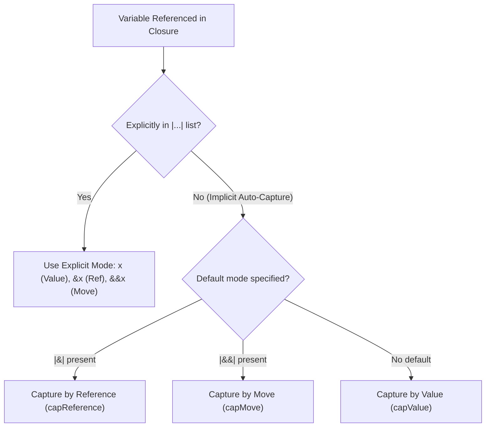
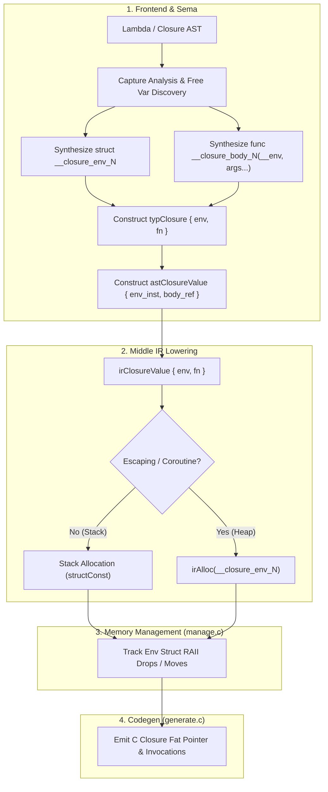
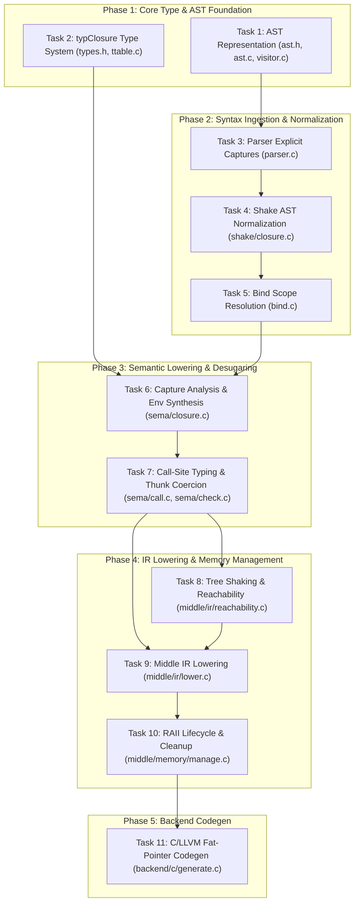

# Closure & Coroutine Architecture Redesign

## 1. Executive Summary & Motivation

Historically, closures and coroutines in Cxy were implemented by synthesizing an anonymous reference-counted `class` for every lambda/closure. This introduced significant performance and semantic limitations:
1. **Unnecessary Heap Allocations & RC Overhead**: Even ephemeral, non-escaping closures (e.g. passed into synchronous iterators or sorting functions) incurred heap allocation (`__smart_ptr_alloc`) and atomic reference counting overhead.
2. **Ambiguous / Rigid Capture Semantics**: The compiler implicitly guessed capture intent without allowing fine-grained control over whether a variable is captured by value copy (`x`), by borrowed reference (`&x`), or by move (`&&x`).
3. **Impedance Mismatch in the Type System**: Call sites accepting function types struggled to cleanly distinguish between raw function pointers (`typFunc`) and closures with environment state (`typClosure`), complicating interop and code generation.

This redesign establishes:
* **Explicit Capture Syntax**: Support for explicit capture lists (`|&|`, `|&&|`, `|x, &y, &&z|`) with backward-compatible implicit capture inference.
* **First-Class `typClosure` Type**: A fat-pointer representation `{ env: const Type*, fn: const Type* }` tracking environment layout and callable signature.
* **Stack-First Value Closures**: Ephemeral closures live on the stack with zero heap allocation; only escaping closures and long-lived coroutines are promoted to heap storage.
* **Transparent Function-to-Closure Coercion**: Raw functions coerce into closures via zero-allocation thunks with `env = null`.
* **Explicit `@pure` Attribute**: Functions marked `@[pure]` strictly accept raw function pointers, omitting closure overhead entirely.

---

## 2. Syntax & Capture Semantics

### 2.1 Explicit Capture Lists

Closures support optional capture lists delimited by `|...|` preceding parameter declarations:

```cxy
var a: i32 = 10
var b: String = "Hello".S
var c: Resource = Resource()

// 1. Explicit Mixed Capture
var f1 = |a, &b, &&c|(x: i32) => {
    // a is copied by value
    // b is captured by reference (&String)
    // c is moved into the closure environment (ownership transferred)
    println(f"${b}: ${a + x}")
}

// 2. Default Capture-All by Reference
var f2 = |&|(x: i32) => {
    // All referenced outer variables captured by &
    println(f"${a} + ${x}")
}

// 3. Default Capture-All by Move
var f3 = |&&|() => {
    // All referenced outer variables moved into closure
    consume(c)
}

// 4. Implicit Capture (Backward Compatible)
var f4 = (x: i32) => {
    // Compiler infers capture mode based on usage
    println(a + x)
}
```

### 2.2 Capture Rules & Coexistence Model

Explicit captures and implicit auto-capture coexist cleanly:
* **Explicitly Listed Variables (`|a, &b, &&c|`)**: Captured strictly using their declared mode (`capValue`, `capReference`, `capMove`).
* **Unlisted Free Variables**: Any free variable referenced in the body that is not explicitly in the capture list is automatically captured using the closure's default policy:
  * If `|&|` is specified $\to$ auto-captured by reference (`capReference`).
  * If `|&&|` is specified $\to$ auto-captured by move (`capMove`).
  * Otherwise $\to$ auto-captured by value (`capValue`).



| Capture Syntax | Environment Field Type | Outer Variable State Post-Closure Creation |
| :--- | :--- | :--- |
| `x` (Value) | `T` (memberwise copy) | Remains live and valid in outer scope |
| `&x` (Reference) | `&T` (borrowed reference / pointer) | Borrowed; must outlive closure execution |
| `&&x` (Move) | `T` (moved value) | Marked moved-from in outer scope (ownership transferred) |
| `|&|` (Default Ref) | `&T` for unlisted referenced free vars | Borrowed |
| `|&&|` (Default Move)| `T` for unlisted referenced free vars | Moved-from |
| Unlisted (Default) | `T` for unlisted referenced free vars | Remains live and valid in outer scope |

---

## 3. Type System Architecture: `typClosure`

### 3.1 Type Representation

A new type tag `typClosure` is introduced into `TypeTable` and `IrTypeTable`:

```c
struct Type {
    TypeTag tag; // typClosure
    // ...
    struct {
        const Type *env; // Struct type for environment, or void if non-capturing
        const Type *fn;  // Callable signature: func(^void, params...): Ret
        bool isEscaping; // true if closure escapes stack activation frame
    } closure;
};
```

### 3.2 Memory Layout & ABI (Fat Pointer)

At runtime, a `typClosure` value is a fat pointer represented in C/LLVM backend as:

```c
typedef struct Closure {
    void *env;                         // Pointer to environment struct (stack or heap)
    Ret (*fn)(void *env, ...Args);     // Function pointer taking environment as first arg
} Closure;
```

When `env == void` (non-capturing closure or raw function coercion):
* `env` pointer is `nullptr`.
* Invocation invokes `fn(nullptr, args...)`.

---

## 4. Pipeline Execution Flow



---

## 5. Detailed Stage Transformations

### 5.1 Semantic Analysis (`sema`)

1. **Free Variable Collection**:
   * Scans closure body AST for identifiers declared outside the closure's local scope.
   * Matches explicit capture list against discovered free variables.
2. **Environment Synthesis**:
   * Creates a synthetic struct node `struct __closure_env_N`:
     ```cxy
     struct __closure_env_0 {
         a: i32
         b: &String
         c: Resource
     }
     ```
3. **Body Function Synthesis**:
   * Creates top-level free function `func __closure_body_N(__env: ^__closure_env_0, x: i32): void`:
     * Translates references to captured variable `a` into member access `__env.a`.
     * Translates references to captured reference `b` into dereference `__env.b`.
4. **Closure Value Construction (`astClosureValue`)**:
   * Emits `astClosureValue`:
     ```cxy
     __closure_env_0{ a: a, b: &b, c: &&c }
     ```
     paired with function reference `&__closure_body_0`.

---

### 5.2 Middle IR Lowering (`lower.c`)

* `astClosureValue` lowers to an atomic aggregate `irClosureValue` or `irStructConst` with type `typClosure`:
  ```
  var __env0: __closure_env_0 = __closure_env_0 { a, &b, &&c }
  var f1: Closure_i32_void = Closure_i32_void { &__env0, __closure_body_0 }
  ```
* If the closure is non-escaping, `__env0` is allocated directly on the current stack frame.
* If the closure escapes (e.g. returned from function or passed into an async spawn), `__env0` is heap-allocated via `irAlloc(__closure_env_0)`.

---

### 5.3 Memory Management & RAII (`manage.c`)

* The environment struct `__closure_env_0` contains ownership of moved resources (`c: Resource`).
* When lowering `__closure_env_0`, the compiler synthesizes `__closure_env_0_op__destructor`:
  ```
  func __closure_env_0_op__destructor(this: ^__closure_env_0): void {
      drop this.c
  }
  ```
* When `f1` leaves scope:
  * Non-escaping: `drop __env0` executes `__closure_env_0_op__destructor(&__env0)` on the stack.
  * Heap closure: runtime drop decrements refcount and runs destructor when refcount reaches 0.

---

### 5.4 Call Sites & Pure Functions (`@pure`)

#### Standard Closure Parameter
```cxy
func execute(cb: (x: i32) -> void) {
    cb(42)
}
```
* Parameter `cb` is typed as `typClosure`.
* Invocation lowers to: `cb.fn(cb.env, 42)`.
* When passing a raw function `func foo(x: i32): void`:
  * Synthesizes zero-cost trampoline:
    ```c
    static void __thunk_foo(void *env, int32_t x) {
        (void)env;
        foo(x);
    }
    ```
  * Passes `(Closure){ .env = nullptr, .fn = __thunk_foo }`.

#### Pure Function Parameter (`@pure`)
```cxy
@[pure]
func executeFast(cb: (x: i32) -> void) {
    cb(42)
}
```
* Parameter `cb` is strictly typed as raw `typFunc` (`void (*cb)(int32_t)`).
* Cannot accept capturing closures (enforced at sema type check).
* Zero trampoline overhead, direct C function pointer call.

---

## 6. Coroutine Integration (`async` & `launch`)

Coroutines generalize escaping closures:
1. **Coroutine Frame**:
   * A coroutine's state (captured environment + local variables suspended across yield/await points) is synthesized as a heap-allocated coroutine frame struct `struct __coro_frame_N`.
2. **Lifecycle & Resumption**:
   * Yield points save suspension state index and return control to the scheduler.
   * Resumption invokes the generated dispatcher `__coro_resume_N(__frame: ^__coro_frame_N)`.
3. **Capture Integration**:
   * `async |&&x| { ... }` moves variables directly into the coroutine frame at launch time, eliminating intermediate closures and preventing lifetime hazards on stack variables.

---

## 7. Comparison Matrix

| Feature | Current Design | Redesigned Architecture |
| :--- | :--- | :--- |
| **Allocation Strategy** | Always heap `class` with RC | Stack-first value struct; heap only when escaping |
| **Capture Control** | Implicit / compiler inferred | Explicit lists (`|&|`, `|&&|`, `|x, &y|`) + inference |
| **Type Representation** | Ad-hoc class reference | First-class `typClosure { env, fn }` |
| **Raw Function Interop** | Incompatible without wrapper class | Zero-alloc thunk coercion with `env = null` |
| **Pure Function Bypass** | `@pure` disables closure type check | `@pure` enforces raw `typFunc` ABI directly |
| **Destructor Safety** | Managed via class refcount | Standard struct RAII lifecycle in `manage.c` |

---

## 8. Dependency-Ordered Implementation Tasks

The redesign is decomposed into 5 sequential phases where each task builds strictly on verified prerequisites.



---

### Phase 1: Core Type & AST Foundation (No Prerequisites)

#### Task 1: AST Node Representation
* **Files**: `src/cxy/lang/frontend/ast.h`, `src/cxy/lang/frontend/ast.c`, `src/cxy/lang/frontend/visitor.h`, `src/cxy/lang/frontend/visitor.c`
* **Work**:
  * Add `astClosureValue` node representing `{ env: AstNode*, func: AstNode* }`.
  * Add `AstNode *captures;` to `astClosureExpr` / `astLambdaExpr` to hold capture items.
  * Register visitor traversal callbacks in `AstVisitor` and `ConstAstVisitor`.
* **Note**: No lexer changes are required because `|` (`tokPipe`), `&` (`tokAmp`), and `&&` (`tokDoubleAmp`) are existing tokens.

#### Task 2: `typClosure` Type Representation
* **Files**: `src/cxy/lang/frontend/types.h`, `src/cxy/lang/frontend/types.c`, `src/cxy/lang/frontend/ttable.h`, `src/cxy/lang/frontend/ttable.c`
* **Work**:
  * Add `typClosure` tag to `TypeTag`.
  * Add closure type payload `struct { const Type *env; const Type *fn; bool isEscaping; } closure;`.
  * Implement `makeClosureType(...)`, `isClosureType(...)`, hash, structural equality, and display string formatting.
  * Add implicit promotion/coercion rules in `promoteType`: `typFunc` $\to$ `typClosure` (when `env == void`).

---

### Phase 2: Syntax Ingestion & Normalization (Prerequisites: Phase 1)

#### Task 3: Parser Support for Explicit Capture Lists
* **Files**: `src/cxy/lang/frontend/parser.c`
* **Prerequisites**: Task 1
* **Work**:
  * In `primary_`: detect `tokBOr` (`|`) to parse explicit captures.
  * In `closureWithCaptures`:
    * Disambiguate `|&&|` (`capDefaultMove`) and `|&|` (`capDefaultRef`) using lookahead.
    * Parse explicit capture list `|a, &b, &&c|` with `parseAtLeastOne`.
  * Attach parsed capture list to `astClosureExpr.closureExpr.captures`.

#### Task 4: Shake AST Normalization
* **Files**: `src/cxy/lang/middle/shake/closure.c`
* **Prerequisites**: Task 3
* **Work**:
  * Clean up `shake/closure.c`: remove legacy commented-out `createStructForClosure` and `makeClosureForward` (closure transformation is now owned by `sema`).
  * Update `shakeClosureExpr` to traverse `node->closureExpr.captures`.
  * Normalize single-expression closure bodies into `astBlockStmt` + `astReturnStmt`.

#### Task 5: Symbol Binding for Captured Scopes
* **Files**: `src/cxy/lang/middle/bind/resolve.c`, `src/cxy/lang/frontend/capture.h`, `src/cxy/lang/frontend/capture.c`
* **Prerequisites**: Task 4
* **Work**:
  * Add `CaptureMode mode;` to `struct Capture` in `capture.h`.
  * In `bindClosureExpr`:
    * If `node->closureExpr.captures != NULL`:
      * Extract default mode policy (`|&|` $\to$ default `capReference`, `|&&|` $\to$ default `capMove`).
      * For named explicit captures (`a`, `&b`, `&&c`):
        * Look up identifier in enclosing scope via `findSymbol(ctx->env, NULL, name, loc)`.
        * If not found $\to$ report error: `variable '{s}' in capture list not found in enclosing scope`.
        * If found $\to$ pre-register in `closureExpr.captureSet` with explicit `mode` and resolve `item->closureCapture.var = symbol`.
  * In `captureSymbol` (during body traversal):
    * When a free variable is accessed:
      * If already pre-registered in `captureSet` $\to$ retain its explicit mode.
      * If not yet in `captureSet` $\to$ auto-capture using default policy (`capReference` for `|&|`, `capMove` for `|&&|`, `capValue` otherwise).

---

### Phase 3: Semantic Lowering & Desugaring (Prerequisites: Phase 2)

#### Task 6: Capture Analysis & Environment Synthesis
* **Files**: `src/cxy/lang/middle/sema/closure.c`, `src/cxy/lang/middle/sema/check.c`, `src/cxy/lang/middle/sema/check.h`
* **Prerequisites**: Task 2, Task 5
* **Work**:
  * **Environment Struct Synthesis (`struct __closure_env_N`)**:
    * If `captureCount == 0`:
      * `envType = makeVoidType(ctx->types)`.
      * `envExpr = makeNullLiteral(ctx->pool, loc, NULL, makeVoidPointerType(ctx->types, flgNone))`.
    * If `captureCount > 0`:
      * For each `capture`:
        * `capValue`: field type is `T`, constructor arg is `x`.
        * `capReference`: field type is `&T` (`makeReferenceType`), constructor arg is `&x` (`makeReferenceOfExpr`).
        * `capMove`: field type is `T`, constructor arg is `&&x` (`makeUnaryExpr(opMove, x)`).
      * Build `NamedTypeMember` list and synthesize `AstNode *envDecl = makeStructDecl(...)`.
      * Construct `const Type *envType = makeStructType(...)` and register `envDecl` via `astModifierAdd(&ctx->root, envDecl)`.
      * Build `AstNode *envExpr = makeStructExpr(...)` initializing all captured fields.
  * **Top-Level Body Function Synthesis (`func __closure_body_N`)**:
    * Synthesize `AstNode *bodyFunc = makeFunctionDecl(...)` with:
      * Name: `__closure_body_N`.
      * Hidden 1st parameter: `this: ^__closure_env_N` (or `this: ^void` if 0 captures).
      * Followed by closure's declared parameters.
      * Return type annotation (or `makeAutoType`).
      * Closure body.
  * **Full Function Checking Pipeline (`checkFunctionDecl`)**:
    * Do **not** type-check the closure body in isolation.
    * Instead, run `checkType(visitor, bodyFunc)`, which invokes `checkFunctionDecl`:
      * Sets `ctx->currentFunction = bodyFunc` and `ctx->currentEnclosure = bodyFunc`.
      * Binds `this: ^__closure_env_N` so captured field references (`this.field`) resolve correctly.
      * Fully verifies all `return` statements (`checkReturnStmt`), deduces return types when `auto`, and checks exception/raise scopes.
      * Resolves and assigns `bodyFunc->type` to the complete `typFunc`.
    * Register `bodyFunc` at the module root via `astModifierAdd(&ctx->root, bodyFunc)`.
  * **Closure Value Construction (`astClosureValue`)**:
    * Construct `closureType = makeClosureType(ctx->types, envType, bodyFunc->type, false)`.
    * Clear and rewrite the original AST node:
      * `node->tag = astClosureValue`.
      * `node->type = closureType`.
      * `node->closureValue.env = envExpr`.
      * `node->closureValue.func = makeResolvedPath(bodyFunc)`.

#### Task 7: Call-Site Typing, Thunk Coercion & `@pure` Enforcement
* **Files**: `src/cxy/lang/middle/sema/call.c`, `src/cxy/lang/middle/sema/check.c`
* **Prerequisites**: Task 6
* **Work**:
  * **Direct Closure Invocation**:
    * In `checkCallExpr`: when `callee->type` is `typClosure`, recognize it as callable.
    * Match argument count and types against `callee->type->closure.fn->func.params` starting from index 1 (skipping index 0 `__env`).
    * Resolve call return type to `callee->type->closure.fn->func.retType`.
  * **Parameter Passing & Function-to-Closure Coercion**:
    * Remove legacy `transformClosureArgument` class-to-tuple conversions in `checkFunctionCallEpilogue`.
    * When passing an argument to a `typClosure` parameter:
      * If argument is `typClosure`: types match directly.
      * If argument is a raw function (`typFunc`):
        * Synthesize a static zero-allocation trampoline:
          ```c
          static Ret __thunk_foo(void *env, Args...) {
              (void)env;
              return foo(Args...);
          }
          ```
        * Emit `astClosureValue { env = null, func = &__thunk_foo }`.
  * **`@[pure]` Attribute Enforcement**:
    * If a function parameter is annotated with `@[pure]`, it is typed as raw `typFunc`.
    * Reject passing any capturing `typClosure` with a compiler diagnostic.

---

### Phase 4: IR Lowering & Memory Management (Prerequisites: Phase 3)

#### Task 8: Tree Shaking & Symbol Reachability
* **Files**: `src/cxy/lang/middle/ir/reachability.c`
* **Prerequisites**: Task 7
* **Work**:
  * Mark synthesized `__closure_body_N`, environment struct type, and synthetic destructor reachable when `astClosureValue` / `irClosureValue` is referenced.

#### Task 9: Middle IR Lowering
* **Files**: `src/cxy/lang/middle/ir/lower.c`, `src/cxy/lang/middle/ir/node.h`, `src/cxy/lang/middle/ir/node.c`
* **Prerequisites**: Task 7, Task 8
* **Work**:
  * Lower `typClosure` to `IrType` composite fat-pointer `struct { ^void env; func(^void, ...): Ret fn }`.
  * Lower `astClosureValue` to an atomic `irStructConst` (stack-allocated for non-escaping closures; `irAlloc` for escaping/coroutines).
  * Lower closure call sites `f(args...)` to fat-pointer calls `f.fn(f.env, args...)`.

#### Task 10: RAII Lifecycle & Cleanup for Environments
* **Files**: `src/cxy/lang/middle/memory/manage.c`
* **Prerequisites**: Task 9
* **Work**:
  * Synthesize `__closure_env_N_op__destructor` for environments holding moved resources.
  * Track stack-allocated environments in `currMay`/`currMust` dataflow analysis and emit scope-exit drops.

---

### Phase 5: Backend Codegen (Prerequisites: Phase 4)

#### Task 11: Backend Emission
* **Files**: `src/cxy/lang/backend/c/generate.c`, `src/cxy/lang/backend/c/typegraph.c`
* **Prerequisites**: Task 10
* **Work**:
  * Emit closure fat-pointer typedefs: `typedef struct Closure_T { void *env; Ret (*fn)(void *env, ...); } Closure_T;`.
  * Emit compound literals for closure construction: `(Closure_T){ .env = &env, .fn = __closure_body_N }`.
  * Emit fat-pointer call sites: `callee.fn(callee.env, arg0, arg1)`.
  * Emit static wrapper thunks for pure function coercions.
