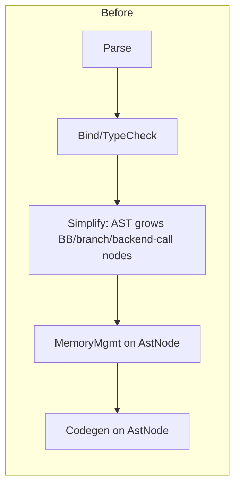
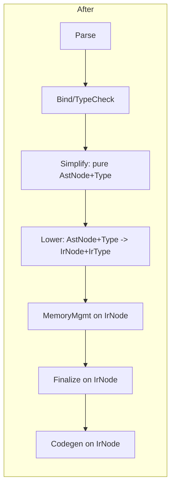
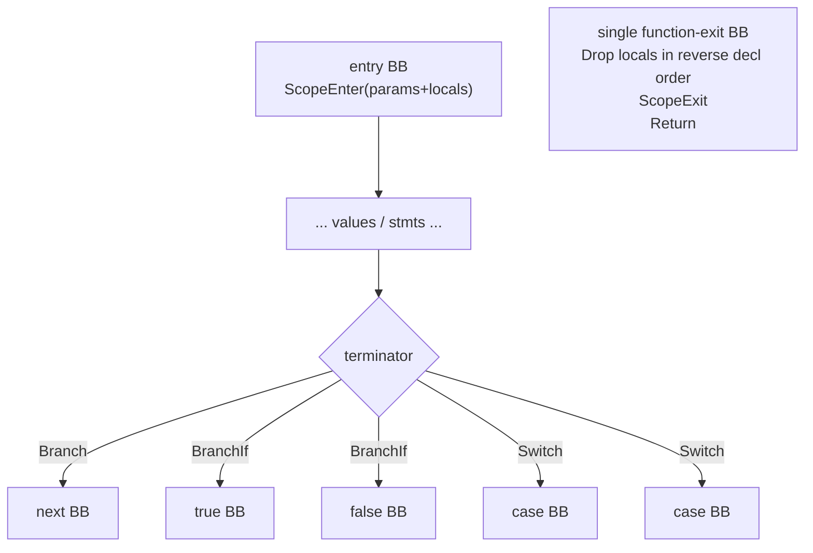
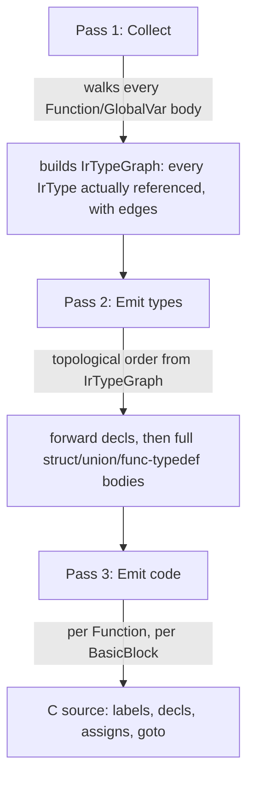

# Cxy IR Migration Design

Status: DRAFT for review
Audience: compiler devs, indexed for use during implementation

## 1. Motivation

- Today every stage from `Simplify` through `Codegen` mutates/evolves the same
  `AstNode` graph (`lang/frontend/ast.h`). Backend-ish concerns (basic blocks,
  branches, phi nodes, geps, drop flags) are already bolted onto the AST as extra node
  tags (`CXY_LANG_IR_TAGS`: `astBranch`, `astBranchIf`, `astBasicBlock`, `astPhi`,
  `astSwitchIr`, `astGep`) and a generic "backend call" escape hatch
  (`BACKEND_FUNC_IDS`/`astBackendCall`: alloca, copy, drop, move, assign, zeromem,
  sizeof, atomics, ...).
- This blurs the line between "source-level Cxy" and "lowered/back-end" concepts,
  bloats the `AstNode` union (`CXY_AST_NODE_BODY_SIZE`), and forces every later stage
  (memory mgmt, codegen, a future LLVM backend) to keep handling AST cases that make no
  sense post-lowering (generics, comptime, match/switch-on-type, closures, aliases,
  etc.), plus a handful of ad-hoc IR-flavored cases layered on top of that.
- **We are designing a brand new, purpose-built IR ("CIR" — Cxy IR) from scratch.**
  There is no existing IR/MIR representation in this codebase worth preserving or
  porting from — any prior art in the tree (e.g. anything under `lang/middle/mir/`) is
  considered dead code, is out of scope for reuse, and will simply be deleted as part
  of this migration. Nothing in this doc is a "port" of that code.

## 2. Goals

- `Simplify` is the **last stage that produces/consumes `AstNode`**.
- `Lower` is a **new stage**: `AstNode` + `Type` (frontend types, `lang/frontend/types.h`)
  → `IrNode` + `IrType` (backend/IR types). One-way door — nothing after `Lower` ever
  touches `AstNode` again.
- All later stages (`MemoryMgmt`, `Finalize`, `Codegen`) operate purely on `IrNode`/`IrType`.
- IR is intentionally low-level / C-shaped: functions made of basic blocks, each
  basic block single-entry/single-exit, explicit scope-enter/scope-exit markers,
  explicit control-flow edges (branch/branch-if/switch), named mutable locals declared
  once (`VarDecl`) and written via plain `Assign` (no SSA, no load/store/phi
  indirection), explicit member/index/deref access, explicit calls, explicit
  drop/copy/move ops. If you can picture the C it should generate, the IR node exists
  to say that directly — no implicit control flow, no implicit conversions, no
  implicit drops, and no register-machine artifacts (like `alloca`+`load`+`store`+`phi`)
  that only exist to simulate C locals through an SSA form we don't need.
- Exceptions become explicit control flow in IR: raise = construct a tagged result
  value + branch out of the normal path; catch = branch on tag; re-raise = forward the
  tagged value to the enclosing function's exit block; trace append = an explicit call
  to a runtime trace-push function. No `!T` / `raise` / `catch` concepts survive
  lowering — they compile down to plain branches + struct/union ops.
- IR has its own closed type system (`IrType`): primitives, pointers, arrays, structs,
  functions. This is where `Optional[T]`, tuples, unions, slices, classes, structs all
  become plain IR struct types (see §6).
- **There is no reference type in IR.** Cxy's `&T`/`this` (in classes)/borrow semantics
  are a *source-level* convenience for "a pointer that auto-dereferences and reads
  nicer" — by the time `Lower` runs, `&T` and `^T` are both simply `*T` (`irPointer`).
  IR has exactly one indirection concept: the pointer. There is no `IrTag`/flag that
  distinguishes "this pointer used to be a reference" — that distinction is purely
  syntactic sugar the frontend already resolved. More generally: **if a concept can't
  be expressed as a basic block, a branch/goto, a named variable read/write, a
  member/index/deref access, a call, or a pointer/array/struct/function type, it does
  not belong in IR.** Optionals, tuples,
  unions, slices, classes, structs, exceptions, references — none of these are IR
  concepts; they are all fully compiled into the primitive shapes in §6 before `Lower`
  finishes. The IR should read like the C it is about to become.
- New `IrVisitor`, modeled 1:1 on `AstVisitor`/`ConstAstVisitor` (`lang/frontend/visitor.h`).
- New IR dumper(s) under `lang/middle/dump/`, styled like `dump/cxy.c`, `dump/sexp.c`,
  `dump/json.c`, `dump/yaml.c`.
- Memory management (RAII drop-flag insertion) and Finalize become IR passes, not AST
  passes — `lang/middle/mem/*` gets rewritten against `IrNode`.
- Codegen is rewritten from scratch against IR: no direct-to-AST string templates. Emits
  a single translation-unit-style output (or per-module), using `typedef`s only for
  primitive aliases, and `struct` definitions for all aggregate concepts (tuple,
  optional, slice, class, struct, union) — see §8.
- LLVM backend (`lang/backend/llvm`) is also migrated to consume `IrNode` instead of
  `AstNode` (follow-up phase, see §11).

## 3. Non-goals (for this doc)

- Not redesigning frontend parsing/binding/type-checking/simplify.
- Not committing to removing the C backend in favor of LLVM — both will eventually read
  IR, but this doc's primary deliverable is the IR + the C codegen rewrite.
- Not specifying the exact LLVM-IR-from-CIR mapping in detail (sketched only).

## 4. Pipeline (before / after)





- `CompilerStage` (`driver/stages.h`) already lists the right stage names in the right
  conceptual order: `Simplify, MemoryMgmt, Lower, Finalize, Codegen`. **Action:**
  reorder to `Simplify -> Lower -> MemoryMgmt -> Finalize -> Codegen`, and give `Lower`
  a real implementation (its current entry in `driver/stages.c` is disabled and wired to
  dead code — that whole call chain is deleted, not extended).
- `AstNode.metadata` (`astMetadata` in `ast.h`) carries `AstNode *node` through every
  stage today. After `Lower`, downstream stages need an `IrNode*`-typed handle instead.
  Add `IrModule *ir;` alongside `AstNode *node;` in the metadata struct; stage executors
  from `Lower` onward read/write `metadata.ir` and ignore `metadata.node`.

## 5. IR Node Design

### 5.1 Node shape

```c
#define CXY_IR_NODE_HEAD                    \
    IrTag tag;                              \
    FileLoc loc;                            \
    u64 flags;                              \
    const IrType *type;                     \
    struct IrNode *parent;        /* enclosing basic block / function */ \
    struct IrNode *next;          /* sibling link within a BB's stmt list */ \
    struct AstNode *ast;          /* the AstNode this IrNode was lowered from, see §5.1.1 */ \
    void *codegen;                /* backend scratch pointer */
```

- Same allocation strategy as `AstNode`: pool-allocated (`core/mempool.h`), with a
  dedicated `MemPoolCacheId` (`memIrNode`, `memIrType`) for fast reuse.
- `Flags` reuse `lang/frontend/flag.h` bits where the concept still applies at the IR
  level (`flgConst`, `flgExtern`, `flgPublic`, `flgVariadic`, ...) — notably
  **not** `flgReference`, since references are not an IR concept (§2); every
  pointer-shaped value is just `irPointer`, full stop. Purely IR-internal flags (e.g.
  "this alloca is a drop-flag", "this call may raise") get a new small `CXY_IR_FLAGS`
  table private to `lang/middle/ir/`.

#### 5.1.1 AstNode <-> IrNode cross-linking (agreed rule, reference this section)

**Every `IrNode` that was produced from a specific `AstNode` carries a pointer back to
it, and that `AstNode` carries a pointer forward to its `IrNode`.** This is a two-way
link, symmetric with how `AstNode` already carries a scratch union for backend
pointers (`CXY_AST_NODE_HEAD`'s `codegen`/`ir`/`mir` union in `ast.h`) — we are
formalizing and always populating that link during `Lower` instead of leaving it as an
unused optional slot.

- **`IrNode -> AstNode`**: the `ast` field in `CXY_IR_NODE_HEAD` above. Set once, at
  the point `Lower` creates the `IrNode` for a given `AstNode`. Used for diagnostics
  (`FileLoc` is already copied onto the `IrNode` directly, but `ast` gives passes
  access to the original source construct when a lowered form alone is ambiguous),
  and for debugging/dumping (§10.2 can optionally annotate a dump with the originating
  Cxy source line).
- **`AstNode -> IrNode`**: `CXY_AST_NODE_HEAD` in `ast.h` already has a `union { void
  *codegen; struct MirNode *ir; }` slot named `ir` (currently typed for the dead MIR
  prototype). **Action:** retype that field from `struct MirNode *` to `struct IrNode
  *` — no new field needed, just fix its type now that it has a real purpose. Set by
  `Lower` the moment it lowers a declaration (`VarDecl`, `FuncParamDecl`, `FuncDecl`,
  `FieldDecl`, ...). This is **the mechanism `Lower` uses to resolve identifier reads**
  — see below. (The neighboring legacy `mir` field in that struct's second union is
  dead and gets deleted per §11 Phase 0, not repurposed.)
- **Why this matters — no separate symbol table in `Lower`:** binding/`Simplify` has
  already resolved every `astIdentifier`/`astPath` to the declaring `AstNode` via
  `ident.resolvesTo` (see `ast.h`'s `ident` field, `resolvesTo`). So when `Lower`
  encounters an identifier, it does **not** need to look anything up in a scope/symbol
  table of its own — it simply reads `node->ident.resolvesTo->ir` to get the `IrNode`
  (a `VarDecl`/`FuncParam`/`Function`/`GlobalVar`) that declaration already lowered
  to, and emits a `VarRef` pointing at it. This is only correct because `Lower`
  processes a function body in the same order the AST declares things (a variable's
  `VarDecl` is always lowered, and its `->ir` populated, before any use of it can be
  reached) — exactly the invariant the frontend's own binding pass already guarantees
  for AstNode-to-AstNode resolution, we're just piggy-backing on it one level further.
- This link is populated by `Lower` only. Later passes (`MemoryMgmt`, `Finalize`,
  `Codegen`) do not need to consult `AstNode` at all (§2's one-way-door rule still
  holds) — the cross-link exists for `Lower`'s own benefit and for
  diagnostics/dumping, not as a backdoor for post-`Lower` stages to reach back into
  the AST.

### 5.2 Instruction set

The instruction set is **three-address code over named, mutable locals** — this is the
correct C-shaped model, not an SSA/register model. C locals are declared once and
assigned to as many times as needed; there is no `Alloca`+`Load`+`Store`+`Phi` dance
to reconstruct that behavior. Concretely:

- A local variable is declared exactly once per scope via `VarDecl` (like `int x;` in
  C) and is read/written directly by name for the rest of its scope — there is no
  `Load` instruction and no `Store` instruction. Writing to a variable (`x = expr`,
  including a `VarDecl`'s own initializer) is a single `Assign` statement.
- Every node is either a **value** (produces a typed result usable as an operand of
  another instruction or the right-hand side of an `Assign`), a
  **statement/terminator** (control flow or scope bookkeeping), or a **declaration**
  (function/global/module level).
- `Alloca` still exists, but it is demoted to what it means in C: an *explicit,
  rare* raw stack-buffer reservation (source-level `alloca!`, VLA-shaped locals, or a
  buffer `MemoryMgmt`/`Lower` needs to synthesize, e.g. for a large struct temporary
  it wants to address without a named variable). It is **not** the general mechanism
  for representing ordinary variables — ordinary variables are `VarDecl`.

```c
// clang-format off
#define CXY_IR_CONST_TAGS(f)   \
    f(NullConst)               \
    f(BoolConst)                \
    f(CharConst)                \
    f(IntConst)                 \   /* signed/unsigned, value + width from type */
    f(FloatConst)                \
    f(StringConst)               \   /* raw C string literal constant */
    f(ArrayConst)                 \   /* constant aggregate, array-typed */
    f(StructConst)                 \   /* constant aggregate, struct-typed (tuple/optional/union/struct) */
    f(GlobalRef)                    /* reference to a GlobalVar/Function by symbol */

#define CXY_IR_VALUE_TAGS(f)    \
    f(VarRef)                   \   /* read of a named local/param/global - holds a direct pointer to its VarDecl/FuncParam/GlobalVar IrNode, see §5.1.1 */
    f(Member)                     \   /* struct/union/tuple field access, by index: x.name / x._0 */
    f(Index)                       \   /* array/slice element access: x[i] */
    f(Cast)                          \   /* explicit representation-preserving or numeric cast */
    f(Unary)                          \   /* -, !, ~, etc. */
    f(Binary)                          \   /* +, -, *, ==, &&, etc. */
    f(Call)                              \   /* direct or indirect call */
    f(AddrOf)                             \   /* address-of an lvalue (&x, &x.field, &x[i]) */
    f(Deref)                               \   /* dereference a pointer value: *p */
    f(Alloca)                               \   /* explicit raw stack-buffer reservation (rare - see above) */
    f(Malloc)                                \   /* heap allocation (sized by type) */
    f(Sizeof)                                 /* compile-time-known size as a value, kept explicit for codegen parity with sizeof() in C */

#define CXY_IR_RAII_TAGS(f)     \
    f(Copy)                     \   /* invoke type's copy semantics into a destination */
    f(Move)                      \   /* invalidate source, transfer ownership */
    f(Drop)                       \   /* invoke type's destructor, inserted by MemoryMgmt */
    f(Zeromem)                     /* memset-to-zero a variable/buffer after drop/move-out */

#define CXY_IR_STMT_TAGS(f)     \
    f(VarDecl)                  \   /* declares a named local exactly once within the enclosing scope */
    f(Assign)                     \   /* write to a variable/member/index/deref lvalue - statement, not a value */
    f(ScopeEnter)                   \   /* marks start of a lexical scope (Cxy `{ ... }`), records locals */
    f(ScopeExit)                     \   /* marks end of scope; MemoryMgmt expands into Drop sequence */
    f(Branch)                          \   /* unconditional jump to a BasicBlock */
    f(BranchIf)                         \   /* conditional jump: cond ? trueBB : falseBB */
    f(Switch)                            \   /* multi-way jump on an integer value */
    f(Return)                             \   /* terminate function - only legal in the function's single exit BB */
    f(Unreachable)                         \   /* terminator for provably-dead code, e.g. after raise-only path */
    f(InlineAsm)                             /* verbatim asm block, operands as Member/VarRef values */

#define CXY_IR_DECL_TAGS(f)     \
    f(BasicBlock)                \   /* named list of stmts/values, ends in exactly one terminator */
    f(FuncParam)                  \
    f(Function)                    \
    f(GlobalVar)                     \
    f(Module)                          /* top-level container: globals + functions + types for one compiled unit */

#define CXY_IR_TAGS(f)          \
    CXY_IR_CONST_TAGS(f) CXY_IR_VALUE_TAGS(f) CXY_IR_RAII_TAGS(f) \
    CXY_IR_STMT_TAGS(f) CXY_IR_DECL_TAGS(f)
// clang-format on

typedef enum {
#define f(NAME) ir##NAME,
    CXY_IR_TAGS(f)
#undef f
    irCOUNT
} IrTag;
```

- Every AST-level control construct (`if`, `while`, `for`, `switch`, `match`, ternary,
  short-circuit `&&`/`||`, `catch`) is lowered by `Lower` into some combination of
  `BasicBlock` + `Branch`/`BranchIf`/`Switch`. There is no separate "high-level control
  flow" tier in IR, and — importantly — **no `Phi` instruction**: where source-level
  control flow produces a value (ternary, `match`-as-expression), `Lower` instead
  declares one `VarDecl` before the branch and emits an `Assign` to that same variable
  at the end of each branch, exactly the way a human writing the equivalent C would
  (`int c; if (cond) { c = a; } else { c = b; }`). This keeps every value-producing
  construct expressible with a plain named variable instead of an SSA merge node.
- `Member`/`Index`/`Deref`/`AddrOf` are the address/access primitives (replacing a
  generic LLVM-style `Gep`): `Member` for `x.field`/`x._0`, `Index` for `x[i]`,
  `Deref` for `*p`, `AddrOf` for `&lvalue`. Each is a plain value node — there's no
  separate "compute address" vs "load" split; `Member`/`Index`/`Deref` directly yield
  the value at that location, and `Assign` targets them directly as lvalues
  (`x.field = v`, `arr[i] = v`, `*p = v`) without a separate address computation step.
- `RAII` ops (`Copy`/`Move`/`Drop`/`Zeromem`) are first-class instructions, not calls
  through a generic "backend function id" indirection. `Lower` emits `Copy`/`Move`
  directly wherever the source language has `__copy!`/`&&`; `MemoryMgmt` is the only
  stage allowed to *insert* `Drop`/`Zeromem`.
- Atomics are represented as `Call` to well-known intrinsic symbols (e.g.
  `__atomic_load`, `__atomic_fetch_add`) resolved by `Lower`; they don't need dedicated
  `IrTag`s because they have normal call semantics (args in, value out) and codegen can
  special-case the intrinsic symbol names it recognizes.

### 5.3 Basic blocks, functions, scopes (single-entry / single-exit)



- A `Function` is a flat list of `BasicBlock`s. Every `BasicBlock` has exactly one
  terminator (`Branch`/`BranchIf`/`Switch`/`Return`/`Unreachable`) as its last
  statement, and it is always present — `Lower` never leaves a block "falling off the
  end" (mirrors real C-with-goto structure, and makes the IR trivially valid to
  interpret/verify: a simple pass can assert "every BB's last stmt is a terminator,
  and no earlier stmt is").
- **Single function-exit block**: `Lower` allocates exactly one exit `BasicBlock` per
  function. Every `return`, implicit fall-off-the-end, and every `raise` path
  ultimately becomes: (assign the function's return slot, if any) → `Branch` to the
  exit block. The exit block is the only block allowed to contain `Return`. This gives
  `MemoryMgmt` one place to emit the final drop sequence for all function-scope locals,
  regardless of which control path got there — this is the direct enabler of RAII
  without duplicating drop code at every return site.
- **Scopes**: every Cxy `{ ... }` block (function body, if-body, loop-body, etc.)
  lowers to a `ScopeEnter` statement followed by its contents followed by a `ScopeExit`
  statement, both carrying a reference to the ordered list of locals declared directly
  in that scope. Scopes do **not** need their own `BasicBlock` — multiple scopes can
  live inside one BB, and a scope can span multiple BBs (e.g. an `if` whose body is one
  scope but two BBs due to further nesting). `ScopeEnter`/`ScopeExit` are pure
  bookkeeping for `MemoryMgmt`; they carry no control-flow effect and are compiled away
  (see §9) before Codegen ever sees the IR.
- `Lower` is deliberately ignorant of liveness/ownership: it always emits balanced
  `ScopeEnter`/`ScopeExit` pairs and never emits a `Drop`. All ownership analysis and
  drop-insertion is `MemoryMgmt`'s job, operating purely on the IR (§9). This keeps
  `Lower` a pure structural + type translation pass.
- Loops lower to the natural 3-4 BB shape: `condBB` (evaluates the condition,
  `BranchIf` to body/end), `bodyBB` (body, `Branch` to update-or-cond), optional
  `updateBB` (for `for`-style post-body updates), `endBB` (loop exit). `break` = branch
  to `endBB`; `continue` = branch to `updateBB` (if present) else `condBB`.
- `switch`/`match` both lower to a single `Switch` instruction: an integer-valued
  condition (the switch expression itself, or — for `match` — the union's tag read via
  `Member`), a list of `(constant, BasicBlock)` cases, and a default `BasicBlock`.
  `match`'s per-case alias binding (`as x`) lowers to an ordinary `VarDecl`+`Assign`
  inside that case's BB, no different from any other local.
- Ternary expressions (and any other expression-position branch, like `match`-as-value)
  lower to: a `VarDecl` for the result **before** the branch, `BasicBlock`s for each
  arm that each end with an `Assign` to that same variable, and a merge `BasicBlock`
  that simply reads the variable via `VarRef` — exactly the C idiom
  `T c; if (cond) { c = a; } else { c = b; }`. There is no merge/phi instruction
  anywhere in the IR; every value-producing branch construct uses this
  declare-then-assign-in-each-arm shape instead.

#### Worked example

```cxy
func message(s: String) {
  var x = 0
  var z: i32 = 10
  var c = s.size() < z ? x : x
  println(c)
}
```

**Methods do not exist in IR at all.** By the time `Simplify` finishes, `s.size()` has
already been rewritten to a plain call to the free function that implements
`String::size`, with `s` passed as its first (`this`) argument — exactly like every
other member-function call in Cxy is already desugared before codegen today. `Lower`
never sees `.method()` syntax; it only ever sees `Call(func, args...)`. There is no
receiver/dot-call node in the IR instruction set at all (§5.2 has no such tag), so the
dump below shows the call exactly as it lowers: `String_size(s)`.

After `Lower` (dumped per §10.2 — note `s` is `*String`, not `&String`; `s.size()` is
already the plain call `String_size(s)`; the ternary is a `VarDecl`+`Assign`-in-each-arm,
not a `Phi`; and both `ScopeEnter`/`ScopeExit` are still present, carrying scope index
`0`):

```
func message(s: *String): void {
entry:
  scope.enter 0
  var x: i32
  x = 0
  var z: i32
  z = 10
  var __t0: u64
  __t0 = String_size(s)
  var c: i32
  if (__t0 as i32) < z goto ternary.true else goto ternary.false
ternary.true:
  c = x
  goto ternary.merge
ternary.false:
  c = x
  goto ternary.merge
ternary.merge:
  println(c)
  goto exit
exit:
  scope.exit 0
  return
}
```

After `MemoryMgmt` (the `ScopeEnter`/`ScopeExit` pair for scope `0` is expanded and
removed; only `s` is destructible, so it is the only local dropped, in the single exit
block — `x`/`z`/`__t0`/`c` are plain integers and need no drop):

```
func message(s: *String): void {
entry:
  var x: i32
  x = 0
  var z: i32
  z = 10
  var __t0: u64
  __t0 = String_size(s)
  var c: i32
  if (__t0 as i32) < z goto ternary.true else goto ternary.false
ternary.true:
  c = x
  goto ternary.merge
ternary.false:
  c = x
  goto ternary.merge
ternary.merge:
  println(c)
  goto exit
exit:
  drop s
  return
}
```

A few things worth calling out about this example:

- `String_size(s)` is an ordinary `Call` — no method/receiver syntax exists in IR.
  `Simplify` (or earlier) is responsible for resolving `s.size()` to the concrete
  function symbol and inserting `s` as its first argument; `Lower` just translates
  whatever plain call expression it's handed.
- The call's result gets a compiler-generated `VarDecl` (`__t0`) here because its
  value is consumed by a `Cast` used as the branch condition — in this design, `Lower`
  names a call's result whenever it isn't immediately, trivially inlinable as a single
  operand; a bare `Binary`/`Cast` expression over already-named values (like `z` or
  `__t0`) prints and stays inline, but a `Call` always materializes into a named local
  first, exactly like most humans would write the equivalent C
  (`u64 t0 = String_size(s); if ((int)t0 < z) ...`). Whether `Lower` should *always*
  name call results this way, or only when required, is an implementation-detail
  knob, not a semantic one — either choice is IR-legal.
- `String_size(s) < z` needed a `u64 -> i32` `Cast`, shown here as `(__t0 as i32)`
  printed inline in the `BranchIf` condition, per the original walkthrough's type
  assumptions.
- Both ternary arms happen to assign the same variable (`x`) — `Lower` does not try to
  optimize this away; that's `Simplify`'s job if it's worth doing at all, or dead-code
  elimination later. `Lower` is a mechanical structural translation.

### 5.4 Exceptions in IR

**See §8.6 for the authoritative, corrected version of this section.** Summary: source-
level `!T`/`raise`/`catch` are not IR concepts — they compile down to a tagged-union
result value plus branches on its tag, expressed purely with the instructions in
§5.2/5.3 (`Call`/`StructConst` to build the raised value, `Assign` into a tagged-union
return variable, `BranchIf` on `Member(result, tag)` for propagation/catching, `Branch`
to the function's single exit block for both `return` and `raise`). **Importantly,
this rewrite happens in `Lower`, not earlier** — §8.6 corrects an inconsistency in an
earlier draft of this doc (and in the current frontend) that had `shake`/`sema`
performing this same rewrite directly on `AstNode`, which is the wrong layer for
backend-shaped work per §2's goals. Read §8.6 before implementing any of this; it also
covers what must change in the frontend (`lang/middle/shake/shake.c`,
`lang/middle/sema/exception.c`) to stop doing this rewrite prematurely.

### 5.5 IrType design

```c
#define CXY_IR_TYPE_TAGS(f)                 \
    f(Void) f(Bool) f(Char)                 \
    f(I8) f(I16) f(I32) f(I64) f(I128)       \
    f(U8) f(U16) f(U32) f(U64) f(U128)       \
    f(F32) f(F64)                           \
    f(Pointer) f(Array) f(Struct) f(UntaggedUnion) f(Func) f(Opaque)

typedef struct IrType {
    IrTypeTag tag;
    u64 size, align;
    cstring name;   /* mangled/final name, already unique */
    union {
        struct { const IrType *pointee; } pointer;
        struct { const IrType *elem; u64 len; } array;    /* len == UINT64_MAX => flexible/slice-backing array */
        struct { IrField *fields; u64 count; } strct;      /* Struct AND UntaggedUnion both use this shape (see §8.4) - only the tag differs, which controls whether codegen emits `struct` or `union` and whether members are offset-sequential or all-overlapping */
        struct { const IrType **params; u64 count; const IrType *ret; bool variadic; } func;
    };
} IrType;
```

- `IrType` is a **flat, closed, already-mangled** representation: no generics, no
  aliases, no `This`, no interfaces-as-such, no comptime — `Lower` fully resolves
  `lang/frontend/types.h`'s richer `Type` (which still has `typGeneric`, `typApplied`,
  `typAlias`, `typThis`, `typInterface`, etc., all already resolved to concrete types by
  `Simplify`/`TypeCheck`) down to this closed set.
- `Lower` owns a memoized `Type* -> IrType*` cache inside its own context object so
  repeated references to the same frontend type produce one shared `IrType*`.

### 5.6 Expression flattening (ANF-style) — agreed rule, reference this section

**This section is the settled answer** to "how nested does an IR expression get?" —
don't re-derive it, link back here.

- **Rule 1 (flattening trigger):** `Lower` never nests a `Call` inside another
  expression. Any time a `Call`'s result is used as anything other than the direct,
  sole initializer of a `VarDecl`/`Assign` (i.e. it's an operand of a `Binary`/`Unary`/
  `Cast`, an argument to another `Call`, or a branch condition), `Lower` first binds it
  to a fresh compiler-generated local (`VarDecl __tN` + `Assign`), then references that
  local everywhere else. This applies uniformly, whether or not the call's result type
  is destructible — uniformity keeps `Lower` simple and keeps every call its own
  statement (which also gives every call a natural, single place to attach
  exception-propagation checks, §5.4).
  - Corollary: `x = call(...)` and `var x = call(...)` do **not** get an extra
    temporary — the destination variable already *is* the named binding the call's
    result lives in. Flattening only introduces a *new* name when the call's result
    would otherwise be nested inside something else.
  - Everything else may stay nested/inline: `VarRef`, constants, `Binary`/`Unary` over
    already-named values, `Cast`, and `Member`/`Index`/`Deref`/`AddrOf` that just
    read/address *existing* storage. None of these can raise, allocate, or produce a
    fresh destructible value, so there's nothing for `MemoryMgmt` to lose track of by
    leaving them nested.
  - Practical effect: **`MemoryMgmt` never needs to recurse into expression trees to
    find hidden destructible intermediates.** Every destructible value in the IR is
    the direct result of some statement (`VarDecl`, `Assign`, or a call's flattened
    binding) — a purely statement-level walk of each `BasicBlock` is sufficient.
- **Rule 2 (temporary lifetime ≠ local lifetime):** a compiler-generated temporary
  (`__tN`) is *not* scoped like a user `var`. It does not live until its enclosing
  `ScopeExit` — `MemoryMgmt` drops it immediately after the statement that consumes it
  (or immediately, if it was moved-from before that point, in which case it needs no
  drop at all). User-declared locals keep the normal rule: they live until their
  enclosing `ScopeExit` (or until moved). Two lifetimes, two rules — never conflate
  them.
- **Naming convention:** compiler-generated temporaries print as `__t0`, `__t1`, ...
  (per-function counter) in dumps and in this doc. Short-circuit `&&`/`||` merge
  variables print as `__cond`/`__condN` if more than one is live at once.

#### Worked example A — a destructible temporary buried in a call argument

```cxy
func greet(a: String, b: String) {
  println(concat(a, b))
}
```

`concat(a, b)`'s result is a `String` (destructible) and is used as an argument to
`println` — by Rule 1 it must be flattened into a named temporary, and by Rule 2 that
temporary is dropped right after its one use, not deferred to `exit`:

```
func greet(a: *String, b: *String): void {
entry:
  scope.enter 0
  var __t0: String
  __t0 = concat(a, b)
  println(&__t0)
  drop __t0
  goto exit
exit:
  drop b
  drop a
  return
}
```

#### Worked example B — `||`, an operator-overload call, and a nested scope

```cxy
func fn(s: String) {
    var x = String("Hello")
    if s == x || x.size() < 4 {
        var j = f"What {s}"
        x = String("Very Small")
    }
    println(x)
}
```

`s == x` and `x.size()` are ordinary method calls, already desugared to plain `Call`s
by `Simplify` (§5.3's worked example already established there is no method/receiver
node in IR). `||` reuses the exact same declare-before/assign-in-each-arm idiom as
ternary (§5.3) — no new instruction, and short-circuiting falls out for free because
`or.true` never reaches the RHS block:

```
func fn(s: *String): void {
entry:
  scope.enter 0
  var x: *String
  x = String_new("Hello")
  var __t0: bool
  __t0 = String_eq(s, x)
  var __cond: bool
  if __t0 goto or.true else goto or.rhs
or.rhs:
  var __t1: u64
  __t1 = String_size(x)
  __cond = __t1 < 4
  goto or.merge
or.true:
  __cond = true
  goto or.merge
or.merge:
  if __cond goto if.true else goto if.end
if.true:
  scope.enter 1
  var j: *String
  j = __str_interp("What ", s)
  var __t2: *String
  __t2 = String_new("Very Small")
  x = &&__t2
  scope.exit 1
  goto if.end
if.end:
  println(x)
  goto exit
exit:
  scope.exit 0
  return
}
```

Note `String_new("Hello")`/`__str_interp(...)` are direct initializers of `x`/`j`, so
Rule 1's corollary applies — no extra temp. `__t2` **does** need a temp only because it
feeds a `Move` into `x` rather than being `x`'s own direct initializer; it needs no
separate drop since it is moved-from immediately. See §9 for what `MemoryMgmt` does
with this example (in particular, the `x = &&__t2` reassignment).

## 6. Type Lowering Table

| Cxy `Type` (`lang/frontend/types.h`)                | IR representation |
|------------------------------------------------------|--------------------|
| `typPrimitive` (`PRIM_TYPE_LIST`)                     | matching `IrType` primitive tag |
| `typVoid`                                             | `irVoid` |
| `typPointer`                                          | `irPointer(pointee)` |
| `typReference`                                        | `irPointer(referred)` (references are just pointers post-lowering) |
| `typString` (builtin `String`/`__string`)             | `irStruct { data: i8*, len: u64, cap: u64 }` (owned) / `{data: i8*, len: u64}` (borrowed slice-view) |
| `typArray` (fixed `[T, N]`)                           | `irArray(elem, N)` |
| `typArray` (unsized `[T]` / `Slice`)                  | `irStruct { data: T*, len: u64 }` |
| `typTuple`                                            | `irStruct { _0: T0, _1: T1, ... }` |
| `typOptional`                                         | `irStruct { tag: u32, value: T }` |
| `typUnion` / `typResult` (tagged union incl. `!T`)    | `irStruct { tag: u32, union { T0 _0; T1 _1; ... } }` |
| `typException`                                        | `irStruct { <ctor params...>, trace: TraceFrame[] }` |
| `typStruct`                                           | `irStruct { <fields...> }` (methods/statics dropped — they're already separate `Function`s) |
| `typClass`                                            | `irStruct { vtable: *VTableStruct?, <fields...> }` — **no explicit refcount field**; ref-counting is an opaque runtime detail behind `Call`s to `__smart_ptr_alloc`/`__smart_ptr_get`/`__smart_ptr_drop`, see §8.5 |
| `typUntaggedUnion` (C `union` from `.h` imports)       | `irUntaggedUnion { <fields...> }`, see §8.4 |
| `typEnum`                                             | underlying integer `IrType` (`tEnum.base`) |
| `typFunc`                                             | `irFunc(params, ret)` |
| `typInterface`/abstract class w/ virtuals              | `irStruct` with explicit `vtable*` field + a generated `irStruct` for the vtable itself, see §8.5 |
| `typGeneric`, `typApplied`, `typAlias`, `typThis`, `typAuto`, `typModule`, `typContainer`, `typLiteral`, `typInfo` | **do not exist in IR** — fully resolved/erased before `Lower`; `Lower` asserts they never reach it (`csAssert0`) |

- Name mangling: reuse the existing `lang/middle/mangle.c` (`mangle.h`) as-is, invoked
  from `Lower` when producing `IrType.name` / function/global symbol names, so
  generated C symbol names stay stable and comparable against existing snapshot tests.

### 6.1 `IrType` interning (agreed, answers open question in §13)

**`IrType`s are interned/deduplicated**, exactly like frontend `Type` already is via
`lang/frontend/ttable.h`'s `TypeTable`. `Lower` owns an `IrTypeTable` (keyed by
structural identity: tag + field types/names in order, or pointee/element/param types
for non-aggregate shapes) so that lowering the same frontend `Type*` — or two
structurally-identical-but-distinct frontend `Type*`s, which does happen, e.g. two
instantiations of the same generic tuple shape — always yields the **same** `IrType*`.
This matters for two concrete reasons already required elsewhere in this doc:

- §8.1's Pass 1 (`IrTypeGraph` construction) needs stable `IrType*` identity to build
  a correct graph and to guarantee each distinct type is emitted exactly once in
  Pass 2 — without interning, the same logical struct could be emitted twice under two
  different `IrType*` values with the same mangled name, a C redefinition error.
- §5.6's flattening/temp machinery and §9's drop-insertion both compare `IrType*` by
  pointer identity (e.g. "is this type destructible" is a property looked up once per
  distinct `IrType*` and cached) — non-interned types would force those lookups to
  fall back to structural comparison every time, which is both slower and a source of
  subtle bugs if two structurally-equal-but-distinct `IrType*`s ever disagree.

## 7. Lower Stage

- New directory `lang/middle/ir/` (sibling to `lang/middle/mem`):
  - `ir/node.h` / `ir/node.c` — `IrNode`, `IrTag`, `makeIr*` constructors (mirrors the
    `makeXxxAstNode` family style in `ast.h`, but for the closed instruction set in §5.2).
  - `ir/type.h` / `ir/type.c` — `IrType`, `IrTypeTag`, `lowerType(LowerContext*, const
    Type*)` memoized cache, per §5.5/§6.
  - `ir/context.h` — `IrContext`/`IrModule` (owns `MemPool`, `StrPool`, function/global
    list for one compiled unit).
  - `ir/visitor.h` / `ir/visitor.c` — `IrVisitor`/`ConstIrVisitor` (§10.1).
  - `ir/lower.c` — the `AstNode → IrNode` pass itself: this is a **new implementation**,
    designed fresh around the BB/scope/exception model in §5, not an extension of any
    existing lowering code.
- `lowerToIr(CompilerDriver*, AstNode* simplifiedRoot) -> IrModule*` is the stage entry
  point wired into `driver/stages.c` at the (fixed) `ccsLower` slot.
- `Lower`'s responsibilities, precisely:
  1. Walk each function body (already free of generics/comptime/aliases — `Simplify`
     guarantees this) and build its `BasicBlock` graph per §5.3: one BB per control-flow
     join point, `ScopeEnter`/`ScopeExit` around every `{ }` block, a single synthesized
     exit BB per function.
  2. Translate every expression/statement into the instruction set in §5.2 (locals via
     `VarDecl`+`Assign`; values via `VarRef`/`Member`/`Index`/`Deref`/`Cast`/`Unary`/
     `Binary`/`Call`/`AddrOf`/`Malloc`; RAII markers via `Copy`/`Move` only where the
     source explicitly requests them — never `Drop`).
  3. Lower every frontend `Type` reachable from the function/module into `IrType` (§6),
     memoized per module.
  4. Finish the exception rewrite into plain branches/tagged unions (§5.4).
  5. Call into `mangle.c` for final symbol names.
  6. Explicitly **not** do: liveness analysis, drop insertion, scope-exit expansion
     (all `MemoryMgmt`), or any codegen-shape decisions (typedef vs struct, file
     layout — all `Codegen`).
- **Identifier resolution during Lower (agreed rule, reference this bullet):** when
  `Lower` encounters an `astIdentifier`/`astPath` node, it does **not** consult a
  symbol table of its own. It reads the already-resolved `AstNode *decl =
  node->ident.resolvesTo` (populated by binding, long before `Lower` runs), then
  `decl->ir` (§5.1.1) to get that declaration's already-lowered `IrNode`
  (`VarDecl`/`FuncParam`/`Function`/`GlobalVar`), and emits a `VarRef` pointing at it.
  Concretely: `astToMirIdentifier(node) = makeIrVarRef(node->ident.resolvesTo->ir)`.
  This is safe because `Lower` visits a function body top-to-bottom, so a
  declaration's `->ir` is always populated before any reachable use of it — the same
  ordering guarantee binding already relies on for `AstNode`-level resolution. No
  separate `Lower`-owned scope/environment (`Env`/`Scope` from `lang/middle/scope.h`)
  is needed at all.

## 8. Codegen Redesign (C backend)

- Full rewrite of `lang/backend/c/{codegen.h,generate.c,pre.c}` to consume `IrNode` /
  `IrType` via `ConstIrVisitor` (§10.1), replacing all `ConstAstVisitor` usage.
- Output shape:
  - Codegen's job is strictly "IR → C translation unit(s)". It has no notion of
    `@__cc`/native source concatenation, comptime, or any other pre-lowering concept —
    those are handled earlier in the pipeline or by the driver/build system, not by
    codegen.
  - **Typedefs are reserved for primitive aliases only** (e.g. `typedef uint8_t u8;`,
    an enum's underlying integer type). No other type gets a typedef.
  - **Every aggregate `IrType` (struct/tuple/optional/slice/class/union) emits exactly
    one `struct NAME { ... };` declaration** — no forward-typedef-then-struct double
    declaration. Forward declarations (for recursive/pointer-only-referenced types) are
    plain `struct NAME;` when required by ordering, computed via the type dependency
    graph in `lang/frontend/typegraph.c`, now walking `IrType` instead of `Type`.
  - Function bodies are generated straight from `IrNode` basic blocks: each
    `BasicBlock` becomes a C label + statements; `VarDecl`/`Assign` become plain C
    declarations/assignments; `Branch`/`BranchIf`/`Switch` become
    `goto`/`if-goto`/`switch-goto`. By the time Codegen runs, `ScopeEnter`/`ScopeExit`
    no longer exist in the IR (see §9) — Codegen only ever sees flat BBs of
    declarations, assignments, calls, and terminators.

### 8.1 Codegen is multi-pass, driven by an `IrType` dependency graph (agreed design)

Codegen for a single output translation unit runs in **three passes over the
already-Finalized `IrModule`**, not one:



- **Pass 1 (Collect / build the `IrTypeGraph`).** A new `lang/backend/c/typegraph.c`
  (or a thin `IrType`-keyed adapter reusing the existing generic graph machinery in
  `lang/frontend/typegraph.c`, since that file already only depends on `Type*`
  identity/edges and is trivially portable to `IrType*`) walks every `Function`,
  `GlobalVar`, and their transitively-used types (member types, param/return types,
  pointee types) and builds a graph: one node per distinct `IrType*`, one edge per
  "A's definition needs B's definition to already exist" (a struct field of type `B`
  used **by value** needs `B` fully defined first; a field of type `*B`/`^B` only
  needs a forward declaration, so it does **not** create a hard ordering edge, exactly
  like C's own forward-declaration rules). This is the **only** place `Codegen`
  decides emission order — nothing else in the pipeline needs to know about
  translation-unit-level ordering.
- **Pass 2 (Emit types).** Topologically sort the `IrTypeGraph` (cycle-breaking via
  forward `struct NAME;` declarations wherever a cycle is purely pointer-mediated,
  same strategy `lang/frontend/typegraph.c` already uses today for `Type`). Emit, in
  that order: primitive typedefs first (once, globally), then one `struct`/`union`
  declaration per aggregate `IrType` (§8's rule: exactly one declaration, no
  typedef-then-struct split), then function pointer `typedef`s needed for closure/
  vtable slots (§8.5).
- **Pass 3 (Emit code).** Only after every type used by any function body has a
  visible, complete declaration does Codegen walk `Function`/`BasicBlock` bodies and
  emit C statements. This ordering guarantee ("every type Pass 3 needs is already
  fully defined") is exactly why Pass 1/2 must run to completion first — Codegen never
  has to interleave "emit this type on first use" logic into statement emission the
  way the current single-pass `generate.c` sometimes has to (see its
  `type->generated`/`generating` flags in `CXY_TYPE_HEAD`, which exist to paper over
  exactly this ordering problem today). The new design removes the need for those
  flags entirely — by Pass 3, every type is unconditionally already emitted.
- This is also why §5.5 recommends interning `IrType` in a table (open question §13.4
  — now answered **yes**, see §6.1): Pass 1 needs stable `IrType*` identity to build a
  correct graph, and Pass 2 must emit each distinct `IrType` exactly once.

### 8.2 Tuple types

- Lowered exactly per §6: `irStruct { _0: T0, _1: T1, ..., _N: TN }`, one field per
  tuple member, named `_0.._N` to match today's C output (`generateTupleType`) so
  hand-written native interop code that already assumes this layout keeps working.
- No tag, no discriminant — a tuple's shape is fixed at compile time, so it's a plain
  aggregate, nothing more.
- Tuple copy/destructor functions (`type->tuple.copyFunc`/`destructorFunc` today) stay
  as ordinary `Function`s in the `IrModule`, one per distinct tuple `IrType` that needs
  one (i.e. has at least one destructible member) — `Lower` emits them once per
  distinct tuple shape, memoized alongside the `IrType` cache itself.

### 8.3 Optional types

- Lowered per §6: `irStruct { tag: u32, value: T }` (tag: `0` = `None`, `1` = `Some`,
  matching today's convention).
- `Some(x)`/`None[T]()` construction lowers to a `StructConst`/field-by-field
  `Assign` sequence into a `VarDecl`'d local (per §5.6's flattening rule — constructing
  an optional is no different from constructing any other struct).
- `!!opt` (has-value check) lowers to `Member(opt, tag) != 0`; `*opt` (unwrap) lowers
  to `Member(opt, value)`. Both are plain inline values (§5.2) since `Member` never
  needs flattening.
- `opt&.field`/`opt&.method()` (redirect operator) desugars **before** `Lower` (it's a
  frontend sugar for "if valid, access field/call method, else no-op/propagate" —
  already a `Simplify`-level rewrite into an ordinary `if`/ternary over the same
  `Member(opt, tag)` check). `Lower` never sees a redirect operator, only the plain
  `if`/`Member` shape it desugars to.

### 8.4 Untagged unions (from `.h` imports) vs. tagged unions (Cxy `|`)

These are **two different `IrType` shapes** — do not conflate them:

- **Untagged union** (`typUntaggedUnion`, produced by the C-header importer for a C
  `union`): lowers to a plain **C `union`** `IrType` (a new `IrTypeTag` value,
  `irUntaggedUnion`, alongside `irStruct` in §5.5 — same field-list shape as
  `irStruct` but codegen emits the keyword `union` instead of `struct` and every
  member overlaps at offset 0). No tag field, no discriminant, no `MemoryMgmt`
  involvement — by construction, C-imported untagged unions may not contain
  Cxy-managed/destructible members (this is already enforced by the frontend/binder
  when importing `.h` unions, `Lower` just carries that invariant forward and can
  `csAssert0` it).
- **Tagged union** (`typUnion`, Cxy's `A | B | C`, including the exception result type
  `!T`): lowers to `irStruct { tag: u32, union { A _0; B _1; C _2; ... } }` — an
  `irStruct` whose *last* field happens to be an anonymous `irUntaggedUnion`. This
  reuses the untagged-union `IrType` shape as a building block rather than inventing a
  third representation — a tagged union **is** "a tag integer plus an untagged union",
  full stop, and the IR should say exactly that.
- `is`/`as` (type-narrowing/cast) on a tagged union lowers to `Member(u, tag) ==
  <index>` / `Member(Member(u, value), <index>)` respectively — both plain inline
  values.
- `match` (§5.3) already reads a tagged union's discriminant via `Member(u, tag)` for
  its `Switch` condition, and each case's `as x` alias binds `Member(Member(u, value),
  <index>)` into a `VarDecl`+`Assign` at the top of that case's `BasicBlock`.

### 8.5 Classes, base classes, and the vtable

- **Single flattening point:** by the time a class reaches `Lower`, the frontend's
  `checkClassDecl`/`inheritClassMembers` (`lang/middle/sema/class.c`) has already
  flattened every inherited field from every base into one linear member list on the
  *derived* class's `Type` (`type->tClass.members`) — including synthesizing a
  `vtable` field as **member index 0** when the class (or any base) is `virtual`.
  **`Lower` therefore never deals with C-style "base struct as first field"
  sub-typing at all** — a Cxy class, no matter how deep its inheritance chain, lowers
  to exactly **one flat `irStruct`**, field order preserved from `tClass.members`
  (vtable pointer first, if present, then fields in declaration/inheritance order).
  There is no separate `IrType` per level of the hierarchy and no nested nominal
  "base substruct" the way hand-written C inheritance idioms usually do it.
- **Ref-counting header:** every class `irStruct` additionally carries whatever fields
  the ref-counting runtime needs (today: an implicit refcount slot managed by
  `__smart_ptr_alloc`/`__smart_ptr_get`/`__smart_ptr_drop`, `lang/frontend/strings.h`'s
  `S_sptr_*` names). `Lower` does not need to model the refcount as an explicit
  `IrType` field — `new`/copy/drop for a class type lower to plain `Call`s to those
  three runtime functions (exactly matching today's `bfiMemAlloc`/`bfiCopy`/`bfiDrop`
  codegen in `visitBackendBfiMemAlloc`/`visitBackendBfiCopy`), keeping the refcount an
  opaque runtime implementation detail behind an ordinary function call boundary, not
  something `MemoryMgmt`/`Codegen` need to know the byte layout of.
- **The vtable itself** is, and stays, a perfectly ordinary `IrType`: a struct of
  function-pointer fields (one per virtual method, matching
  `inheritanceBuildVTableType`'s member list today), instantiated exactly once per
  concrete class as a `const` `GlobalVar` (matching `makeVTableVariable`'s
  `flgConst|flgTopLevelDecl` pattern today), and referenced from the class `irStruct`'s
  `vtable` field as a plain pointer (`AddrOf` of that global). Nothing new needed here
  — vtables were already "just structs of function pointers" pre-IR, and stay exactly
  that in IR.
- **Virtual dispatch** (`target.method(...)` where `method` is virtual) is *not* a
  special IR construct either. `Simplify` already rewrites
  `target.method(args)` → `target.vtable.method(target, args)` (see
  `lang/middle/simplify/simplify.c`'s `virtualDispatch`) before `Lower` ever runs
  — by the time `Lower` sees it, it is nothing more than `Call(Member(Member(target,
  vtable), method), target, args...)`: two nested `Member` reads (address-of a
  function pointer, then load it) feeding an ordinary indirect `Call`. `Lower` has no
  "virtual call" tag; `Call`'s callee operand is simply a value, and an indirect call
  through a loaded function pointer is exactly the same `Call` node as a direct one
  through a `GlobalRef`.
- **`is`/downcast checks** (`target is Derived`, `target as Derived`) similarly
  desugar pre-`Lower` to `Member(Member(target, vtable), __tid) == <constant>` (see
  `checkBinaryExpr`'s `optTypeEquality` handling and `checkCastExpr` in
  `lang/middle/sema/{binary,cast}.c`) — again, plain `Member` reads and an `IntConst`
  comparison, nothing IR-specific.

### 8.6 Exceptions — correction: `Lower` desugars them, not the frontend

**This corrects an inconsistency in earlier drafts of this document (§5.4) and in the
current frontend implementation.** Today, `!T`/`raise`/`catch` are desugared
progressively across `shake`/`sema` (`lang/middle/shake/shake.c`'s `shakeReturnStmt`/
`shakeBinaryExpr`, `lang/middle/sema/exception.c`'s `checkCatchBinaryOperator`) —
i.e. **the frontend itself** currently does the tagged-union-and-branches rewrite,
building real `AstNode` `if`/`VarDecl`/`Path` trees to represent it. **That is the
wrong layer for this transform**, for the same reason everything else in §2 says so:
it's backend-shaped work being done on `AstNode`, bloating `Simplify`'s output with
constructs that only exist to be immediately re-lowered.

**Going forward:** `Simplify` keeps `!T`/`raise`/`catch` as first-class, un-desugared
`AstNode`s (the existing `astReturnStmt.isRaise`, `opCatch` binary expression, and the
result-union `Type` already carried by such expressions today) all the way through to
`Lower`. **`Lower` is the stage that performs the tagged-union-and-branches rewrite**,
directly into IR instructions, per §5.4's shape:

- `raise Foo(args)` → `Call`/`StructConst` to build `Foo`, `Assign` into the current
  function's return variable's tagged-union slot (tag = 1), an optional `Call` to a
  trace-push runtime function (only if exception traces are enabled — the
  `exceptionTrace` option `Lower` reads directly instead of inheriting a
  frontend-computed `ctx->exceptionTrace` flag), then `Branch` to the function's
  single exit block.
- A bare `raise` (re-raise inside a handler) → `Branch` to the exit block, forwarding
  the already-tagged result variable unchanged — no reconstruction.
- Every call whose result type is a result-union, when its result is not immediately
  followed by `catch`, gets an automatic `BranchIf` on `Member(result, tag) == 1`
  emitted by `Lower` right after the flattened call (§5.6): true → forward to this
  function's exit block; false → continue. This is `Lower`'s uniform "unhandled raise
  propagates" rule — it applies to *every* raising call site, not something `Simplify`
  needs to have already threaded through as extra `AstNode`s.
- `expr catch { block }` / `catch discard` / `catch <default>` → `BranchIf` on the
  tag, splitting into a handler `BasicBlock` (the `{ block }`, `discard`'s empty body,
  or an `Assign` of `<default>`) and a continue `BasicBlock`. `ex!` inside the handler
  → `Member(result, 1)`.
- Trace-push itself (appending `(mod, cls, fn, file, line)` to the exception's trace
  list) is a plain runtime `Call` that `Lower` inserts directly — it does not need a
  pre-resolved `AstNode` method call to already exist (contrast with §5.4's earlier
  "already a resolved free function call" phrasing, which described the *current*,
  now-superseded frontend behavior). `Lower` knows the runtime symbol name statically
  (an `OVERRIDABLE_BUILTINS`-style well-known symbol) and emits the `Call` itself.
- **Net result:** `checkCatchBinaryOperator`, `shakeReturnStmt`'s exception-push
  insertion, and `makeExceptionPush` (`lang/middle/shake/shake.c`,
  `lang/middle/sema/exception.c`) are deleted, not ported — per §11 Phase 0/3's
  "dead code, not reused" stance, now extended to this part of the frontend too.
  `Simplify`'s job shrinks to: verify raise/catch typing (already done in
  `lang/middle/sema/exception.c`'s type-checking half, which is **not** being
  removed, only its *rewriting* half), and leave the raise/catch `AstNode` shape
  intact for `Lower` to consume.

### 8.7 Closures — replacing today's per-closure synthesized class

Today (`lang/middle/sema/closure.c`), every closure literal synthesizes a whole new
`AstNode` `classDecl`/`structDecl` with a `CallOverload` member function, an
`InitOverload` constructor, and one field per captured variable
(`createStructForClusure`/`transformClosureToStructExpr`) — i.e. **a full class
declaration and heap allocation for every closure literal**, even trivial
non-escaping ones. This is the "very inefficient" behavior being replaced.

**New design:** a closure lowers to exactly two things, both of which already exist
as ordinary IR concepts — no new `IrTag` needed:

1. **An environment `irStruct`** — one field per captured variable (by value if
   captured by copy, by pointer if captured by reference — §2 already established
   references become plain pointers, so a by-reference capture is just a pointer
   field, nothing special). This is exactly §6's ordinary struct-lowering rule; a
   closure's captures are structurally identical to any other tuple/struct of
   values, so they get **no bespoke closure-specific `IrType` shape**.
2. **An ordinary top-level `Function`**, generated once per closure *literal* (not
   once per invocation), whose first parameter is a pointer to that environment
   struct (exactly analogous to `this` for a method — both are "implicit first
   parameter pointing at the data the function needs"). The closure's body lowers
   completely normally; captured-variable reads become `Member(env, name)` off that
   first parameter instead of `VarRef`.
- **Call-site representation:** a closure *value* (the thing stored in a variable,
  passed as an argument, etc.) is the same `(fn_ptr, env_ptr)` pair Cxy already
  documents as "a callable tuple" (see `thread.cxy`'s `__launch`: `fn.1` is the
  function pointer, `fn.0` is the environment, passed to C's `thrd_create` as a
  classic `(start_routine, arg)` pair). `Lower` gives this pair a fixed, uniform
  `irStruct { fn: FnPtrType, env: *void }` shape — i.e. **the closure representation
  IS a 2-field tuple**, not a synthesized class with a vtable-like call overload.
  Calling it is `Call(Member(closure, fn), Member(closure, env), args...)`; no
  virtual dispatch, no allocated "callable object" with RAII overhead unless the
  environment itself contains something destructible.
- **Allocation only when actually needed:** if (and only if) the environment struct
  contains at least one field that needs to outlive the enclosing scope in a way a
  stack `VarDecl` can't satisfy (i.e. the closure genuinely escapes — stored
  somewhere, returned, or handed to `async`/`launch`, §8.8/§8.9), `Lower` heap-allocates
  the environment (`Malloc`, ref-counted the same way a class is, reusing §8.5's
  `__smart_ptr_alloc` machinery). A **non-escaping closure's environment is just a
  stack `VarDecl`**, dropped like any other local — no allocation, no refcount, no
  `CallOverload` indirection at all. This escape analysis lives in `Lower` (a purely
  structural/dataflow-independent check: "is this closure value ever moved out of,
  stored into a longer-lived location, or passed to `async`/`launch`?") — it does not
  need `MemoryMgmt`'s more general liveness machinery, since a closure's env either
  provably stays within its creating scope or it doesn't, decidable at `Lower` time
  from the call graph shape alone.
- Net effect: no per-closure class declaration, no vtable, no heap allocation for the
  common (non-escaping, passed-and-called-immediately) case — exactly the shape a
  hand-written C callback (`fn_ptr` + `void *ctx`) would take, which is the point of
  having a C-shaped IR in the first place.

### 8.8 Coroutines (`async {}`) — becomes an ordinary IR-level CPS-ish transform

Today, `async { body }` is **not actually lowered at all** — it's a macro
(`stdlib/coro.cxy`'s `__async`) that runs the body **in place**, using `setjmp`/
`longjmp` (`__cxy_coro_setjmp!`/`__cxy_coro_longjmp!`) plus a manually managed stack
(`prologue`/`epilogue`/`allocStack`) to physically switch C call stacks at runtime.
Everything about suspension (`suspend()`, `yld()`, `fdWaitRead`, `sleepAsync`, etc.) is
implemented as ordinary function calls into `CoroutineScheduler`, which itself
`longjmp`s between coroutine stacks. **This already works without any compiler
support** — there is no state-machine transform today, just stack-switching.

**What actually needs to move into `Lower`/`Codegen`, per your request, is not a CPS
rewrite** (there is no `await`-style suspension point that needs the function split
into resumable pieces — `setjmp`/`longjmp` already gives coroutines their own
full C stack, so a suspend point is just "call a function that might not return here
for a while, then later some other coroutine resumes on this same stack and
execution continues exactly where it left off"). What moves is: **the mechanical,
currently-macro-shaped body-wrapping done by `__async`, becomes a `Lower`-time
rewrite of the `async { ... }`/`async expr` `AstNode` (parsed today into a
`macroCallExpr` calling `S___async`, see `parser.c`'s `async()`) directly into IR,
instead of relying on macro expansion to paste in scheduler calls:**

- `async { body }` lowers to: `Call` to `__get_scheduler()` (a `VarDecl`'d local
  holding the scheduler pointer), a `Call` to the scheduler's `prologue` (allocating a
  coroutine stack record), then the body's `BasicBlock`s lowered completely normally
  (per §5.3 — nothing about the body itself is special; it's an ordinary sequence of
  statements, calls, and control flow, on a physically different C stack at runtime,
  which the IR has no reason to know or care about), followed by a `Call` to
  `epilogue()`. The `setjmp`/`longjmp` pair (`__cxy_coro_setjmp!`) becomes a plain
  `Call` to an intrinsic (matching §5.2's "atomics as intrinsic calls" precedent) —
  `Lower` doesn't need a bespoke IR instruction for it, since `setjmp`'s
  "returns twice" semantics are already exactly representable as: call a function,
  branch on its (possibly-later, possibly-immediate) integer return value, exactly
  like the macro does today with `if (__cxy_coro_setjmp!(...) == 0) { ... }`.
- `suspend`/`yld`/`fdWaitRead`/`fdWaitWrite`/`sleepAsync`/`timeout` (the
  `OVERRIDABLE_BUILTINS` in `strings.h`) all stay exactly what they already are:
  ordinary function calls into `CoroutineScheduler` (`stdlib/coro.cxy`). **None of
  these need new IR concepts** — they're just `Call`s, same as today, just reached via
  `Lower` emitting the call directly instead of the call coming from macro-expanded
  Cxy source. The entire coroutine *runtime* (`stdlib/coro.cxy`) is unaffected by this
  migration; only the small `__async` wrapper's job moves from "Cxy macro expanded
  before typechecking" to "`Lower` emitting the equivalent IR directly," which is
  strictly a simplification (one dedicated `Lower` case instead of a macro plus
  everything downstream having to understand the macro's expansion).
- Net effect: coroutines get **no new `IrTag`s** at all. `async` becomes a thin
  `Lower`-time pattern (wrap body in prologue/epilogue calls) rather than a
  macro-then-typecheck pattern; the actual concurrency primitive (stack-switching via
  `setjmp`/`longjmp`) remains entirely inside the hand-written C runtime
  (`stdlib/coro.cxy`'s native `.c` half), exactly as it is today.

### 8.9 Threads (`launch {}`) — already just a closure

`launch { body }` / `launch expr` (`parser.c`'s `launchExpression`) already desugars,
**at parse time**, to `__thread_launch(closureLiteral)` — i.e. it is *already* nothing
more than "build a closure, call a function with it" (see `thread.cxy`'s `__launch`,
which takes `fn: func() -> i32` and passes it to `tinyThread.thrd_create` as exactly
the `(fn.1, fn.0)` function-pointer/environment pair §8.7 gives every closure). **No
new IR support is needed for `launch` at all** — once §8.7's closure representation
lands, `launch` automatically gets the right shape for free, because it was always
just "a closure, escaping into a new OS thread." The only interaction worth calling
out: a `launch`ed closure's environment is, by definition, always the *escaping* case
in §8.7's escape analysis (it's handed to a new thread, so it can never be provably
stack-scoped to the creating function) — `Lower` can special-case "argument to
`__thread_launch`/`__async`" as an automatic escape trigger rather than needing full
interprocedural analysis to reach the same conclusion.

## 9. Memory Management & Finalize on IR

- `MemoryMgmt` is a new IR pass (`lang/middle/mem/` rewritten against `IrNode`) with
  one job: turn every `ScopeEnter`/`ScopeExit` pair into concrete RAII behavior and then
  delete the markers.
  - Walks each function's BB graph, tracking, per active scope, the ordered set of
    locals declared since the matching `ScopeEnter` and their assignment state
    (uninitialized / assigned / maybe-assigned / moved — a small state lattice, since a
    local can be conditionally initialized along different branches before a shared
    `ScopeExit` is reached).
  - Where a local's state is statically known at a given `ScopeExit` (assigned or
    moved-away), emits an unconditional `Drop`/no-op respectively.
  - Where a local's state is only "maybe assigned" (merged from divergent branches),
    synthesizes a boolean drop-flag local (a `VarDecl` of `irBool`, set via `Assign` at
    each assignment site) and guards the `Drop` with a `BranchIf` on that flag.
  - Loop bodies: a scope re-entered on each iteration needs its locals re-initialized
    to "uninitialized" at the top of the loop body BB — this pass owns that reset logic
    too, since it already has the per-scope local list from `ScopeEnter`.
  - Once every `ScopeExit` in a function has been expanded into its concrete drop
    sequence, both `ScopeEnter` and `ScopeExit` nodes are removed from the BB stmt
    lists entirely — they carry no meaning past this pass.
  - Compiler-generated temporaries (`__tN`, per §5.6 Rule 2) are dropped inline, right
    after the statement that consumes them, not deferred to any `ScopeExit` — this
    pass treats them exactly like a user local whose scope is exactly one statement
    long, so no special-casing is needed beyond using the narrower scope.
- **Reassignment rule (agreed, reference this bullet):** `Assign` to an
  **already-initialized** destructible variable (i.e. not its `VarDecl`'s own
  initializer) is rewritten by this pass into: compute the RHS into place, `Drop` the
  lvalue's *old* value, then move/copy the new value in. A fresh `VarDecl`'s
  initializer never gets this treatment — there is no old value to drop yet. This
  mirrors the fact that in C, overwriting an owning pointer/handle without freeing the
  old one first is a leak; `MemoryMgmt` is exactly the pass responsible for never
  letting that happen.

#### Worked example B, continued — after `MemoryMgmt`

Continuing §5.6's Worked example B: `scope.enter`/`scope.exit` are gone, `j` drops
where `scope.exit 1` used to be, and — per the reassignment rule above —
`x = &&__t2` becomes `drop x` (dropping `"Hello"`) immediately before the move. `x`'s
final drop at `exit` is unconditional (no drop-flag needed) because `x` is assigned on
every path reaching `exit`, whether or not the `if` body ran:

```
func fn(s: *String): void {
entry:
  var x: *String
  x = String_new("Hello")
  var __t0: bool
  __t0 = String_eq(s, x)
  var __cond: bool
  if __t0 goto or.true else goto or.rhs
or.rhs:
  var __t1: u64
  __t1 = String_size(x)
  __cond = __t1 < 4
  goto or.merge
or.true:
  __cond = true
  goto or.merge
or.merge:
  if __cond goto if.true else goto if.end
if.true:
  var j: *String
  j = __str_interp("What ", s)
  var __t2: *String
  __t2 = String_new("Very Small")
  drop x
  x = &&__t2
  drop j
  goto if.end
if.end:
  println(x)
  goto exit
exit:
  drop x
  drop s
  return
}
```

- `Finalize` is a second, smaller IR pass: ensures every `Function`/`GlobalVar` that IR
  instructions reference (constructors, destructors, copy functions synthesized for
  aggregate types, runtime intrinsics used by RAII/exception lowering) has a
  corresponding forward declaration emitted into the current `IrModule`, using a small
  `IrNode* -> declared?` cache (same purpose as today's node-to-extern-decl cache, just
  keyed on `IrNode*` instead of `AstNode*`).
- After `Finalize`, the IR is "flat": no `ScopeEnter`/`ScopeExit`, every referenced
  function/global has a visible declaration, every BB ends in exactly one terminator.
  This is the contract `Codegen` can rely on for a simple, single-pass emission.

## 10. IR Visitor & Dumper

### 10.1 Visitor (mirrors `lang/frontend/visitor.h`)

```c
typedef struct IrVisitor IrVisitor;
typedef void (*IrVisitorFn)(IrVisitor *, IrNode *);

typedef struct IrVisitor {
    void *context;
    IrNode *current;
    void (*visitors[irCOUNT])(IrVisitor *, IrNode *);
    void (*fallback)(IrVisitor *, IrNode *);
    void (*dispatch)(IrVisitorFn, IrVisitor *, IrNode *);
} IrVisitor;
/* + ConstIrVisitor twin, irVisit/irVisitManyNodes/irVisitFallbackVisitAll/irVisitSkip,
   same naming convention as astVisit* functions */
```

- Same `makeAstVisitor`-style macro: `makeIrVisitor(ctx, {...})`.
- `IrModifier` (mirrors `AstModifier`) for in-place list edits during `MemoryMgmt`/
  `Finalize` passes (insert/remove nodes from a `BasicBlock`'s stmt list — this is how
  `MemoryMgmt` expands `ScopeExit` into `Drop` sequences and then deletes the marker).

### 10.2 Dumper (mirrors `lang/middle/dump/cxy.c`, not s-expressions)

- New file `lang/middle/dump/ir.c`, following `dump/cxy.c`'s `dispatch[]` +
  `ConstAstVisitor`-analog pattern: styled output via `core/format.h` (`FormatState`,
  `keywordStyle`/`literalStyle`/`stringStyle`), one case per `IrTag`. The dumper for
  IR should read like readable pseudo-C with labeled basic blocks and `goto`, matching
  `dump/cxy.c`'s general spirit (real syntax, indentation, styled keywords) rather than
  `dump/sexp.c`'s prefix-parenthesized form — the whole point of this IR is that it
  should look almost like the C it lowers to.
- Every `IrType` prints using C-pointer syntax (`*T`, never `&T`) since references do
  not exist past `Lower` (§2/§5.5) — the dumper has no reference case to handle at all.
- Target textual form:
  ```
  func greet(name: *String): i32 {
  entry:
    scope.enter 0
    println(name)
    goto exit
  exit:
    scope.exit 0
    return
  }
  ```
  - `func NAME(params...): RetType { ... }` for `Function`, one `label:` per
    `BasicBlock`, in declaration order.
  - Each `ScopeEnter`/`ScopeExit` prints as `scope.enter N`/`scope.exit N` where `N` is
    the scope's synthesized index (matches how locals are grouped for `MemoryMgmt`,
    and disappears entirely from the dump once §9's pass has run — post-`Finalize`
    dumps never contain a `scope.*` line). RAII ops print plainly too
    (`drop x`, `copy x -> y`, `move x`) once `MemoryMgmt` has inserted them.
  - `Branch`/`BranchIf`/`Switch` print as `goto label`, `if cond goto t else goto f`,
    and `switch cond { val -> label, ... else -> label }` respectively — plain,
    C-`goto`-flavored text, not nested parens.
  - `VarDecl` prints as an ordinary C-style declaration (`var x: i32`); `Assign` prints
    as `x = expr` (or `x.field = expr`, `arr[i] = expr`, `*p = expr` for
    member/index/deref lvalues). Values (`VarRef`/`Member`/`Index`/`Deref`/`Cast`/
    `Call`/...) print inline wherever they're used as an operand (`c = String_size(s)`,
    `x.field`, `*p`) — note `Call` always prints as a plain free-function call, never
    as `receiver.method(...)`, since there is no method/receiver-call node in IR at
    all (§5.2, worked example in §5.3). There are no synthetic `%N`-style temporaries
    in the dump unless `Lower`/`MemoryMgmt` actually introduced a named
    compiler-generated local
    (which then prints exactly like any other `VarDecl`, e.g. `var __t0: u64`).
- Wire into a `ccsDumpIR`-style dev stage in `driver/stages.c`, gated the same way
  `ccs_Dump` is today for AST dumps, driven by a `--print-ir` / `dev.printIR` CLI flag
  (`driver/options.c`).

## 11. Rollout / Migration Plan

```mermaid
flowchart TD
    Pm1[Phase -1: frontend prep - strip exception rewrite to type-check only] --> P0[Phase 0: delete dead IR code, scaffold new dirs]
    P0 --> P1[Phase 1: IrNode+IrType+Visitor+Dumper skeleton]
    P1 --> P2[Phase 2: Lower - structural control flow + types, no exceptions/closures/mem]
    P2 --> P3[Phase 3: exceptions + closures + coroutines in Lower]
    P3 --> P4[Phase 4: MemoryMgmt on IR]
    P4 --> P5[Phase 5: Finalize on IR]
    P5 --> P6[Phase 6: multi-pass C Codegen against IR]
    P6 --> P7[Phase 7: delete old AstNode-based mem/lower/codegen paths]
    P7 --> P8[Phase 8 (stretch): retarget LLVM backend to IR]
```

- **Phase -1 (new, must land before Phase 3):** pare back
  `lang/middle/shake/shake.c`'s `shakeReturnStmt`/`shakeBinaryExpr` and
  `lang/middle/sema/exception.c`'s `checkCatchBinaryOperator`/`makeExceptionPush` to
  *type-checking only* (per §8.6/open question 6): verify `raise`/`catch` typing, but
  stop rewriting them into `if`/`VarDecl`/`Path` `AstNode` trees. Leave
  `astReturnStmt.isRaise`/`opCatch` binary expressions structurally intact all the way
  through `Simplify`, so `Lower` (Phase 3) has an un-desugared `AstNode` shape to
  consume. This is a self-contained frontend change, independently testable against
  the *existing* AST-to-C pipeline (the current codegen's `visitBackendCallExpr`-style
  handling would need a temporary compatibility shim, or this phase is sequenced right
  before Phase 6 flips the default — sequencing choice left to implementation time).
- **Phase 0:** delete `lang/middle/mir/` outright (dead code, not reused); delete
  `lang/middle/lower/lower.c` (dead code, not reused — its AST-mutating BB approach is
  superseded entirely by the fresh IR design in §5); remove the `MirContext` field from
  `driver/driver.h`/`driver/driver.c`. Add `memIrNode`/`memIrType` mempool cache ids.
  Add `IrModule *ir;` to `astMetadata`'s struct in `ast.h` so `driver/stages.c` can
  carry an `IrModule*` through stages the same way it carries `AstNode*` today.
  Retype `CXY_AST_NODE_HEAD`'s existing `ir` union field from `struct MirNode *` to
  `struct IrNode *`, and delete the neighboring dead `mir` field, per §5.1.1.
- **Phase 1:** land `lang/middle/ir/{node,type,context,visitor}.{h,c}` with no callers
  yet; unit-testable in isolation (per project incremental-development rule) by hand
  constructing small `IrNode` graphs and round-tripping them through the dumper
  (snapshot tests) — no dependency on `Lower` existing yet. Include the `IrTypeTable`
  interning structure (§6.1) at this stage, since Phase 2 depends on it immediately.
- **Phase 2:** implement `Lower` for the structural 80%: literals, arithmetic, calls,
  member/index access, `if`/`while`/`for`/`switch`/`match`/ternary via the BB+scope
  model in §5.3, plus the full type-lowering table (§6): tuples, optionals, tagged
  and untagged unions, and flat (already-inherited-and-flattened) classes/structs with
  vtables (§8.2–§8.5). Gate behind a dev flag (e.g. `--use-ir`) so it can be developed
  without breaking the current AST-to-C pipeline until it's ready.
- **Phase 3:** exceptions (§5.4/§8.6, depends on Phase -1 having already simplified
  the frontend's job to type-checking only), closures (§8.7, including the `Lower`-time
  escape-analysis check), and coroutines/`async`/`launch` (§8.8/§8.9, the `__async`
  macro-to-`Lower` migration) — all three depend on Phase 2's call/branch/closure-env
  struct support and can proceed in parallel once Phase 2 lands, since they touch
  disjoint `AstNode` tags (`raise`/`catch` vs. `astClosureExpr` vs. `async`/`launch`).
- **Phase 4/5:** implement `MemoryMgmt`/`Finalize` per §9, directly against `IrNode`
  (fresh implementation — the frontier state-tracking *ideas*, like a per-scope
  local/assignment-state map, are reasonable to reuse conceptually, but the code is
  new and IR-native, not a port of `lang/middle/mem/manage.c`/`finalize.c`).
- **Phase 6:** rewrite `lang/backend/c/generate.c`/`pre.c` against `ConstIrVisitor` as
  the three-pass Collect/Emit-types/Emit-code pipeline in §8.1 (not a drop-in
  single-pass replacement — the pass split is itself part of what's being built here).
  Suggest doing this incrementally by IR tag family (constants → values → control flow
  → function/module) with snapshot tests per family, reusing `tests/runner.sh` snapshot
  infra (`tests/lang/**/__snapshots`). This is also where Phase -1's frontend change
  becomes load-bearing (the old codegen's exception handling can finally be deleted
  rather than shimmed).
- **Phase 7:** flip the default to the IR pipeline; delete `CXY_LANG_IR_TAGS` from
  `ast.h` (`astBranch`/`astBranchIf`/`astBasicBlock`/`astPhi`/`astSwitchIr`/`astGep`),
  delete `BACKEND_FUNC_IDS`/`astBackendCall`, delete the old
  `lang/middle/mem/*`/`generate.c`/`pre.c` AST-based implementations, and delete
  `lang/middle/sema/closure.c`'s per-closure class synthesis (§8.7 supersedes it).
- **Phase 8 (stretch, separate doc):** retarget `lang/backend/llvm/*` from `AstNode` to
  `IrNode` the same way; likely simpler once IR exists since LLVM IR is *also*
  BB/SSA-shaped — most `visitXxx` there should map closely onto `IrNode` tags already.

## 12. Testing Strategy

- Unit-testable increments per project rule ("Feature development must be incremental
  and unit-testable"):
  - `ir/node.c`, `ir/type.c` — pure construction, no AST dependency, easy CTest unit
    tests.
  - `ir/lower.c` — snapshot tests: `.cxy` source → dump IR (via the new dev stage +
    `dump/ir.c`) → compare against a checked-in snapshot, same pattern as
    `tests/lang/middle/simplify/__snapshots`. Cover each §8 subsystem with its own
    dedicated snapshot cases: a tuple/optional/union-typed function (§8.2–§8.4), a
    class with a virtual base and a downcast (§8.5), a `raise`/`catch`/re-raise chain
    (§8.6, verifying the tag-branch shape lands correctly now that `Lower` — not
    `shake`/`sema` — performs the rewrite per Phase -1), an escaping vs.
    non-escaping closure (§8.7, verifying the non-escaping case produces no `Malloc`),
    and an `async {}`/`launch {}` body (§8.8/§8.9).
  - `MemoryMgmt` (IR) — snapshot tests comparing pre/post drop-insertion IR dumps,
    including the reassignment-drop case from §9's worked example and a closure
    environment's drop (since a captured destructible value's ownership now lives in
    the environment `irStruct`, not a synthesized class).
  - Codegen's `IrTypeGraph` (§8.1) — dedicated unit tests independent of full
    compilation: construct a small set of `IrType`s with a deliberate
    pointer-mediated cycle (e.g. two classes referencing each other by pointer) and
    assert Pass 1/2 produce a valid forward-decl-then-define order, before wiring this
    into full Codegen.
  - Codegen rewrite — reuse the full existing `tests/lang` + `tests/package` corpus via
    `tests/runner.sh`; these are black-box (compile+run) so they validate correctness
    without caring that the internal representation changed. This is the primary
    regression safety net for Phase 6, and the only practical way to validate
    coroutine/thread output end-to-end (§8.8/§8.9), since those depend on the real
    `stdlib/coro.cxy`/`thread.cxy` runtime behavior, not just IR shape.
  - Keep the old pipeline reachable behind a flag until Phase 6/7 tests are green, so
    `ctest`/`tests/runner.sh` can run both paths during the transition.

## 13. Open Questions

1. Do we keep one `IrModule` per compiled Cxy module, or does `Lower` merge everything
   into a single `IrModule` for the whole binary before Codegen (simplifies
   topological type emission via `pre.c`)? Leaning single merged `IrModule` per final
   binary, since C codegen already wants one translation unit.
2. ~~Coroutines/`async`/`launch`~~ — **Answered, see §8.8/§8.9.** No CPS/state-machine
   transform is needed at all — `setjmp`/`longjmp`-based stack switching already makes
   a coroutine an ordinary function body from IR's point of view; only the `__async`
   macro's body-wrapping moves from macro-expansion into a `Lower`-time rewrite, with
   zero new `IrTag`s. `launch` was already just a closure handed to a thread-start
   function, so it falls out of §8.7's closure design for free.
3. Debug info (`CodegenContext.debug`, `lang/backend/llvm/debug.cpp`) — needs IR nodes
   to retain enough `FileLoc` fidelity (already part of `CXY_IR_NODE_HEAD`), but the
   exact DWARF-scope mapping to `ScopeEnter`/`ScopeExit` needs a short spike.
4. ~~Should `IrType` be interned/deduplicated~~ — **Answered, see §6.1: yes.**
5. Closures (§8.7) introduce an escape-analysis question that's new as of this
   revision: is "argument to `__thread_launch`/`__async`" a sufficient/complete list
   of automatic-escape triggers, or are there other stdlib entry points (e.g. anything
   storing a closure into a longer-lived container/callback registry) that also need
   to be recognized by `Lower`? Needs an audit of `stdlib/*.cxy` call sites that accept
   `func(...)`-typed parameters before Phase 2/6 implementation.
6. Exceptions (§8.6) move the tagged-union-and-branches rewrite from the frontend
   (`shake`/`sema`) into `Lower`. This means `lang/middle/shake/shake.c`'s
   `shakeReturnStmt`/`shakeBinaryExpr` exception-rewriting code and
   `lang/middle/sema/exception.c`'s `checkCatchBinaryOperator`/`makeExceptionPush`
   need to be pared back to *type-checking only* (verify raise/catch typing, leave the
   `AstNode` shape alone) well before `Lower` exists — this is frontend surgery that
   should probably happen as its own preparatory change, not bundled into Phase 3.
   Flagging so it isn't discovered mid-implementation.
