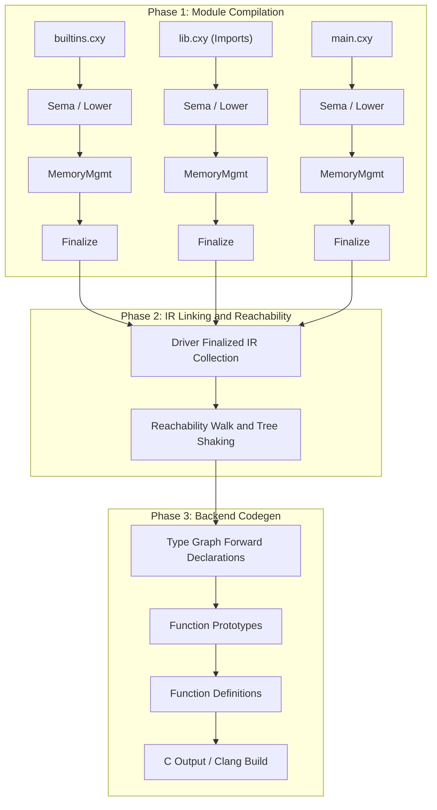

# Multi-Module IR Compilation & Whole-Program Codegen Architecture

## 1. Overview & Motivation

Historically, compilation stages through backend code generation were triggered per compilation unit in isolation. When `builtins` or imported modules were compiled, their generated code or IR was either discarded, emitted separately, or required ad-hoc prototype synthesis.

By compiling **all** compilation units through Middle IR lowering, memory management, and finalization into a centralized collection of finalized `IrModule` instances, we achieve:
1. **Clean Separation of Frontend/Middle vs. Backend**: All language semantics, type checks, RAII insertions (`MemoryMgmt`), and control flow optimizations (`Finalize`) happen in middle IR before any backend sees the code.
2. **Whole-Program Type & Symbol Discovery**: Types, function prototypes, and global variables across `builtins`, imported modules, and `main` are fully resolved before code emission begins.
3. **Dead Code Elimination & Tree Shaking**: Unused functions and types from `builtins` and imported libraries can be marked as unreachable and omitted during final codegen.
4. **Deterministic, Collision-Free Single-Pass Codegen**: Types, forward declarations, and static functions are emitted in a single translation unit in topological dependency order.

---

## 2. Compilation Phases



---

## 3. Pipeline Execution Flow

### Step 1: `builtins` Compilation
- `compileBuiltin()` parses and compiles `__builtins.cxy` with `program->flags |= flgBuiltinsModule`.
- Runs stages: `Parse` $\to$ `Bind` $\to$ `TypeCheck` $\to$ `Simplify` $\to$ `Lower` $\to$ `MemoryMgmt` $\to$ `Finalize`.
- The resulting `IrModule` (module name `"builtins"`) is added to `CompilerDriver.finalizedModules`.

### Step 2: Main Module Compilation & Recursive Import Lowering
- Main file begins compilation with `program->flags |= flgMain`.
- During `TypeCheck` / `Bind`, when an import is encountered (e.g. `import "lib.cxy"`):
  - `compileModule()` is invoked on `lib.cxy` with `program->flags |= flgImportedModule`.
  - `lib.cxy` runs stages `Parse` $\to$ `Finalize`.
  - The finalized `IrModule` for `lib.cxy` is added to `CompilerDriver.finalizedModules`.
- `main.cxy` finishes stages `Lower` $\to$ `MemoryMgmt` $\to$ `Finalize`.
- The finalized `IrModule` for `main.cxy` is added to `CompilerDriver.finalizedModules`.

### Step 3: Whole-Program Codegen
- If the target stage includes `ccsCodegen` (e.g. `cxy build`, `cxy dev --last-stage=Codegen`, or `cxy test`):
  - Backend codegen is invoked across the collection of all `driver.finalizedModules`.
  - Emits:
    1. Aggregated Type Graph (`typedef struct ...`)
    2. Function Prototypes (`static ...` or `extern ...` without hints)
    3. Function Definitions starting with `builtins`, then imported modules, ending with `main`.

---

## 4. CompilerDriver Structure Changes

`cxy/src/cxy/driver/driver.h`:

```c
typedef struct CompilerDriver {
    ...
    DynArray finalizedModules; // Collection of IrModule* pointers
    ...
} CompilerDriver;
```

---

## 5. Implementation Plan

### Phase 1: Pipeline & Driver Integration (Foundation)
- [x] **Ordered Module Registration (`driver/driver.c`, `driver/stages.c`)**
  - `driver->finalizedModules` initialized in `initCompilerDriver` and deallocated in `deinitCompilerDriver`.
  - `compileBuiltin` parses and compiles `__builtins.cxy` up to `ccsFinalize`, pushing `IrModule: builtins` first.
  - `compileModule` compiles imported libraries up to `ccsFinalize`, pushing modules in depth-first order.
  - `compileProgram(main)` compiles `main` through `ccsFinalize`, pushing the main module last.
  - `executeFinalize` prevents duplicate registration.
- [x] **Symbol & Module Naming Verification (`ir/lower.c`, `backend/c/generate.c`)**
  - `builtins`: symbol prefix `builtins_` for internal methods/types, bare name for extern libc.
  - `imported modules`: symbol prefix `<module>_`.
  - `main`: bare symbol names without `main_` prefix.
  - `@hint` functions: marked with `flgHint` and skipped in IR function prototype emission.
- [x] **Dataflow-Based Definite Initialization & Drop Elaboration (`middle/memory/manage.c`)**
  - CFG construction (`buildFunctionCfg`) extracting predecessor and successor edge graphs.
  - Intra-block `Gen` / `Kill` computation.
  - Fixed-point forward May/Must dataflow analysis.
  - `__drop_flags` synthesis and selective static `irDrop` vs conditional `irDropIf` elaboration.

### Phase 2: Whole-Program Reachability & Tree Shaking (`middle/ir/reachability.c`)
- [x] **Root Collection (`collectRoots`)**
  - Locate `main()` / `_main()`.
  - Locate test case entry points (`hasFlag(func, TestContext)` or `allTestCases`).
  - Locate exported symbols when building plugins (`hasFlag(func, Public)`).
- [x] **Graph Traversal & Marking (`markReachableSymbols`)**
  - From root functions, traverse IR statements and expressions:
    - `irCall` / `irGlobalRef` $\to$ mark callee/target `irFunction` as `flgReachable`.
    - `irVarRef` to global variable $\to$ mark `irGlobalVar` as `flgReachable`.
    - `irAddrOf` $\to$ mark referenced global variable or global function as `flgReachable`.
    - `irDrop` / `irCopy` $\to$ mark lifecycle operators as `flgReachable`.
  - Traverse basic blocks and CFG branches to discover all transitively referenced symbols.
- [x] **Module Pruning**
  - Only reachable functions, globals, and types are emitted into the final C translation unit.

### Phase 3: Centralized Backend Codegen (`backend/c/generate.c`, `backend/c/typegraph.c`)
- [x] **Aggregated Type Graph Synthesis**
  - `emitTypeGraphDefinitions` iterates all modules in `driver->finalizedModules`.
  - Emits forward declarations and full struct/union/tuple definitions in dependency order.
- [x] **Unified Function Prototype Emission**
  - `emitFunctionPrototypes` iterates all finalized modules, emitting `static` prototypes and non-hinted `extern` declarations.
- [x] **Sequential Function Definition Emission**
  - Emits global variables and function bodies across all finalized modules (`builtins` $\to$ imports $\to$ `main`).
- [x] **Driver Entry Point Wrapper**
  - Emits `int main(int argc, char **argv)` calling the resolved root `mainFunc`.

### Phase 4: Verification & Regression Testing
- [ ] Run test suite for basic RAII and memory tests:
  - `01_basic_raii.cxy`
  - `02_reassignment.cxy`
  - `03_conditional_drop_flags.cxy`
  - `04_nested_loops_unwind.cxy`
  - `05_aggregates.cxy`
- [ ] Verify multi-module imports and `builtins` tree-shaking reduction in generated output.

---

## 6. Benefits & Future Optimizations
- **Dead Code Elimination (Tree-shaking)**: Reachability graph starting from `main()` marks used symbols; unvisited functions and struct definitions in `builtins` are skipped in codegen.
- **Cross-Module Inline Expansion**: Small pure functions from imported modules can be inlined directly in IR before finalization.
- **Unified Diagnostic Verification**: IR snapshot tests can dump individual or linked IR modules cleanly.
