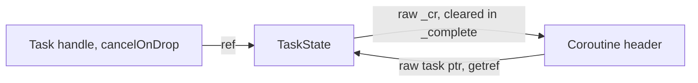

# Coroutine `Task` Design Notes

Design notes for adding a joinable / cancellable / wakeable `Task` to the
coroutine library (`stdlib/coro.cxy`). Status: **proposal, not implemented**.

## Motivation

`async f()` is fire-and-forget. Nothing can wait for a coroutine, stop it, or
wake it early. This makes it hard to give a background coroutine the same
lifetime as the object that owns it:

- A coroutine started from a method usually captures a raw `this`.
- If the owner is destroyed while the coroutine is still queued, the next
  scheduler switch runs it on freed memory.
- The only workaround today is a flag plus a spin loop in the owner's
  destructor (`while running { yld() }`), with a channel or similar to tell the
  coroutine to stop.

A `Task` handle replaces the channel, the flag and the spin loop. It also gives
long-lived blocking loops (reading from a file descriptor, receiving from a
channel) a clean shutdown path.

## Proposed API

```cxy
class Task {
    _cr: ^Coroutine = null      // cleared in _finish()
    _cancelled = false          // sticky
    _permit = false             // wake() before park() is not lost
    _done = false
    _joiners: List[Coroutine]

    func park(ms: i64 = 0): bool   // false => cancelled. ms == 0 => indefinite
    func wake()                    // resume a parked task early
    func cancel()                  // set flag + wake with CANCELLED result
    func join()                    // suspend until the task finishes
    func done(): bool
    func cancelled(): bool
}
```

Usage:

```cxy
var t = @async worker()
...
t.cancel()
t.join()
```

Inside the task:

```cxy
func worker() {
    var task = currentTask()
    while task.park() {          // woken normally
        task.park(100)           // sleep 100 ms, still cancellable
    }                            // park() == false => cancelled, exit
}
```

`yld()` keeps its current meaning (reschedule immediately). `park` is a
different operation (block until woken, timed out, or cancelled), so it gets a
different name. `park` returns `true` on wake or timeout and `false` only when
cancelled.

## Semantics

- **Cancellation is cooperative.** A coroutine cannot be killed: its stack holds
  live RAII objects, smart pointers and open handles. Cancel sets the flag and
  wakes the coroutine; the code unwinds itself.
- **Sticky cancel.** Once cancelled, every later `park()` returns `false`
  immediately.
- **Wake permit.** If `wake()` arrives while the task is running (or blocked in
  something other than `park`), the next `park()` returns immediately. Without
  this, wakeups are lost (e.g. a task woken in the middle of a scan).
- **`cancel()` does not wait.** Use `t.cancel(); t.join()`.
- **Dropping the handle detaches** (current fire-and-forget behaviour). It does
  not cancel. Owners that need cleanup do `cancel(); join()` in their
  destructor.
- **`join()`** returns immediately if done; otherwise adds `running()` to
  `_joiners` and suspends. `_finish()` resumes all joiners.

## Reaching library code (important)

`cancel()` must also interrupt tasks blocked inside library calls, not only in
`task.park()`. Examples: `Channel.receive`, `fdWaitRead`, `sleepAsync`.

Plan:

1. Give `Coroutine` a back-pointer: `cr.task` (null when spawned without a
   task).
2. `cancel()` resumes the coroutine with a reserved result code (e.g.
   `AE_CANCELLED`).
3. `timeout()`, `fdWaitRead/Write` and `Channel.receive/send` already treat a
   result that does not match their event as failure and return early. Verify
   each one cleans up its own timer / file event after `suspend()` returns.
4. A loop that blocks in `fdWaitRead` returns early when the result is not
   `AE_READABLE`, so `while task.park()` (or a `cancelled()` check) observes the
   cancel on its next iteration.

## Injection vs ambient lookup

Two ways for the task body to reach its `Task`:

### A. Injected parameter (`@task`)

```cxy
@task
func hello() {          // compiler injects `task` as a hidden parameter
    while task.park() { ... }
}
```

- Explicit. No hidden global state.
- Costs: hidden parameter complicates overloads, lambdas, function pointers and
  methods (`this` vs `task` position). `hello()` called directly has no `task`
  (needs an inert dummy or a compile error). Helpers called from `hello`
  do not get the task unless threaded through by hand.

### B. Ambient lookup (recommended first)

```cxy
func hello() {
    var task = currentTask()   // running().task, null if none
    while task.park() { ... }
}
```

- Works from any call depth, so library code can check cancellation itself.
- No `@task` attribute and no hidden parameters.
- Compiler work is limited to making `@async f()` an expression that returns a
  `Task`.

Both can coexist later (A as sugar over B).

## Lowering of `@async` (compiler support)

The existing codegen for `@async` does inline `setjmp` / `prologue` / `sp`
switch / call / `epilogue` in the caller's frame, so a plain library function
cannot spawn. `var t = @async f(args)` needs to lower to roughly:

```cxy
var __t = Task()                 // heap class: child runs on another stack
cr = prologue(...)               // child runs first, parent is queued
__t._cr = cr
cr.task = __t                    // retain
f(args)                          // or f(__t, args) for injected form
__t._finish()                    // _done = true, wake joiners, _cr = null, drop ref
epilogue()
// parent resumes later:  t = &&__t
```

Notes:

- Observed in the coro trace: the child runs first, the parent is resumed
  afterwards, so `__t._cr = cr` can be set right after `prologue()` with no gap.
- `Task` **must** be heap allocated (class). A moved struct would point into the
  parent's stack frame.
- Two variants: `async f()` is unchanged (detached, no allocation).
  `@async f()` allocates a `Task[T]` and must use the result; discarding it is a
  compile error.
- `_finish()` must run before `epilogue()`, which returns the stack to the pool.
  `Coroutine` headers live at the top of pooled stacks, so a raw `_cr` would
  dangle or alias a later coroutine if not cleared.
- If `f` raises (`!`), `_finish()` should still run.

## Scheduler hazards

1. **Double resume.** `wake()`, a timer and an fd callback can all resume the
   same coroutine. `ready` is an intrusive list through `cr.link`, so a second
   push corrupts it.
   - Make `resume()` a no-op when `cr.ready` is already set.
   - A parked `park(ms)` must delete its time event after waking (as
     `timeout()` already does).
2. **Threads** (`__CXY_THREADS_ENABLED__`). `cancel`, `wake` and `join` from
   another thread must go through the `resumeAndWake` pending queue.
   `_cancelled`, `_permit`, `_done` and `_cr` need atomics.
3. **No RC cycles.** The coroutine holds a reference to the `Task`; the `Task`
   holds `_cr` raw. Keep it that way.

## Findings from the current implementation (`stdlib/coro.cxy`)

These constrain the design and are why the runtime has to be hardened before
`Task` can be added.

1. **`async` is a library macro, not a compiler feature.** `__async(CALL, NAME)`
   expands inline in the caller: `setjmp` on the parent, `prologue()` (allocates
   a stack, queues the *parent*, makes the child current), `__cxy_coro_setsp`
   to the child stack, `CALL!`, `epilogue()`. Everything the child needs after
   the `setsp` must not live in a parent register or in a local that is
   modified after `setjmp`: the existing macro re-fetches the scheduler instead
   of reusing `__sched` for that reason.
2. **The `Coroutine` header lives at the top of the pooled stack**
   (`prologue`: `stack - sizeof(Coroutine)`). `epilogue()` hands the stack back
   to the cache and then calls `suspend()` on it, so the header may be reused by
   the next `prologue()`. Any raw `^Coroutine` kept elsewhere (the `Task`,
   `Channel._in/_out`) dangles once the coroutine exits.
3. **`cr.link` is shared.** The ready queue and every waiter list
   (`CoWaitGroup`, `Mutex`, `Semaphore`, `ConditionVariable`, `WaitGroup`,
   `SharedChannel`, and the future `_joiners`) are intrusive lists through the
   same `link` field. A coroutine in a waiter list must **not** be pushed onto
   the ready queue: it would corrupt both lists. Today this cannot happen
   because only the primitive that parked the coroutine resumes it. `cancel()`
   and `wake()` break that assumption.
4. **`resume()` has no guard.** It sets `ready = true`, overwrites `result` and
   pushes. A second resume (timer + fd event, wake + timer, cancel + event)
   pushes the same coroutine twice. `suspend()` asserts `coro.ready` when popping
   but nothing prevents the double push.
5. **`suspend()` returns `running.result`.** Callers interpret it: `fdWait*`
   return it (AE mask), `timeout()` returns `by == status` (the timer id is used
   as the result), `Channel.send/receive` rely on `timeout(dd)` returning
   `true` only for the timer. A cancel code must therefore be a reserved
   negative value that cannot equal an `AE_*` mask, `ae.Status` value or timer
   id.
6. **`sleep(ms)` does not delete its time event** after `suspend()` returns.
   That is fine today (only the timer wakes it). With early wake the event stays
   armed and later resumes a stale or reused coroutine. `timeout()`,
   `fdWait*` and `pidWait` already clean up after `suspend()`.
7. **Stale waiter entries.** `ConditionVariable.waitTimeout` already documents
   that a timed-out waiter stays in the list. `Semaphore.acquire` and
   `CoWaitGroup.wait` also never unlink on an early wake.
8. **Threads.** `ready` is a plain `bool`; `resumeAndWake` is the only
   cross-thread entry (`pending` queue guarded by `pendingMtx`, then
   `aeWakeup`). `Coroutine.scheduler` identifies the owning scheduler.

## Implementation plan

The work splits into a library part that can be built and tested with no
compiler changes, and a small compiler part that only exposes it as syntax.

### Phase 0: runtime hardening (`coro.cxy`)

1. **Cancel code.** Add `AE_CANCELLED = -2` to `enum Status` in
   `native/evloop/ae.h` (`-1` is already `AE_ERR`, `AE_NO_MORE` and
   `AE_DELETED_EVENT_ID`). It lives in `Status`, not `State`: results share the
   space of timer ids (non-negative) and fd masks (`1, 2, 4, 8`), so a negative
   value cannot collide with either. `timeout()` checks
   `by == ae.Status.AE_CANCELLED` **before** `by == status`; `fdWait*` return it
   to the caller as "not the event I asked for".
2. **`Coroutine` fields** (append at the end; the header is raw stack memory
   initialised field by field in `prologue`, so **initialise every new field
   there**):
   - `task: ^void` (back-pointer to the `Task`, `null` when none; `^void`
     avoids declaring `Task` before `Coroutine`),
   - `interruptible: bool` (set only while blocked in a cancel-safe wait).
3. **`resume()` guard.** `if cr.ready { return }` before the push. For the
   cancel path add `resumeCancel(cr)`: if `cr.ready`, only overwrite
   `cr.result = ae.Status.AE_CANCELLED` (no push); otherwise behave like `resume`.
   `yld()` and `prologue()` call `resume` on a coroutine whose `ready` is
   `false`, so they are unaffected.
4. **`suspendInterruptible()`** = set `running.interruptible = true`, `suspend()`,
   clear it. Use it in `fdWaitRead/Write`, `pidWait`, `timeout`, `sleep`,
   `Channel.send/receive`, and in `Task.park`. Waiter-list primitives (rule 3
   above) keep plain `suspend()`: they are **not interruptible**, `cancel()`
   only sets the flag and the coroutine notices at its next cancel-safe point.
   This is the simplest rule that keeps the shared `link` invariant.
5. **Fix `sleep`.** Keep the timer id, `aeDeleteTimeEvent` after `suspend()`
   (same pattern as `timeout`).
6. **Channels.** After `timeout(dd)` returns, re-check cancellation:
   `receive` returns `null`, `send` returns without pushing (it currently
   pushes into a full buffer and discards the value). `_in`/`_out` are already
   cleared after the wait, keep that on every exit path.
7. **Threads.** `cancel`/`wake` for a coroutine owned by another scheduler call
   `resumeAndWake` (see `resumeWaiter` in the `#if` block); make `ready` and
   `interruptible` atomic or perform the check under `pendingMtx`.

### Phase 1: `Task` class (library only)

```cxy
pub class Task {
    _cr: ^Coroutine = null
    _cancelled = false
    _permit = false
    _parked = false
    _done = false
    _joiners = List[Coroutine]{}
    #if (defined __CXY_THREADS_ENABLED__) { _mtx = tinyThread.mtx_t{} }
}
```

- `park(ms)`: return `false` if `_cancelled`; consume `_permit` and return
  `true` if set; otherwise `_parked = true`, wait (`timeout(ms)` if `ms > 0`,
  `suspendInterruptible()` otherwise), `_parked = false`, return `!_cancelled`.
- `wake()`: if `_parked` resume the coroutine with result `0`, else set
  `_permit`.
- `cancel()`: set `_cancelled`; if `_cr != null && _cr.interruptible` call
  `resumeCancel`. Otherwise the flag is observed later (rule 3).
- `join()`: return if `_done`, else push `running()` on `_joiners` and
  `suspend()` (not interruptible).
- `_finish()` (child stack, **before** `epilogue()`): `_done = true`,
  `_cr.task = null`, `_cr = null`, resume every joiner (cross-thread aware),
  release the reference the coroutine held.
- `currentTask()` = `running().task` cast back to `Task`, `null` for the main
  coroutine or a coroutine spawned without a task.
- Ownership: `Task` is a heap class shared by the handle and the coroutine.
  The coroutine side is a raw back-pointer, so take the extra reference with
  the existing `getref`/`dropref` builtins (see `S_getref`, `S_dropref` in
  `strings.h`; confirm their exact semantics before use) and drop it in
  `_finish()`. The `Task` never owns the coroutine (`_cr` is raw), so there is
  no cycle.

Phase 1 can spawn with a second library macro, no compiler support needed:

```cxy
macro __async_task(CALL, NAME) =({
    var __task = Task()                         // before setjmp, see below
    var __sched = module.__get_scheduler()
    if (__cxy_coro_setjmp!(ptrof __sched.running.ctx) == 0) {
        var cr = __sched.prologue(NAME!, file!, line!)
        __task._cr = cr
        cr.task = getref!(__task)
        __cxy_coro_setsp!(cr !: ^void)
        CALL!
        module.currentTask()._finish()          // via the header, not via locals
        module.__get_scheduler().epilogue()
    }
    __task
})
```

Two constraints come from the `setjmp` model:

- `__task` must be assigned **before** `setjmp`. A value assigned between
  `setjmp` and the second return may be a stale register copy on resume.
- After `setsp` the child must reach the task through `cr`/`currentTask()`, not
  through parent locals.

Usable today as `module.__async_task!(f(), "f")`, which lets the library be
tested before touching the compiler.

### Phase 2: compiler

The compiler changes are small because the expansion stays in the library. The
relevant AST pieces are the `launch` node (`ast.h`: `launch { name, closure }`),
`launchExpression` in `parser.c`, and the interned names `S___async`,
`S_asyncLaunch`, `S_asyncLaunchMember`, `S_Coroutine`, `S_Promise` in
`strings.h`. The pass that rewrites `@async f()` into the `__async` macro call
still has to be located and confirmed.

1. **Two variants.** `async f()` keeps today's expansion (`__async`, detached).
   `@async f()` is an expression expanding to `__async_task`.
2. **`@task` gate.** `@async f()` is only allowed when the callee `f` carries the
   `@task` attribute. `@task` is a marker (no hidden parameter, injection stays
   deferred): it declares that `f` is written to run as a cancellable task.
   Sema error otherwise: "`@async` requires a function marked `@task`".
   - Add `task` to `CXY_BUILTIN_NAMES` (`strings.h`) and check
     `findAttribute(funcDecl, S_task)` on the resolved callee.
   - Callee kinds: free functions, member functions, and static member
     functions. Closures and function pointers have no declaration to carry the
     attribute, so they are rejected.
   - Plain `async f()` is unaffected and accepts any function.
   - `@task` functions may raise (`!T`). Errors are handled by a synthesized
     wrapper, see item 6.
3. **Grammar.** Accept `@async call` in expression position (right-hand side of
   `var`, assignment, argument, `return`).
4. **Sema: result type.** `@async f()` has type `coro.Task[T]` where `T` is the
   return type of `f` (`void` allowed). Error when the parent is an `ExprStmt`:
   "result of `@async` must be used (use `async` to detach)". Resolve `Task`
   from the coroutine module the same way the existing expansion resolves
   `__async`.
5. **Expansion.** `__async_task` is a statement-expression macro (`=({ ... })`),
   a form `coro.cxy` already uses for `__cxy_coro_setjmp`.
4. **Memory management.** The macro result is an owned class value, so
   `var t = @async f()` moves it into `t`. Verify with the memory pass dumps:
   - the `if (setjmp == 0)` child path ends in `epilogue()`, which never
     returns, but IR still flows to the merge block. Dropping `__task` on that
     static path must not double-drop. Marking `epilogue` as noreturn would let
     lowering end the path with `unreachable`. Only `extern` functions support
     `@[noreturn]` today (see the attribute work in `lower.c`/`generate.c`),
     so either move `epilogue`'s tail into a native helper or leave the
     analysis as is and test it.
   - `CALL!` temporaries are dropped by the child before `_finish()`.
6. **Wrapper function (shake stage).** For every `@task` function `f` the
   compiler synthesizes a sibling `_task_f(<same params>): void` next to it, using
   the same AST-building helpers `shake.c` already uses for synthesized
   declarations (`shakeTestDecl`, `makeFunctionDecl`, `makeCallExpr`, ...):
   - parameters cloned with their default values (so `@async f()` may omit
     them); generic parameters, `this` and static-ness copied from `f`; same
     visibility; same name overloading (identical parameters resolve like `f`);
   - body is one macro call `module.__task_run!(f(p1, p2, ...))`.
   `f` itself is untouched, direct calls behave as before.
7. **`__task_run!(CALL)` (in `coro.cxy`).** Expanded inside the wrapper, so
   `return` is local to the wrapper. With `Callee = callee!(CALL!)` and `R` the
   unwrapped return type:
   - non-raising void: `CALL!`;
   - non-raising value: `task._set(CALL!)`;
   - raising: `var v = CALL! catch as ex { task.throw(ex); return }` then
     `task._set(&&v)` (void: `CALL! catch as ex { task.throw(ex); return }`).
   The task is obtained with `module.__currentTask[R]()`, `R` coming from the
   callee type, so no enclosing-function builtin is needed. The wrapper only
   records the outcome; the spawn macro calls `_finish()` after the wrapper
   returns, so `f`'s and the wrapper's locals are destroyed before joiners run.
8. **`@async f(args)` expansion.** `__async_task(CALL, NAME)` spawns the wrapper
   instead of `f`: a builtin renames the callee of the call, `x.y(args)` becomes
   `x._task_y(args)` (member target and explicit generic arguments kept).
   `Task[R]` is created from the original callee type. `@task` presence is
   checked with `require!(Callee.attributes.[:task], ...)`.
9. **`callee!(CALL!)`.** New builtin in `eval/macro.c`. Clones the callee of a
   `CallExpr` argument and wraps it as `typeof!(x.y)` (untyped AST, the call is
   never typed, so no raise bubble-up check and no double typing). Errors at the
   argument if it is not a call. Limitations: overloaded callees and generic
   callees whose type arguments are inferred cannot be resolved from the callee
   alone (they are needed for `R`) and are rejected; closures and function
   pointers have no declaration and fail the `@task` check.
10. **Attributes of a function type.** `typeof!(x.y)` is a type reference, which
    has no `attrs`. Make the `attributes` comptime member (`getAttributes` in
    `eval/comptime.c`) fall back to `type->func.decl->attrs` for `Func` types.
11. **Error location.** `require!` reports at its own node (inside `coro.cxy`).
    Add the macro-expansion frame from `LOGS.md` so the error also points at
    the user's `@async` line.
6. **No new IR or backend work.** `setjmp`/`longjmp` are already `returns_twice`
   in the native context file, and `Task` is an ordinary class.

Injection (`@task` hidden parameter) is deliberately left out of Phase 2. If it
is added later it can be sugar that lowers to `currentTask()` at function entry.

### Phase 3: audit and tests

- Audit every `suspend()` call site and classify it (interruptible or not);
  document the classification in `coro.cxy`.
- Tests (stdlib `coro` test file, run in both threaded and non-threaded builds):
  join after finish, join before finish, cancel while parked, cancel while in
  `sleep`, cancel while in `fdWaitRead` and `Channel.receive`, cancel while in a
  non-interruptible wait (flag set, observed later), `wake()` before `park()`
  (permit), wake + timer + cancel arriving together (no double push), detach on
  drop, `Task` freed while the coroutine still runs (`cxy utils mem diff` shows
  no leak), cross-thread `cancel`/`join`.

## `Task[T]`

- `class Task[T]` adds `_value: T?` and `_error: Exception` (null if none).
  `Task[void]` has neither value slot.
- `join(): !T`: suspends until done, then returns the value or raises the stored
  exception. Joined once; a second `join()` raises or returns the same value
  (decide: move out on first join).
- `_set(value)` records the value and `throw(ex)` records the error `join()`
  raises (the first one wins). Neither finishes the task: the function returns
  normally and its destructors run first.
- `_finish()` is called once by the spawn macro on the child stack, after the
  wrapper returns and before `epilogue()`.
- A recorded error with no joiner is dropped with the task.

## Decisions

- Injection (`@task`) and `currentTask()`: deferred. `park`/`wake` need a handle,
  so until ambient lookup exists the task body gets the handle through a
  captured variable or argument.
- `Task[T]`: supported (see above).
- Cancel-on-drop / `@async(autocancel)`: future work, not part of the first
  implementation (see the last section). `Task[T]` is a single shared class until
  then.
- Task groups / structured scopes: out of scope.

## Future work: cancel on drop (`@async(autocancel)`)

Status: **deferred**. Nothing in Phases 0-3 depends on it.

Surface syntax: `@async(autocancel) f()` (attribute argument, or `autocancel = true`)
sets the initial flag; a runtime `t.autocancel(on)` method overrides it. Sema
accepts only that argument and rejects it where the handle is not bound
(argument, `return`), since a temporary handle would cancel and join at the end
of the statement. Use the name `autocancel` for the attribute, the field
(`_autocancel`) and the method; it replaces `cancelOnDrop` below.

Default: dropping the last handle detaches the coroutine. Opt-in: dropping the
last handle runs `cancel(); join()` so the coroutine has exited before the
owner's memory is freed. Owners no longer write `cancel(); join()` in `deinit`.

### Handle / state split (required for this feature only)

The coroutine holds a reference to the task (back-pointer retained via `getref`),
so the task's refcount never reaches zero while the coroutine runs. "Last handle
dropped" therefore cannot be a destructor on the shared object. Split it:

- `TaskState[T]`: the shared heap class from the sections above (`_cr`,
  `_cancelled`, `_permit`, `_done`, `_joiners`, `_value`, `_error`). Referenced by
  the coroutine (`cr.task`) and by handles.
- `Task[T]`: the user-facing handle, a class holding a `TaskState[T]` reference
  and `_cancelOnDrop: bool`. Only handles are visible to users; copies of a
  handle bump the handle's own refcount, so the handle `deinit` runs exactly once,
  when the last copy is dropped.



### API

- `t.cancelOnDrop(on = true): Task[T]` sets the flag, returns the handle (chain
  with `@async`). Default `false`.
- Handle `deinit`:
  1. return if `_state.done()` or the flag is off (detach);
  2. return after `cancel()` only if the drop happens on the task's own
     coroutine (`running() == _state._cr`; joining yourself deadlocks);
  3. if no scheduler is running (process shutdown, global destructors) `cancel()`
     only;
  4. otherwise `cancel(); join()` and ignore the stored error/value.
- The main coroutine is a `Coroutine` too, so `join()` from `deinit` on the main
  stack suspends normally and the scheduler runs the worker to completion.

### Hazards

- `join()` is not interruptible. A worker blocked in a non-interruptible wait
  (`Semaphore`, `Mutex`, `ConditionVariable`, `WaitGroup`) delays the drop until
  its next cancel-safe point; a worker that never reaches one hangs the owner's
  destructor. Audit workers used with cancel-on-drop.
- A suspending destructor runs at scope exit and at every owner drop, including
  error unwinding paths. Verify the memory pass accepts a drop that yields to
  other coroutines (locals of the dropping frame stay valid, they live on its own
  stack).
- Handles stored in a struct that is moved across threads: `deinit` must `join`
  through `resumeAndWake`, never through the local scheduler of the thread that
  created the task.
- Dropping the handle on the worker's own coroutine (rule 2) leaves it detached;
  document as a footgun.

### Tests

- owner with a parked worker is dropped: worker exits before the owner memory is
  released (`cxy utils mem diff` clean, no use after free under ASan);
- flag off: coroutine keeps running after the drop;
- handle copied: only the last drop cancels;
- drop from the worker's own coroutine does not deadlock;
- drop during shutdown with no scheduler cancels without joining;
- worker blocked in `sleep` / `fdWaitRead` / `Channel.receive` is woken by the drop;
- worker blocked in `Semaphore.acquire` delays the drop until released.

## Implementation checklist

Phase 0 (runtime hardening)
- [x] `AE_CANCELLED = -2` in `ae.h` `Status`; `timeout()` checks it first
- [x] `Coroutine.task` and `Coroutine.interruptible`, initialised in `prologue`
- [x] `resume()` guard against double push; `resumeCancel`
- [x] `suspendInterruptible()` and its use in `fdWait*`, `pidWait`, `timeout`,
      `sleep`, `Channel`
- [x] `sleep` deletes its time event after waking
- [x] `Channel.send/receive` return early on cancel
- [x] Atomic `ready` / `interruptible`, cross-thread cancel via `resumeAndWake`

Phase 1 (library)
- [x] `Task[T]` (`park`, `wake`, `cancel`, `join`, `done`, `cancelled`,
      `_complete`, `throw`)
- [x] `currentTask()`
- [x] `__async_task` macro, usable as `__async_task!(f(), "f")`

Phase 2 (compiler)
- [ ] Locate the `@async` / `launch` expansion and confirm the macro hand-off
- [ ] `task` interned name; sema rejects `@async` on a callee without `@task`
      (closures and function pointers rejected)
- [ ] `@async call` in expression position; `async` unchanged
- [ ] Sema: type `Task[T]`; error when the result is discarded
- [ ] `callee!` builtin; `getAttributes` fallback for `Func` types
- [ ] Shake: synthesize `_task_f` wrapper for `@task` functions
- [ ] `__task_run!` macro; `_set` / `_finish` split in `Task`
- [ ] Builtin renaming the callee of a call to `_task_<name>`; `__async_task`
      spawns the wrapper, `require!` checks `@task`
- [ ] Macro-expansion frame in `eval/macro.c` (see `LOGS.md`)
- [ ] `Task[T]` (`_value`, `_error`, `join(): !T`)
- [ ] Memory pass check of the child path that never returns

Phase 3 (audit and tests)
- [ ] Classify every `suspend()` call site
- [ ] Tests listed under Phase 3
