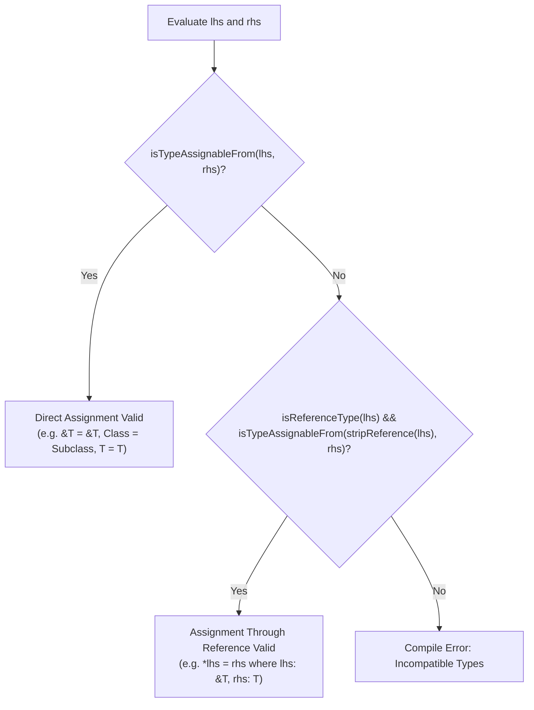

# Cxy Type Assignability Matrix & Rules

This document outlines the type assignability rules in Cxy (`isTypeAssignableFrom(to, from)`) and the assignment expression evaluation rules in `assign.c` (`checkAssignExpr`).

---

## 1. Assignment Expression Evaluation (`lhs = rhs`)

When evaluating an assignment expression `lhs = rhs`, the compiler resolves assignability as follows:



---

## 2. Master Assignability Matrix (`isTypeAssignableFrom(to, from)`)

| Target Type (`to`) | Source Type (`from`) | Assignable? | Semantics / Rules |
| :--- | :--- | :--- | :--- |
| **`&T` (Reference)** | `&T` (Reference) | **Yes** | Reference-to-reference binding (e.g. `this.field = refParam`). `to->referred` and `from->referred` must be compatible. `const` to non-`const` is disallowed. |
| **`&T` (Reference)** | `T` (Value) | **No** (Direct) / **Yes** (Through Ref) | Direct `to = from` cannot bind a temporary rvalue without explicit `&`. If assigning to existing reference variable, dereferences to `*to = from`. |
| **`T` (Value Struct/Prim)** | `&T` (Reference) | **No** | Implicit conversion from reference to value is not supported; requires explicit dereference `*ref` or copy. |
| **`T` (Value)** | `T` (Value) | **Yes** | Identity assignment. |
| **`Class` (Base)** | `Class` (Derived) | **Yes** | Object-oriented polymorphism (derived classes inherit from base class). |
| **`Class` (Derived)** | `Class` (Base) | **No** | Downcasting requires explicit cast. |
| **`^T` (Pointer)** | `^T` (Pointer) | **Yes** | Pointer assignment if pointed types are assignable. Const violation disallowed. |
| **`^void` (Void Pointer)** | `^T` / `[T]` / `string` / `Class` | **Yes** | Implicit conversion to generic `^void` pointer. |
| **`^T` (Typed Pointer)** | `^void` (Void Pointer) | **No** | Unsafe void-pointer cast requires explicit cast. |
| **`^T` (Pointer)** | `null` | **Yes** | `null` literal is assignable to any pointer type. |
| **`?T` (Optional)** | `T` (Value) | **Yes** | Implicit wrapping into `Some(value)`. |
| **`?T` (Optional)** | `?T` (Optional) | **Yes** | Assignable if underlying target types are assignable. |
| **`?T` (Optional)** | `null` | **Yes** | `null` initializes optional to `None`. |
| **`!T` (Result)** | `!T` (Result) | **Yes** | Result assignment if target types match. |
| **`T` (Value)** | `!T` (Result) | **Unwrapped** | If unhandled in throwing context, unwrapped automatically to `T`. |
| **`[T]` (Slice)** | `T[N]` (Fixed Array) | **Yes** | Fixed-size array implicitly converts/decays to a slice view. |
| **`T[N]` (Fixed Array)** | `[T]` (Slice) | **No** | Fixed-size array cannot be assigned from a slice. |
| **`Primitive Int`** | `Enum` | **Yes** | Enum values implicitly convert to their underlying integer base type. |
| **`Enum`** | `Primitive Int` | **No** | Raw integer cannot implicitly convert to an enum (requires explicit cast). |
| **`Signed Int (N-bit)`** | `Signed Int (M-bit)` | **Yes (N >= M)** | Implicit widening integer conversion. Narrowing requires cast. |
| **`Float`** | `Integer` | **Yes** | Implicit integer-to-float promotion. |

---

## 3. Reference Assignment Scenarios

### 3.1 Scenario A: Reference Field Binding (`&T = &T`)
```cxy
struct FmtTime {
    time: &Time
    func `init`(time: &Time) {
        this.time = time // LHS is &Time, RHS is &Time -> Directly Valid
    }
}
```

### 3.2 Scenario B: Assignment Through a Reference (`*ref = val`)
```cxy
func update(val: &i32) {
    val = 42 // LHS is &i32, RHS is i32 -> Assigns 42 into the referenced storage
}
```
