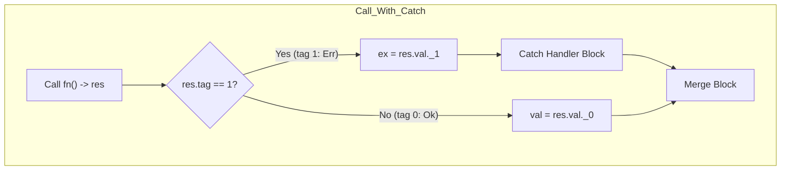

# Cxy Exception Handling & IR Lowering Design

## 1. Overview & Motivation

In Cxy, exceptions are statically typed values (`!T`), represented at runtime as tagged union result types (`Result[T]`):
- **Tag 0 (`ok`)**: Successful return value of type `T`.
- **Tag 1 (`err`)**: Raised exception value implementing the `Exception` protocol/class.

Previously, parts of the frontend (`shake`, `sema/exception.c`) attempted to rewrite `raise` and `catch` into synthetic `AstNode` trees (`if`, `VarDecl`, `Path`). This led to brittle AST mutations, scope binding invalidation, and fragile RAII cleanups.

This document formalizes the redesign where:
1. **Frontend (`Parser` & `Sema`)**: Parses syntax and performs **pure semantic validation & type checking** without mutating or synthesizing AST trees.
2. **Lowering (`ir/lower.c`)**: Desugars `!T`, `raise`, automatic call bubble-up, and `catch` directly into control-flow graph (CFG) basic blocks, tagged-union assignments, and branch instructions.

---

## 2. Syntax Specifications

### 2.1 Result Types & Raising
Functions that can raise must declare their return type with `!T`:
```cxy
func parseNumber(str: string): !i32 {
    if (len!(str) == 0) {
        raise InvalidArgumentError("empty string")
    }
    return 42
}

func doWork(): !void {
    // Void-returning functions can also raise
    if (failed) {
        raise IOError("disk full")
    }
}
```

### 2.2 Re-raising (Bare `raise`)
Inside a catch block, a bare `raise` re-throws the currently caught exception up the stack:
```cxy
func handle(): !void {
    doWork() catch as ex {
        println("Logging error before re-raising: ", ex)
        raise // Re-throws `ex`
    }
}
```

### 2.3 Catch Syntax Variants

1. **Default Value Fallback**:
   ```cxy
   var val = parseNumber(input) catch 0
   ```
2. **Discard Exception**:
   ```cxy
   doWork() catch discard
   ```
3. **Anonymous Catch Block** (access exception via `ex!`):
   ```cxy
   parseNumber(input) catch {
       println("Failed: ", ex!)
       return 0
   }
   ```
4. **Named Catch Block (`catch as <alias> { ... }`)**:
   ```cxy
   parseNumber(input) catch as err {
       println("Error encountered: ", err)
       return -1
   }
   ```
   *Requirement*: When `as <alias>` is specified, a body block `{ ... }` is required. The `<alias>` is modeled directly as an `astAliasExpr` aliasing the exception payload generated by the lowering stage.

---

## 3. AST & Parser Architecture

### 3.1 AST Representation

In `src/cxy/lang/frontend/ast.h`:
```c
typedef struct CatchExpr {
    AstNode *expr;     // Raising expression (LHS)
    AstNode *var;      // Optional alias expression (`as <alias>`)
    AstNode *body;     // Handler: block, discard, or default value expression
} CatchExpr;
```
`astCatchExpr` is a dedicated expression tag (`CXY_LANG_AST_EXP_TAGS`), completely replacing the former reuse of `astBinaryExpr(opCatch)`.

### 3.2 Parser Grammar (`src/cxy/lang/frontend/parser.c`)
In `binary(P)` when parsing `tokCatch`:
```
catch_expr ::= expression "catch" ( "as" alias_target )? ( "discard" | block | expression )
```
- When `as` is encountered, consume `as`, parse the alias target, and create an `astAliasExpr`.
- Enforce that the following token is `{` (a block statement) whenever `as` is present.
- The alias node is prepended to the catch block's statement list during parsing/binding so that references to the alias within the block resolve naturally.

---

## 4. Compiler Intrinsic Base Exception & C Runtime Foundation

To ensure exception handling functions identically across all compilation modes (including `--without-builtins`, bare-metal, and minimal tests) without hard circular dependencies on `builtins.cxy`, the base `Exception` type and its stack trace structures are implemented as **compiler intrinsics**.

### 4.1 C Runtime Foundation (`src/cxy/runtime/prologue.h`)
The C runtime defines the opaque stack trace buffers and operations:
```c
typedef struct __cxy_call_trace {
    const char *mod;
    const char *cls;
    const char *fun;
    const char *path;
    uint64_t line;
} __cxy_call_trace;

typedef struct __cxy_stack_trace {
    __cxy_call_trace *calls;
    uint64_t size;
    uint64_t capacity;
} __cxy_stack_trace;

static inline __cxy_stack_trace *__cxy_stack_trace_alloc(void);
static inline void __cxy_stack_trace_push(__cxy_stack_trace *st, const char *mod, const char *cls, const char *fun, const char *path, uint64_t line);
static inline void __cxy_stack_trace_destroy(__cxy_stack_trace *st);
```

### 4.2 Compiler Intrinsic `class Exception` (`src/cxy/lang/middle/builtins.c`)
During compiler initialization, the compiler synthesizes the base `class Exception` AST node directly in C:
```cxy
class Exception {
    name: string
    stackTrace: ^__cxy_stack_trace = null

    func `init`(name: string) {
        this.name = name
        this.stackTrace = null
    }

    func `deinit`() {
        if (this.stackTrace != null) {
            __cxy_stack_trace_destroy(this.stackTrace)
            this.stackTrace = null
        }
    }

    virtual func what(): string {
        return this.name
    }

    func push(mod: string, cls: string, fun: string, path: string, line: u64): void {
        if (this.stackTrace == null) {
            this.stackTrace = __cxy_stack_trace_alloc()
        }
        __cxy_stack_trace_push(this.stackTrace, mod, cls, fun, path, line)
    }
}
```

### 4.3 Frontend Semantic Analysis (`sema/exception.c`)

Sema only validates typing and scopes; it **does not synthesize synthetic AST nodes**:

1. **`checkRaiseStmt`**:
   - Verify enclosing function return type is `!T` (`isResultType`).
   - If expression is provided, verify `<expr>` inherits from `Exception`.
   - If bare `raise`, verify it is located inside an enclosing catch handler.
2. **`checkCatchExpr`**:
   - Verify `expr` has type `!T`.
   - If `var` (`as <alias>`) is present, bind alias target to the intrinsic `Exception` type.
   - If `body` is a default value expression, verify `body->type` is assignable to `T`.
   - If `body` is a block, verify it either yields a value of type `T` or exits control flow (`return`, `break`, `continue`, `raise`).
3. **`checkCallExceptionBubbleUp`**:
   - If a call returning `!T` is unhandled (no `catch`), verify the current function also returns `!T`.

---

## 5. IR Lowering (`src/cxy/lang/middle/ir/lower.c`)

`Lower` translates exceptions directly into tagged unions and CFG branching:



### 5.1 Tagged Union Result Representation
A result type `!T` lowers to `irTypeStruct` (tagged union):
- `tag: u32` (0 = value, 1 = exception)
- `val: union { _0: T; _1: Exception; }` (or for `!void`: `tag: u32, val: Exception`)

### 5.2 Exception Trace Push Resolution (`Exception.push`)
- `Lower` looks up `Exception.push` once during context initialization and caches its `IrNode *` callee declaration.
- `push` is non-virtual and invoked via direct static call dispatch.

### 5.3 Lowering `raise <expr>`
1. Evaluate `<expr>` to `IrNode *errVal`.
2. Assign into current function return variable:
   ```c
   retVar.tag = 1;
   retVar.val._1 = errVal;
   ```
3. If exception tracing is active (`ctx->driver->options.withExceptionTrace`), emit a direct `Call` to the cached `Exception.push` member function with arguments:
   `(errVal, moduleName, className, funcName, fileName, line)`.
4. Emit `Branch(ctx->funcExitBlock)` (unwinds local scopes and executes RAII destructors).

### 5.4 Lowering Bare `raise`
1. Re-uses the active exception in the current handler.
2. Emits `Branch(ctx->funcExitBlock)` directly.

### 5.5 Lowering Automatic Call Bubble-Up
When a throwing call `fn()` is invoked without `catch` in a throwing function:
1. Emit `res = Call(fn, args...)`.
2. Emit `BranchIf(Member(res, tag) == 1, unwindErrBB, continueBB)`.
3. In `unwindErrBB`:
   - If tracing is active, emit `Call(Exception.push, Member(res, val._1), ...)`.
   - `Assign(ctx->funcRetVar, res)`
   - `Branch(ctx->funcExitBlock)`
4. In `continueBB`:
   - Value is `Member(res, val._0)`.

### 5.6 Lowering `catch` (`astCatchExpr`)
1. Lower `catchExpr.expr` into `res`.
2. Emit `BranchIf(Member(res, tag) == 1, catchBB, continueBB)`.
3. In `catchBB`:
   - If `catchExpr.var` is present (`as <alias>`), bind `<alias>` to `Member(res, val._1)`.
   - Lower handler body (`catchExpr.body`) or default expression into the target variable.
   - `Branch(mergeBB)`.
4. In `continueBB`:
   - Assign `target = Member(res, val._0)`.
   - `Branch(mergeBB)`.
5. In `mergeBB`:
   - Target holds the unwrapped result.

### 5.7 Tag-Aware RAII Drop & Copy in Backend Codegen (`generate.c`)
Because `Result[T]` is a tagged union carrying an active `Exception` (when `tag == 1`) or an active value `T` (when `tag == 0`):
- `irTypeCatResult` is added to `IrTypeCategory`.
- `emitDrop` for `irTypeCatResult`:
  ```c
  if (target.tag == 1) {
      __smart_ptr_drop(target.val._1);
  } else if (target.tag == 0) {
      // drop target.val._0 if T is destructible
  }
  ```
- `emitCopy` for `irTypeCatResult`:
  ```c
  dst.tag = src.tag;
  if (src.tag == 1) {
      dst.val._1 = __smart_ptr_get(src.val._1);
  } else if (src.tag == 0) {
      // copy src.val._0 to dst.val._0
  }
  ```

### 5.8 Result Container (`__tX`) Lifecycle & Branching Matrix

| Scenario | Path Taken | Action on Payload | What happens to `__tX` Container? | Who cleans up the memory? |
| :--- | :--- | :--- | :--- | :--- |
| **1. Unhandled Call Bubble-Up** | `errBB` | **Move** `__tX.val._1` into `__ret.val` | **Defuse**: `__tX.tag = 0` | Caller takes ownership; `__tX` drop at exit is a no-op. |
| **2. Catch: Re-raise (`raise`)** | `catchBB` → `raise` | **Move** `__tX.val._1` into `__ret.val` | **Defuse**: `__tX.tag = 0` | Caller takes ownership; `__tX` drop at exit is a no-op. |
| **3. Catch: Handled Successfully (Block ends or default value)** | `catchBB` → `mergeBB` | **Exception swallowed/consumed** by the handler | **Drop Exception at `mergeBB`**: `__smart_ptr_drop(__tX.val._1)` and set `__tX.tag = 0` | The catch handler consumes and frees the exception before merging. |
| **4. Catch: Returns/Breaks out of handler (`return`, `break`)** | `catchBB` → `unwindBB` | Exception discarded | **Drop Exception in `unwindBB`** before exiting scope | Normal RAII drop of `__tX` (since `tag == 1`). |
| **5. Catch: Success Path (tag == 0)** | `continueBB` → `mergeBB` | **Move** `__tX.val._0` into target variable | **Defuse**: `__tX.tag = 0` | Target variable takes ownership of `_0`; `__tX` drop is a no-op. |
| **6. Non-throwing Success (tag == 0)** | `continueBB` (call in expr) | **Move** `__tX.val._0` into expr result | **Defuse**: `__tX.tag = 0` | Expr destination takes ownership of `_0`. |

#### Handling Branches within Catch Blocks
When a catch handler contains branches (`if`/`else`, `switch`, `while`), each branch terminates in one of four ways:
1. **`yield <val>` or Normal Fallthrough (Handled)**:
   - Evaluates target value.
   - Drops `__tX.val._1` and defuses `__tX.tag = 0`.
   - Branches to `mergeBB`.
2. **Bare `raise` (Re-raise)**:
   - Moves `__tX.val._1` to `__ret.val`.
   - Defuses `__tX.tag = 0`.
   - Branches to `unwindBB`.
3. **`return <expr>` / `break` / `continue` (Scope Exit)**:
   - The handler abandons the exception.
   - Branches to `unwindBB`.
   - Because `__tX.tag == 1` was not defused, the standard scope unwinder RAII drop for `__tX` automatically executes `__smart_ptr_drop(__tX.val._1)`.
4. **`raise NewError(...)` (Raising a New Exception)**:
   - Evaluates new exception and sets `__ret.val = newError`.
   - Branches to `unwindBB`.
   - Standard scope unwinder drops `__tX` (`tag == 1`), cleanly freeing the old swallowed exception.

---

## 6. Implementation Tasks

### Task 1: Parser & AST Support
- [x] Add `astCatchExpr` tag to `CXY_LANG_AST_EXP_TAGS` and `catchExpr` struct (`expr`, `var`, `body`) in `src/cxy/lang/frontend/ast.h`.
- [x] Add `makeCatchExpr` constructor in `src/cxy/lang/frontend/ast.c`.
- [x] Add `astCatchExpr` visitor dispatch in `src/cxy/lang/frontend/visitor.h` and `visitor.c`.
- [x] Add `astCatchExpr` formatters in AST dumpers (`src/cxy/lang/middle/dump/` - `cxy.c`, `json.c`, `yaml.c`, `sexp.c`).
- [x] Parse `expr catch (as <alias>)? (discard | block | expr)` as `astCatchExpr` in `src/cxy/lang/frontend/parser.c`.
- [x] Handle `astCatchExpr` in `src/cxy/lang/middle/bind/resolve.c` to define `<alias>` in the catch block scope.

### Task 2: Frontend Semantic Analysis
- [x] Pare back `src/cxy/lang/middle/sema/exception.c` to pure type-checking and scope resolution.
- [x] Remove all AST mutation / node synthesis from `checkCatchBinaryOperator` and `shake.c`.
- [x] Support scoping and typing of `as <alias>` inside catch blocks.

### Task 3: Compiler Intrinsic Base Exception & Runtime StackTrace
- [x] Add `__cxy_call_trace`, `__cxy_stack_trace`, and allocation/free functions to `src/cxy/runtime/prologue.h`.
- [x] Update `class Exception` to use opaque `stackTrace: ^void` with on-demand `__cxy_stack_trace_alloc` and `__cxy_stack_trace_destroy`.

### Task 4: IR Lowering & Backend Codegen Implementation
- [x] Add `irTypeCatResult` to `IrTypeCategory` in `src/cxy/lang/middle/ir/type.h`.
- [x] Implement `lowerType` for `typResult` in `src/cxy/lang/middle/ir/lower.c`.
- [x] Implement `visitReturnStmt` for `isRaise` and bare `raise` in `lower.c`.
- [x] Implement automatic exception bubble-up branching after unhandled throwing calls in `lower.c`.
- [x] Implement `visitCatchExpr` and `visitYieldStmt` in `lower.c`.
- [x] Implement tag-aware `emitDrop` and `emitCopy` for `irTypeCatResult` in `src/cxy/lang/backend/c/generate.c`.

### Task 5: Testing & Verification
- [x] Add snapshot tests in `tests/lang/ir` and `tests/lang/mem` covering:
  - Simple `raise` and `return`.
  - Default value `catch`.
  - Discard `catch`.
  - Anonymous `catch` with `ex!`.
  - Named `catch as err { ... }`.
  - Multi-level bubble-up and RAII scope unwind on raise.
  - Exception handling with destructible types (`String`, custom classes).
  - `!void` exception handling and RAII cleanups.
