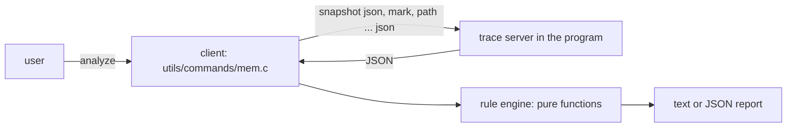

# `cxy utils mem analyze`: is my program's memory normal?

Status: design, nothing built yet. Builds on the memory trace
(`memory-manager.md` section 10, user guide in `docs/book/memory.md`).

## 1. Why

`cxy utils mem` answers precise questions: who holds this object, what leaked, what
grew. A user has to know which question to ask, in which order, and how to read the
numbers. `analyze` runs the questions for them and says what it sees:

```
$ cxy utils mem analyze            # first call: takes a baseline
baseline taken (mark 60). Run the workload, then run analyze again.

$ cxy utils mem analyze            # second call: compares
verdict: LIKELY LEAK
```

Goals:

- A short, honest summary during development: normal, worth watching, or likely a
  problem, with the evidence behind each statement.
- For each finding, the exact `cxy utils mem` commands to look further, so the tool
  also teaches the tool.
- A structured (JSON) form for scripts, CI and editors.
- When something looks suspicious about specific objects, look at those objects:
  sample some, follow their owners, report the common pattern.

Non-goals:

- Proof. The checks are heuristics. A finding says how sure it is and why.
- Production monitoring. The trace build is for development.
- Replacing the other commands, `analyze` is built from them.

## 2. User workflow

| Step | Command | What happens |
|---|---|---|
| 1 | `cxy utils mem analyze` | no baseline yet: `mark`s one on the program and stops |
| 2 | run the workload (a request, an action, a test) | |
| 3 | `cxy utils mem analyze` | compares with the baseline, prints the report |
| ... | `cxy utils mem analyze` again | compares with the **same** baseline, a longer window |
| reset | `cxy utils mem mark` or `analyze --reset` | a new baseline |

Without a workload the user can let the tool watch instead:

```
cxy utils mem analyze --watch 30s            # 3 samples over 30 seconds
cxy utils mem analyze --watch 30s --samples 5
```

`--watch` takes a new baseline, then `--samples` snapshots (default 3) at equal
intervals, the last at the end of the window, and analyzes them together. The k-th
snapshot is taken at k times the interval from the start, a slow snapshot does not
push the next ones back. Progress goes to stderr, the report to stdout, so `--json`
stays parseable. A duration is `500ms`, `30s`, `2m`, `1h` or a number of seconds.
`--watch` cannot be combined with `--reset` (it always takes a new baseline).
Code: `src/cxy/utils/mem/watch.c`. Several samples matter: with two a warm-up looks like a
leak, with three or more the growth rate says whether it is still growing or has
flattened (section 5, rule G2). `--watch` is just a loop in the client, it needs
nothing the baseline mechanism does not already have.

Options:

| Option | Meaning |
|---|---|
| `--json` | structured output, section 7 |
| `--watch <time>`, `--samples <n>` | as above (default samples: 3) |
| `--reset` | drop the baseline and take a new one |
| `--no-graph` | skip the ownership graph checks (they pause the program for a moment) |
| `--suspects <n>` | how many suspect sites to look into (default 3) |
| `--fail-on <severity>` | exit code 3 when a finding is at least that severe (default: never) |
| `--pid`, `--socket`, `--timeout` | as for the other `cxy utils mem` commands |

Exit codes: 0 done (and nothing at `--fail-on` or above), 2 cannot reach the
program, 3 a finding reached `--fail-on`.

## 3. Output

Illustrative text report (a program that keeps 50 nodes in a global cache and leaks
one pair of nodes that own each other):

```
verdict: LIKELY LEAK                    window: 31s, 3 samples

memory       live 1264 B in 53 objects (+1232 B, +52 objects since baseline)
             buffers 432 B   zombies 0   process 5.1 MB (traced heap 0.03 MB)
growth       +52 objects, +1.7 objects/s, +40 B/s  (still growing: 3 of 3 samples)

[definite] C1 leaked cycle: 2 Node objects, 32 bytes
    app.cxy:20  app.cxy:21
    fix: make one side a weak reference (@weak Node)
    see: cxy utils mem cycles

[likely]   G1 `Node` made at app.cxy:30 is never freed: 50 of 50 survive
    all 50 sampled objects are held by: global cache -> Cache -> Vector buffer (app.cxy:13)
    this is a cache that only grows. Intended? If not, evict entries.
    see: cxy utils mem path 0x79c6c00bf0

[watch]    K1 one root holds 99% of live bytes: global cache (1264 B)

ok: no dangling borrows, no zombies, no unexplained external references
```

Rules of the format:

- The verdict is the highest severity present. Severities: `info`, `watch`,
  `likely`, `definite`.
- Every finding has an id, a title in plain words, the evidence (numbers and
  sampled objects) and at least one command to look further.
- A line "ok: ..." lists what was checked and found nothing, so the user knows what
  was covered.
- Lines of code in the user's files come first. Objects made in the standard
  library are shown but folded into the caller's line when the caller can be found.

## 4. Architecture



Decisions:

- **The rules live in the compiler tool, not in `libcxy-trace`.** A better heuristic
  then never needs the user to rebuild a traced program. The trace library only
  reports facts.
- **The rule engine is a pure function** from snapshots (plus optional suspect
  details) to findings. It can be unit tested with synthetic snapshots, no running
  program needed.
- **The server stays one command per connection** (a request line of at most 255
  bytes, a reply, close). `analyze` opens several connections.
- **One consistent snapshot.** Asking many commands one after another sees a program
  that keeps running. A new command `snapshot` collects what the rules need in one
  pause (the same fork of the process the graph commands use), so the numbers agree
  with each other.

## 5. Checks

Inputs already exist unless marked **new**.

| Id | Check | Source | Severity |
|---|---|---|---|
| G1 | **Survivor ratio.** For each site: objects made since the baseline and still alive, divided by objects made. About 1 means everything is kept. Reported above a minimum count (default 100) and ratio (default 0.9). | live objects born after the mark (`diff`), cumulative allocations (`sitecounts`) delta | watch, likely when the last 3 samples all grew |
| G2 | **Plateau.** Growth that is slowing down across samples is probably a cache filling up or warm-up. Lowers G1 to `info` and says so. | 3 or more samples | info |
| G3 | **Never freed type.** `allocs > 0`, `frees == 0`, `live == allocs` for a type with many instances. | `types` | watch |
| R1 | **Who keeps the growth.** The sampled survivors of G1 are followed with `path`, grouped by retention shape. Held by a named global: cache-like. Held by nothing reachable: a real leak. | `path`, `holders` | raises or lowers G1 |
| C1 | **Leaked cycles** | `cycles` | definite |
| D1 | **Dangling borrows** | `dangling` | definite |
| Z1 | **Zombies increasing.** Weak references that are never released. | `zombies` delta | watch, likely when growing |
| X1 | **Unexplained owners.** Objects with owners that are in neither the graph nor a root: held by a stack, a thread, a stuck coroutine. | `holders` (external count) | watch |
| K1 | **Concentration.** One root holds most live bytes (default 80% and 1 MB). | `retained` | info |
| B1 | **Buffer regrowth.** Many allocations at a buffer site relative to its live buffers: a container that grows by reallocation. Suggest reserving capacity. | `sitecounts` | info |
| H1 | **Reference count outliers.** A very high `refs` is a hot shared object, or a retain without a release. | **new** `refs [n]` | watch |
| M1 | **Process memory versus traced heap.** Large gap: memory outside the traced heap (C libraries, raw allocations, fragmentation). | process RSS of the pid (`ps`, `/proc/<pid>/statm`), traced bytes | info |
| A1 | **Age.** Live objects that are old (in allocation ticks) versus young. Objects made during the workload and still alive at the end of it may simply be in flight. | birth ticks | info |

What "normal" means:

- A fixed list of runtime objects is ignored (the scheduler, `stdout` and `stderr`
  streams).
- Objects made before the baseline are never growth.
- A window that is too short (fewer than a minimum number of allocations) says
  "not enough activity to tell", it does not say "ok".
- If the answer is approximate (a thread did not reach a safepoint), the report says
  so, as the graph commands already do.

Rates use the wall-clock time between samples, taken by the server, so the client
being slow does not matter. They allow statements like "+1.7 objects/s, about
+40 B/s, roughly +144 KB per hour at this rate".

### As built (rules G1, G2, G3, C1, D1, Z1, K1)

Code: `src/cxy/utils/mem/rules.c`. The series of snapshots is the baseline followed by
the samples, so "the last three" can include the baseline.

| Setting | Default | Used by |
|---|---|---|
| `minCount` | 100 | G1 objects made, G3 allocations |
| `minRatio` | 0.9 | G1 alive / made |
| `minActivity` | 100 | objects allocated in the window, below it with no finding the verdict is `not enough activity` |
| `plateauFactor` | 0.5 | G2 latest growth rate at most this part of the previous one (rates when the snapshots are unevenly spaced) |
| `minZombies` | 10 | Z1 growth below it is noise |
| `concentration`, `concentrationBytes` | 0.8, 1 MB | K1 |
| `maxSiteFindings` | 5 | G1 reports the sites with the most survivors |
| `ignoreTypes` | none | G3 runtime types to skip |

- G1 compares `allocs` with the baseline's and takes `aliveSinceMark` as survivors. It
  is `likely` when the survivors grew in each of the last three snapshots, `watch`
  otherwise, `info` when G2 says the growth is slowing.
- G2 only reports when it lowered a G1 finding.
- G3 ignores a type that nothing was made of since the baseline.
- C1 and D1 are `definite` whatever the activity. K1 is `info`.
- Verdict: the worst finding at `watch` or above, else `ok`, or `not enough activity`.

### Looking into suspects

For the highest ranked sites (default 3) the client:

1. takes up to 8 sample objects of that site (`difflist`),
2. runs `path` on each,
3. groups the answers by shape, the chain of types and sites,
4. reports the largest group and how many of the samples it covers.

A budget bounds this: at most 10 graph commands per run, each with the usual scan
time limit. `--no-graph` skips all of it.

## 6. Server changes (`libcxy-trace`)

1. **`json` token on every command**, like `nosym`: `types json`, `sites 5 json`,
   `path 0x... json`. Text output does not change, so the existing trace snapshots
   keep passing. Commands convert one at a time.
2. **`snapshot json`** (JSON only, runs in the forked copy): the counters below,
   then `graph` (`nodes`, `edges`, `external` = objects and references held from
   outside the heap, `retained` = the 5 largest roots, `cycles` = the 5 largest) and
   `dangling`. The graph parts are the reports of the same names, nested.
3. **`mark` stores a baseline**: a *counter set*: the tick, a monotonic time in
   milliseconds, the mark, object / buffer / zombie counts and bytes, objects ever
   allocated, per type (`allocs`, `frees`, `live`, `bytes`) and per site (`allocs`,
   `bytes` cumulative, `live`, `liveBytes`, `aliveSinceMark`). `snapshot` starts with
   the same set, so two of them subtract. `baseline json` returns the stored set
   (`{"exists":false}` when there is none), `mark json` returns
   `{"mark","tick","timeMs","baseline"}`. This is what makes "the first call marks,
   the second compares" work without any file on disk: the baseline belongs to the
   program and goes away with it.
4. **`refs [n]`**: the live objects with the highest reference counts (new, for H1).
5. **A small streaming JSON writer** in `libcxy-trace` (decided, see section 9). The
   server writes JSON directly to the socket, nothing is built in memory first. It
   needs no allocation, so it is safe in the query thread and in the forked child,
   and it adds no third party symbols to the user's program. About 100 lines:
   `jsonBegin/End` for objects and arrays, `jsonKey`, and value writers for
   strings (escaped), integers, unsigned integers, doubles, booleans and null.
   Commas and nesting are tracked by the writer, so a command cannot produce
   malformed JSON by forgetting one. The **client** parses the replies with the
   cJSON it already has (`src/3rdParty/cJSON.c`, part of `cxy-core`).

## 7. JSON

Versioned, so tools can rely on it. Illustrative:

```json
{
  "version": 1,
  "program": {"pid": 57915},
  "window": {"seconds": 31.2, "samples": 3, "baseline": true},
  "approximate": false,
  "verdict": "likely",
  "totals": {
    "objects": {"count": 53, "bytes": 1264, "deltaCount": 52, "deltaBytes": 1232},
    "buffers": {"count": 1, "bytes": 432},
    "zombies": {"count": 0, "bytes": 0},
    "rssBytes": 5300000
  },
  "rates": {"objectsPerSecond": 1.7, "bytesPerSecond": 40.0},
  "findings": [
    {
      "id": "G1",
      "severity": "likely",
      "title": "Node made at app.cxy:30 is never freed",
      "evidence": {"site": {"file": "app.cxy", "line": 30}, "type": "Node",
                   "made": 50, "alive": 50, "ratio": 1.0, "samplesGrowing": 3},
      "retention": ["global cache", "Cache", "Vector buffer app.cxy:13"],
      "suggest": ["cxy utils mem path 0x79c6c00bf0"]
    }
  ],
  "checked": ["C1", "D1", "Z1", "X1"],
  "suspects": [
    {"ptr": "0x79c6c00bf0", "type": "Node", "site": {"file": "app.cxy", "line": 30}}
  ]
}
```

Notes:

- **As built** (`analyze --json`, `src/cxy/utils/mem/report.c`): one line. It has
  `version`, `program.pid` (from the snapshot), `window` (`seconds`, `samples`,
  `baseline`), `approximate`, `enoughActivity`, `plateau`, `verdict`, `totals`
  (`objects` with `deltaCount`, `buffers`, `zombies`, `deltaBytes` for objects and
  buffers together), `rates`, `findings`, `checked`, `notChecked` and `suspects`
  (empty until R1). A finding has `id`, `severity`, `subject`, `title`, `fix`,
  `evidence` (numbers) and `suggest` (commands). The verdict is a token: `ok`,
  `notEnoughActivity`, `watch`, `likely`, `definite`. `rssBytes` and `retention`
  come with M1 and R1. The call that takes a baseline answers
  `{"version":1,"baseline":{"taken":true,"mark":N}}`.
- Pointers are strings (a hex address), sizes are bytes, times are seconds.
- Fields are only added in a version, never renamed or removed.
- `checked` lists the rules that ran and found nothing, so a consumer can tell
  "clean" from "not checked".

## 8. Tests

- **Rule engine, unit tests** (doctest, no program): synthetic snapshots for each
  rule, including the boundaries (just below and just above each threshold), the
  plateau case, "not enough activity", and the ignore list.
- **End to end, trace snapshots** (`tests/trace/programs`): programs with known
  behaviour and the expected report with addresses normalized:

| Program | Expected |
|---|---|
| healthy (steady churn, everything freed) | `ok`, nothing above info. Guards against false alarms. |
| unbounded list | G1 likely, R1 names the owner |
| global cache that grows | G1 with a rooted retention shape |
| cache that fills and flattens | G2, no leak |
| leaked cycle | C1 definite |
| dangling borrow | D1 definite |
| weak reference never released | Z1 |

  The harness already moves a program forward with `@next`, so a `.cmds` file can
  run `analyze` (baseline), `@next`, `analyze` (report) deterministically. Rates and
  times depend on the clock, so the snapshot mode reports them as zero (`--json`
  tests compare everything else).
- **Server side:** each command that gets a `json` form gets a snapshot test of its
  JSON, and the runtime C tests cover the baseline and the JSON writer. The writer
  tests check that every output parses (the tests link cJSON to parse what the
  writer produced) and that awkward strings survive: quotes, backslashes, control
  characters, UTF-8, and a path longer than the buffer.

## 9. Risks and open questions

- **JSON in the trace library (decided).** The trace library is linked into the
  user's program, so it gets a small streaming writer and not cJSON: a program that
  bundles its own cJSON would clash on symbols, and cJSON allocates inside the query
  thread and the forked child. The cost is that the writer only writes, the client
  does the parsing. Escaping of strings (file paths, type names) is the part to get
  right, the writer has its own unit tests.
- **Heuristic quality.** Thresholds will be wrong for some programs. They are
  options (`--threshold G1.ratio=0.8`), and every finding carries the numbers that
  triggered it. The "healthy" and "plateau" tests exist to keep false alarms down.
- **Cost of looking.** The snapshot and the suspect paths pause the program briefly,
  more with a big heap. `--no-graph` is the escape, and the report says when it was
  used.
- **One baseline per program.** Two people running `mark` on the same program
  overwrite each other. Acceptable for a development tool.
- **Windows of work in flight.** Objects of a request still being handled when
  `analyze` runs look like growth. The age rule (A1) and the plateau rule (G2) are
  the mitigation, the user can also wait and run it again.

## 10. Task list

In order. Each step is testable alone.

- [x] streaming JSON writer in `libcxy-trace` (`stdlib/trace/trace_json.h`) with runtime unit tests (escaping, invalid UTF-8, nesting, commas, numbers, misuse, a failing sink, a closed peer), a `json` token in the command parser (a command with no JSON form answers with a JSON error)
- [x] `json` output for `summary`, `types`, `sites`, `sitecounts` with snapshot tests
- [x] `json` output for `list`, `diff`, `difflist`, `zombies`, `dangling`
- [x] `json` output for the graph commands: `holders`, `path`, `edges`, `tree`, `roots`, `retained`, `cycles`, `contains`
- [x] `mark` stores a baseline, `baseline` reports it, `snapshot` command, runtime tests
- [x] `refs [n]` command
- [x] rule engine and its unit tests: G1, G2, G3, C1, D1, Z1, K1 (`src/cxy/utils/mem/`, `tests/unit/test_mem_analyze.cpp`)
- [x] `analyze` client: first call marks, second reports, text output, exit codes (`--fail-on`, `--reset`; `src/cxy/utils/commands/mem_analyze.c`, `src/cxy/utils/mem/report.c`)
- [x] `analyze --json`
- [x] `analyze --watch` and `--samples`
- [ ] suspect introspection: sampling, `path`, grouping by shape (R1)
- [ ] rules X1, B1, H1, M1, A1
- [ ] end to end trace programs (healthy, leak, cache, plateau, cycle, dangling, zombie)
- [ ] book chapter: a section on `analyze`
