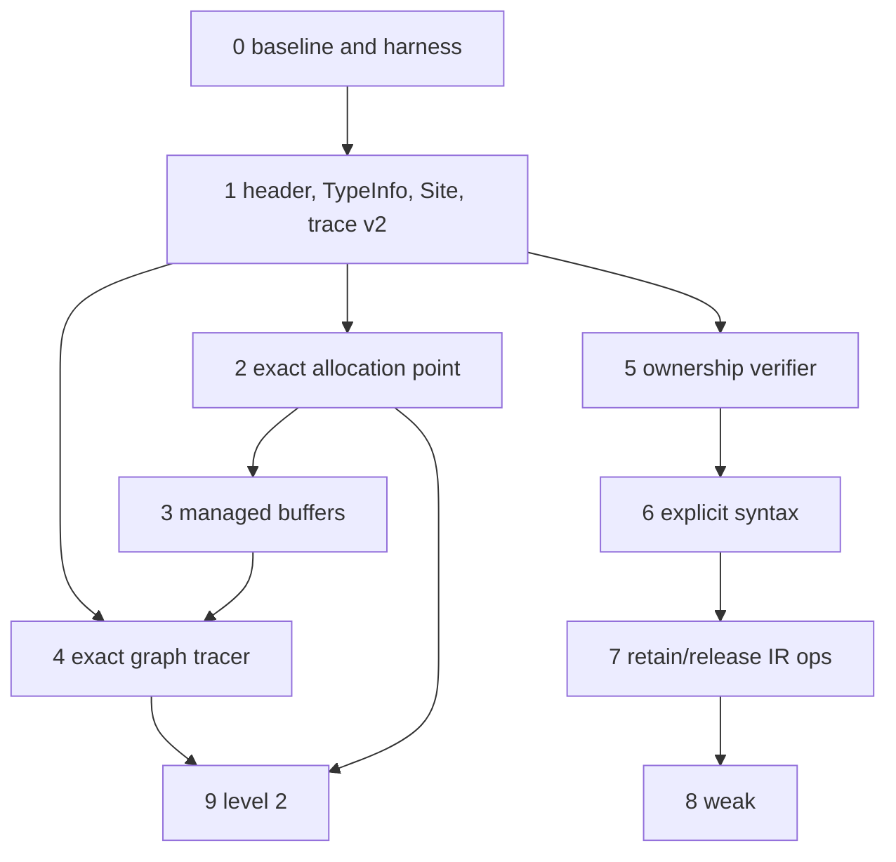

# Memory manager: implementation plan

Companion to `memory-manager.md` (the design). This document orders the work,
names the files each phase touches, and says how each phase is tested and when
it is done. Sizes are rough guesses (S: a few days, M: a week or two, L: more),
not estimates from reading every affected file.

## 1. Ground rules

- **Every phase ships on its own.** After each phase the full test matrix
  (section 3) passes and the compiler is usable. Nothing is left half switched on.
- **Additive until phase 6.** Phases 1 to 5 add runtime, trace and checking
  without changing what programs mean. Phase 6 changes the language (`@copy`,
  `@nocopy`, `clone()`) and is the one phase that can break existing code, so the
  removals have a deprecation period.
- **Both backends.** The C backend (`backend/c/generate.c`) and the planned LLVM
  backend (`llvm.md`) consume the same IR operations. New runtime behavior goes
  into IR operations and the runtime, not into C text.
- **Trace is a compile-time switch** (`--memory-trace`, later with a level). A
  release build must not change in size or speed because of trace features.
- **Old names stay as shims until phase 4 ends**, then are removed.

## 2. What exists today (the surface this plan touches)

From a text search of the source tree:

| Area | Where | Notes |
|---|---|---|
| Header and count functions | `runtime/prologue.h` | `__mem`, `__smart_ptr_alloc/get/drop` and `_trace` variants |
| Their only other users | `backend/c/generate.c` (`emitAlloc`, `emitDrop`, `emitCopy`), `runtime/builtins.cxy` (`@hint extern` declarations), `stdlib/trace/mem.c` (`__cxy_mem_header_refs`), interned names in `frontend/strings.h` | small surface: phase 1 is contained |
| Class construction | `sema/node.c`: `createCoverProto`, `createInitializerCoverBody`, `createAllocateClass` (allocation uses `bfiMemAlloc` with the destructor forwarder). Lowered by `ir/lower.c` to `irAlloc`. | The allocation location today is the `init` function's location, which is why every `Class()` shows one site |
| Copy | `@copy` is a backend call node (`bfiCopy`) typed in `sema/check.c`. Sema and simplify also create `bfiCopy` for copy glue (`sema/builtins.c`, `tuple.c`, `type.c`, `class.c`, `simplify.c`). The `__copy!` macro is gone. | done in 6a |
| Copy inference | `middle/memory/manage.c`: `shouldPromoteAssignToCopy`, `injectCallArgumentCopies`, `processPayloadItem` | stays: implicit owner-to-owner copies are part of the language. |
| Tracer | `stdlib/trace/mem.c` (live hash table under one mutex, 1024-event ring, conservative graph scan), client `utils/commands/mem.c` | the client forwards its arguments as one request line, so new server commands need no client change except help text |
| `__copy!` uses | converted to `@copy` (36 at the time, plus tests and an example) | done |
| `copy` methods | `String.copy()` (deep clone, `builtins.cxy`), one caller in the stdlib (`sse.cxy`). `Vector.clone()` already exists. The operator overloads ``copy`` (`Optional`, `strview`) keep their name. | the `clone()` rename is small inside the repository |
| Stale code | `middle/mem/` (AST based, older than `middle/memory/`). Check whether CMake still builds it. | delete if unused |

## 3. Test matrix and infrastructure

Run for every phase:

| Suite | What it covers |
|---|---|
| `tests/lang/mem` (asan, codegen, ir configs) | memory behavior and generated shapes |
| `tests/lang` other suites | parser, middle, backend |
| stdlib specs (`coro.spec.cxy`, json, others) | library behavior |
| `tests/package` | package flow |
| `ctest` unit tests | `tests/unit` |
| With and without `--memory-trace` | trace builds do not change program output |
| macOS and Linux | different allocators, different `fork` and socket behavior |
| C backend, and the LLVM backend once it exists | same expected outputs |

New: `tests/trace/` (phase 0). A harness builds a program with trace on, runs it,
waits for the query socket, sends commands with `cxy mem --pid`, normalizes
addresses (`0x...` becomes `PTR`) and compares to a snapshot. Programs finish
their workload and then wait so the harness can query. Exit-report tests run to
completion and snapshot the report. Concurrency tests assert on totals, not order.

Snapshot policy: a phase that changes generated C or IR updates the affected
snapshots in the same change, reviewed for structure (not only for names).

## 4. Phases

### Phase 0: baseline and harness (S)

- Record the current results of every suite on both platforms. Any failure that
  exists today is written down so it is not blamed on later work.
- Build the `tests/trace/` harness and add tests for today's behavior (counts,
  `sites`, `list`, `leaks`). These tests will change on purpose in phases 1, 2
  and 4, which makes the changes visible.
- Check `middle/mem/` and remove it if it is not built.
- Add compile-time `_Static_assert` helpers around header layout so later layout
  changes fail loudly.

Exit: harness runs in CI. Baseline recorded.

### Phase 1: header, `TypeInfo`, `Site`, allocator API, trace runtime v2 (L)

Split in four reviewable changes.

**1a. Runtime layout and API (M)**
- New runtime header (pasted like `prologue.h` today): `ObjHeader {strong, weakFlags,
  type}`, `TypeInfo`, `Site`, `mm_alloc`, `mm_retain`, `mm_release`, the destroy
  path, saturating counts with the limit check and the sentinel (design section
  5), underflow handling, and a `CXY_RC_STRICT` switch that aborts on overflow.
- `__smart_ptr_alloc/get/drop` become thin inline shims over the new functions
  so the rest of the compiler does not move yet.
- Debug builds: freed blocks go to a quarantine and are poisoned.

**1b. `TypeInfo` emission (M)**
- The C backend emits one `const TypeInfo` per class type: name from the type's
  display name, size, alignment, the existing destructor and destructor forwarder
  as `deinit`/`dropFields`. `visit` stays null.
- `emitAlloc` passes `&TypeInfo` instead of a size and a destructor pointer.
  `emitDrop` and `emitCopy` call the new names directly. `builtins.cxy` hint
  declarations are updated.
- The same change adds `irAlloc.type` use (the IR already has the allocated
  type), so the LLVM backend can follow.

**1c. `Site` constants (S)**
- Backend emits `Site` records deduplicated by (file, line, column, function),
  in trace builds only. For now they carry the allocation node's location, so
  the reported lines do not change yet.
- Per-site and per-type counters (thread-local arrays, summed on demand).

**1d. Trace runtime v2 (M)**
- Replace the live hash table and ring in `stdlib/trace/mem.c` with the fat
  `TraceHeader`, per-thread intrusive lists with a small lock per list head, and
  the counters, running from the first allocation (no start gate).
- Existing commands (`summary`, `sites`, `list`, `leaks`, `mark`, `diff`,
  `difflist`) work on the new registry. `ring` stays until level 2 replaces it.
- The conservative graph code stays for now (removed in phase 4).

Tests: trace harness snapshots for counts and sizes (with headers and payload
reported separately); a threaded test that allocates and frees on different
threads and checks the totals; the full matrix; header layout asserts.

Exit: all suites green on both platforms. `cxy mem` commands work. Counters are
exact in the threaded test. Release builds are byte-for-byte identical in
behavior and within noise in speed (benchmark: allocate and release 10 million
objects).

### Phase 2: exact allocation point (M)

- **Hidden site parameter, implicitly on every generated constructor.**
  `createCoverProto` adds `__site: ^Site` after the parameters of the cover in
  trace builds. The call that uses the cover (`transformToInitCoverCallExpr`)
  passes the site of the call expression. `createAllocateClass` hands the site to
  `bfiMemAlloc`, which becomes an operand of `irAlloc`, and the backend passes it
  to `mm_alloc`. User `init` functions are not touched.
- **New internal builtin `site!`** that yields the `Site` constant for an
  expression, and the IR constant that refers to the emitted record.
- **`@memtrace(callsite)`** (design 6.3). It already parses: a bare name in an
  attribute is read as `callsite: true`. Sema work: recognise it in
  `checkFunctionSignature`, add the hidden parameter in trace builds, append the
  site argument in `checkFunctionCallEpilogue` (forward the incoming site when the
  caller is also marked), and enforce the restrictions in **all** builds with an
  error that explains the reason.
- Struct construction has no allocation and no site.

Tests
- Trace harness: `Foo()` in user code reports that line; the same in a loop; in a
  generic function (the body's line, which is exact); through a user factory marked
  `@memtrace(callsite)` (the caller's line); through two nested marked functions;
  through a macro (the user's expansion site).
- `tests/lang` compile-fail snapshots for each restriction.
- Codegen snapshot showing no hidden parameter in a non-trace build.

Exit: in the earlier `hello.cxy` style examples, every allocation reports the line
where the user wrote the construction.

### Phase 3: managed container buffers (M)

- **Inventory first:** list every stdlib use of `malloc`, `realloc`, `free` and
  `__calloc` (`vector`, `list`, `hash`, `buffer`, the `String` data buffer, others).
  This is a text search plus a read of each hit; it fixes the real size of this
  phase before it starts.
- New builtins `__alloc_buffer`, `__realloc_buffer`, `__free_buffer` with a site.
  In release builds they are plain `malloc`/`realloc`/`free` with no header and no
  cost. In trace builds a buffer carries a `TraceHeader` only and is registered
  like an object.
- Convert the containers. Mark the growing operations (`push`, `emplace`,
  `resize`, map insert) with `@memtrace(callsite)`.
- `String` is on the hottest path: measure before and after.

Tests: harness checks that a growing vector is attributed to the pushing line and
that byte totals match element size times capacity plus overhead. Benchmark of
10 million pushes in a release build: no regression.

Exit: container memory shows up in `sites`, `list` and the summary, attributed to
user code.

### Phase 4: exact graph tracer (L)

- **Visit glue.** Next to `implementDestructorFunction` in `sema/builtins.c`, add
  a `visit` generator using the same per-field walk (struct, tuple, union,
  optional, array, closure). Fill `TypeInfo.visit` in trace builds. Containers write
  `visit` in stdlib source: owner to buffer, buffer to each initialized element.
  A `Visitor` is a function pointer plus context.
- **Roots.** Lowering collects global variables of owning type. The backend emits
  a `RootInfo` table (name, address, type) in trace builds.
- **Tracer.** New graph module in `stdlib/trace/` builds the graph from the
  registry and `visit`. Commands: `types`, `holders`, `path`, `contains`,
  `retained`, `roots`, `cycles`. Delete the conservative scan.
- **Safepoints and snapshot.** `mm_safepoint` at allocation and free in trace
  builds. A query requests a pause with a timeout, takes the list locks, and
  forks. After a timeout it falls back to a racy snapshot and marks the result
  approximate.
- Remove `__smart_ptr_*` shims and the old trace hooks.

Tests: small known graphs (chain, tree, shared object under two roots, a cycle, a
cache holding N keys in a map) with exact `externalRefs`, `retained` and `cycles`
output; a threaded test for the approximate flag; every command on macOS and Linux.

Exit: `holders`, `path` and `retained` give the same answers on both platforms
and match the known graphs. `cycles` finds exactly the leaked cycle in the test.

### Phase 5: ownership verifier (M)

The rule table, event model and tests are in `memory-verifier.md`. It is a
language-rule checker with its own generic IR walk, independent of `manage.c`.

- New pass in `middle/memory/` after `runMemoryManagement`, before finalize. A
  forward dataflow over the IR CFG with the states owned, moved, dropped and
  maybe. It reports: an owning local that reaches function exit still owned, a
  double move or drop, a move or drop of something not owned, and an owned
  temporary never consumed.
- Warning mode first. Run it across every suite. Each finding is a real bug (or a
  verifier bug) and is fixed or explained.
- Then error mode in CI (`--warning-as-error=Ownership`, on in debug compiler
  builds). The findings are the `Ownership` group of compiler warnings.

Tests: IR-level unit tests that build a function with each defect and expect a
report; regression tests for the three shapes found in practice (a move nested in
a call inside a literal, a move wrapped by an optional, a moved variadic forwarded
with a reference sibling) which must fail without their fixes.

Exit: whole matrix passes with the verifier as an error.

### Phase 6: ownership syntax (L)

The rule (design 7.5): copying one owner into another is implicit, `@copy` is how a
reference becomes an owner. There is no warning for implicit owner-to-owner
copies, and no mass conversion of the stdlib.

**6a. Syntax (S), done**
- `@copy` is a single token (`tokAtCopy`) parsed as a prefix operator, producing a
  backend copy node that sema types. `__copy!` is removed and its uses converted.
- `String.clone()`, with `copy()` kept as a deprecated forwarder. The one stdlib
  caller (`sse.cxy`) is converted.
- Compile-fail tests for `@copy` of a non-place.

**6b. `@nocopy` and the reference rule (S), done**
- `@nocopy` on a type. `@copy` and an implicit copy of it are errors that name the
  type. Mark `Mutex`, sockets and similar stdlib types.
- Check that every `&T` to `T` error says `use '@copy x'`, with a compile-fail
  snapshot for a variable initializer, an assignment, an argument, a field store
  and a return.
- A field or element source (`return this.field`) is an implicit copy by default,
  the user may write `@copy` or `&&` (design 16). `tests/lang/mem/35_field_copy_implicit`
  pins that it needs no syntax.
- Optional: review stdlib signatures where a function only reads a class and
  could take `&T` (a performance choice, nothing is required).

There is no 6c. An earlier version of this plan had sema write every implicit copy
and removed the copy inference from the memory pass. That only made sense while
implicit copies were being removed from the language. They are not: copying one
owner into another is valid, so the memory pass keeps inserting those copies.

Tests: compile-fail snapshots for the `&T` to `T` rows of design 7.5, `@nocopy`
compile tests (explicit, implicit, reference, in a struct, inherited), positive
tests for the implicit rows.

Exit: met. The memory pass is reviewed for simplification separately, see the note
in design 7.6.

### Phase 7: retain and release as IR operations (M)

- Lower class-handle copies and drops to explicit retain and release IR nodes
  (the aggregate glue stays). The C backend emits the inline atomic add or subtract
  with the saturation check, and calls into the runtime only to destroy.
- **Dangling references** (design 8.2): no compiler guard. Debug builds check
  the header on `&T` class-field loads and member returns. Borrow edges and
  `cxy mem dangling` arrive with the tracer in phase 4 if `visit` glue is ready,
  otherwise here.
- **Pair elimination** in `middle/memory/`: within a basic block first, then across
  simple dataflow.
- Stdlib review for `&T` parameters if phase 6b left any.

Tests: IR snapshots showing removed pairs; a counter in trace builds shows fewer
retains on a benchmark; a debug-build test that reads a `&T` field of a freed
object panics with both sites; no change in program output.

Exit: measurable reduction in retain and release counts on the benchmark programs,
no new failures.

### Phase 8: `weak` (M)

- `weak T` in the type system, `upgrade` yielding `T?`, a weak count in the header
  (design section 5), zombie block until the last weak reference goes, copy of a
  weak reference as `@copy`.
- Trace: weak references are not edges. A weak-only object is reported separately.

Tests: upgrade success and failure, destruction order, cycles broken by `weak` no
longer reported by `cycles`.

### Phase 9: trace level 2 (M)

- Instrument calls in lowering (level 2 only): push the call site, pop after.
  The scheduler swaps the shadow stack pointer on a coroutine switch
  (`stdlib/coro.cxy`, `Coroutine` gets a field under trace only).
- Stack interning (`stackId`), the per-object event history in the trace header
  (`Site*` with the operation in the low bits), and the commands `history` and
  stacks in `list`. Saturation events are recorded here.
- Replace the old `ring` command.

Tests: harness checks stacks for nested calls and across a coroutine switch; history
shows the last retain and release sites of an object.

### Phase 10: biased reference counts (optional, L)

Only if measurements after phase 7 show atomic traffic matters. The header already
reserves the bits. Not planned in detail.

## 5. Order and dependencies

Why this order
- Phases 1 and 2 deliver the headline requirement first: exact allocation points.
- Phases 3 and 4 deliver exact containment. Phase 4 needs the buffers from phase 3
  to see through containers.
- Phase 5 comes before any change to the memory pass so it is checked by something
  other than the existing tests.
- Phase 6 is the only breaking change (`__copy!`, `copy()`), so it comes after the
  tracer is in use and the verifier is trusted.
- Phases 4 and 5 are independent of each other and can overlap.

## 6. Options and flags introduced

| Flag | Meaning |
|---|---|
| `--memory-trace[=1\|2]` | trace level (today a boolean) |

| `--warnings=Ownership`, `--warning-as-error=Name` | ownership verifier (phase 5), warning lists |
| `CXY_RC_STRICT` | build option, abort on count overflow instead of saturating |
| `CXY_MEM_SCAN_SECONDS`, `CXY_MEM_SOCKET` | query timeout, socket path (existing) |

## 7. Pull request slicing

- Phase 1: four changes (1a to 1d). 1a and 1b must land with identical behavior.
- Phase 2: sites and `irAlloc` operand first, then the cover change, then
  `@memtrace(callsite)` with its restrictions.
- Phase 3: builtins first, then one container per change, `String` last.
- Phase 4: visit generation, then the tracer commands, then removal of the old code.
- Phase 6: 6a, then 6b. Both done.

## 8. Interaction with other work

- **LLVM backend** (`llvm.md`): needs `irAlloc` with type and site (phase 1 and 2)
  and retain and release as IR operations (phase 7). It can start after phase 1.

- **Docs:** `docs/book` gets a chapter on ownership (`&`, `&&`, `@copy`, `weak`)
  with phase 6. `docs/stage/memory2.md` is removed, this plan replaces it.

## 9. Risks by phase

| Phase | Main risk | Mitigation |
|---|---|---|
| 1 | Header layout change breaks something that assumed 16 bytes | the small surface in section 2, layout asserts, shims |
| 2 | Hidden parameter leaks into closures, interface tables or function values | restrictions are errors in all builds, tests for each |
| 3 | `String` and `Vector` are hot | measure before and after, release path stays plain `malloc` |
| 4 | Visit glue misses a field kind, giving wrong edges | known-graph tests per type kind, the verifier of phase 5 |
| 5 | Verifier false positives | warning mode first, fix or explain each finding |
| 6 | `__copy!` and `copy()` removals break outside code | deprecation period for `copy()`, the migration guide, a precise error for the old macro |

| 7 | `&T` dangles because the programmer cleared the owner (design 8.2) | debug quarantine, poison and `&T` load check, `cxy mem dangling`, `@copy` for values that must survive |

## 10. Done means

- Every `Class()` in user code reports its own line, in every build mode that
  traces.
- Container memory is counted and attributed.
- `holders`, `path`, `retained`, `roots` and `cycles` are exact on both platforms
  (approximate only when the program could not be paused, and marked so).
- Copying an owner into an owner is implicit, `@copy` turns a reference into an owner, and a `@nocopy` type has one owner.
- The verifier passes on the whole suite.
- Release builds are no slower than before phase 1.

## 11. First change to make

Phase 0, then 1a: the new header and API with shims, `_Static_assert` layout
checks, the saturation logic and quarantine, and unit tests for the count paths
(increment to the limit, overflow behavior, underflow, concurrent retain and release
from several threads). It changes no generated code and no program behavior.

## 12. Task list

Source of truth for order. The memory pass work is tracked in `memory-pass.md`.

- [x] Phase 0: baseline, trace harness, layout asserts
- [x] Phase 1a: runtime header and allocator API (`mm.h`)
- [x] Phase 1b: `TypeInfo` per class
- [x] Phase 1c: `Site` constants and per-type, per-site counters
- [x] Phase 1d: trace registry with fat header and per-thread lists
- [x] Phase 2: exact allocation sites, `@memtrace(callsite)`
- [x] Phase 3: managed container buffers
- [x] Phase 4: visit glue, roots, graph commands, pause with timeout
- [x] Phase 5: ownership verifier (V1, V2), `Ownership` warnings
- [x] Phase 6a: `@copy` token, `__copy!` removed, `String.clone()`
- [x] Phase 6b: `@nocopy`, `&T` to `T` errors say `@copy`
- [x] Memory pass redesign (`memory-pass.md`, section 12)
- [ ] Phase 4 leftover: remove the `__smart_ptr_*` shims and old trace hooks
- [x] Phase 5 leftover: `--warning-as-error=Ownership` on in debug compiler builds and CI
- [ ] Phase 6b optional: take `&T` in stdlib functions that only read a class
- [x] Phase 7a: retain and release as operations. Decided with no new IR tags: a `copy` or `drop` of a class handle is the retain or release (`irIsRetain`, `irIsRelease` in `node.h`), the C backend already emits them inline. Aggregates keep `copy` and `drop`, they call glue
- [x] Phase 7b: pair elimination in `middle/memory/pairs.c`: `var b = a` with `b` only read and `a` untouched becomes an alias, no retain and no release. A user `@copy`, a moved or reassigned source, a moved copy and aggregates keep theirs
- [x] Phase 7c: debug check on `&T` loads and `cxy utils mem dangling`
- [x] Phase 8: weak count in the header (`__mm_weak_retain/release`, `__mm_upgrade`, zombie block), `Weak[T]` in `builtins.cxy` (outside the `WITHOUT_BUILTINS` guard, like `Optional`), `@weak T` parses to `Weak[T]`
- [x] Phase 8 trace: a destroyed object kept by weak references is a zombie, off the live reports and the graph: `zombies` command, a line in `summary` when there is one, an exit report section. Weak references are not edges, so `holders` shows only owners
- [ ] Phase 9: trace level 2, shadow stack, stack ids, per-object history
- [ ] Phase 10 (optional): biased reference counts
- [x] Book chapter on ownership (`docs/book/memory.md`), `memory2.md` removed (superseded by `memory-manager.md`)
- [x] A traced program that crashed seemed slow to die: not a Cxy or trace issue, the plain build, a plain C program and the traced build all die at once in a normal terminal; the delay only appeared when the programs were run in the background from a tool
- [x] Module init and finalizers are marked by flag (`ModuleInit`, `ModuleFini`, `ModuleThreadFini`), not found by name
