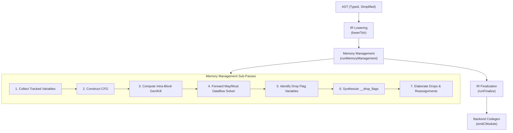
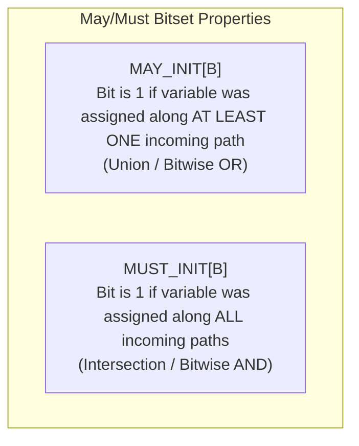
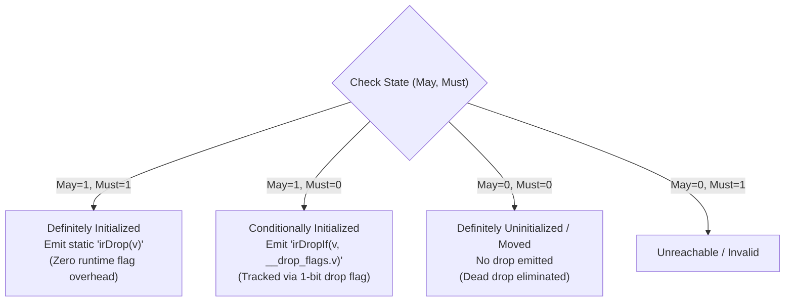
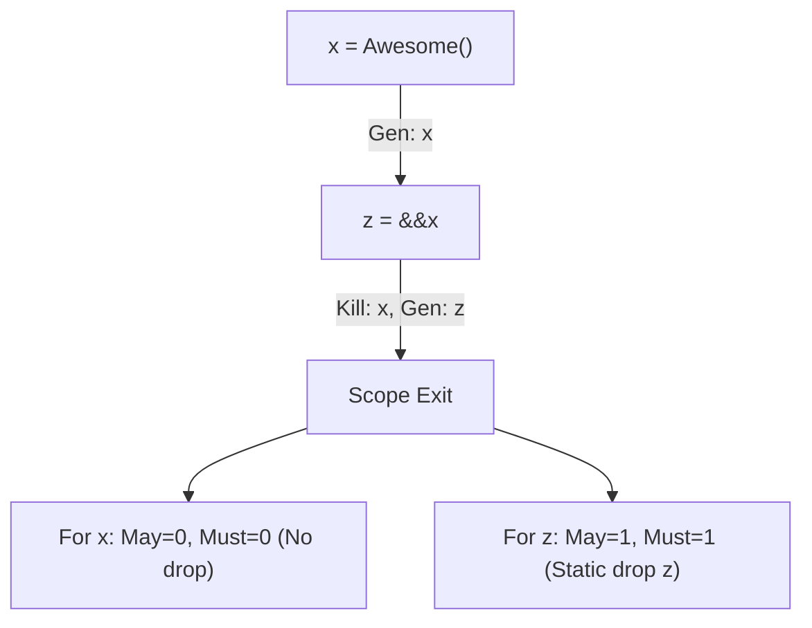
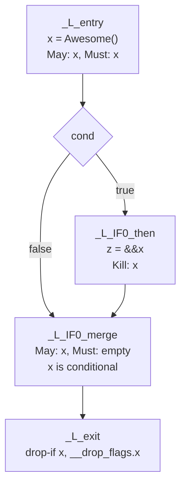
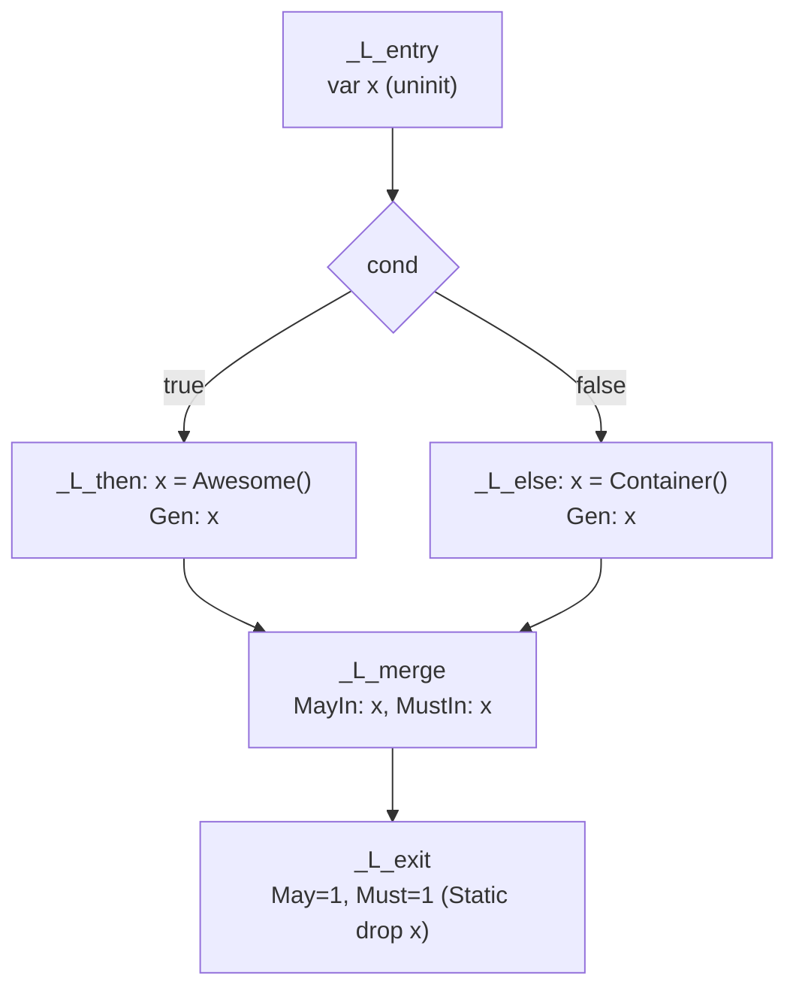

# Memory Management & Definite Initialization Architecture

The Memory Management phase (`cxy/src/cxy/lang/middle/memory/`) is responsible for automatic RAII teardown (`drop`), move semantics, call-argument copy promotion, and CFG-based definite initialization in the Cxy compiler middle-end.

---

## 1. Pipeline Overview

Memory management executes after IR Lowering (`lowerToIr`) and before IR Finalization (`runFinalize`).



---

## 2. Core Concepts

### 2.1 Tracked Destructible Variables
A variable is tracked by the memory management pass if it is destructible:
- **Classes** (`irTypeCatClass`): Reference counted (`__smart_ptr_alloc`, `__smart_ptr_get`, `__smart_ptr_drop`).
- **Destructible Structs & Tuples** (`flgReferenceMembers` or containing a destructible member).
- **Arrays & Slices of Destructible Types**.

Non-destructible value types (e.g. primitive integers, booleans, `strview`) are completely ignored by the pass.

### 2.2 Flag Classifications
- `flgTemporary`: Synthesized intermediate evaluation slots (e.g. `__t0`, `__obj` constructor cover pointers). These participate in normal local dataflow and are **never** dropped eagerly on call arguments.
- `flgEphemeral`: Discarded expression-statement call results (`var __tX = call()` without an lvalue destination). Dropped immediately at statement completion.

---

## 3. Dataflow Analysis Engine

The analysis tracks two bitsets per basic block across all tracked variables ($0 \le v < N$):



### 3.1 Intra-Block Gen and Kill Sets
For each basic block $B$:
- `Gen[B]`: Variable assigned in $B$ and not subsequently moved or dropped in $B$.
- `Kill[B]`: Variable moved (`irMove`) or dropped in $B$ and not subsequently reassigned in $B$.

Traversing statements inside block $B$:
1. **Assignment (`v = expr` or `copy expr -> v`)**:
   - $\text{Gen} \leftarrow \text{Gen} \cup \{v\}$
   - $\text{Kill} \leftarrow \text{Kill} \setminus \{v\}$
2. **Move (`... = &&v` or `move v`)**:
   - $\text{Kill} \leftarrow \text{Kill} \cup \{v\}$
   - $\text{Gen} \leftarrow \text{Gen} \setminus \{v\}$

---

### 3.2 Inter-Block Transfer Equations

Let $\text{Pred}(B)$ be the set of predecessor basic blocks of $B$:

#### Block Entry:
$$\text{MayIn}[B] = \bigcup_{P \in \text{Pred}(B)} \text{MayOut}[P]$$
$$\text{MustIn}[B] = \bigcap_{P \in \text{Pred}(B)} \text{MustOut}[P]$$

*Boundary Condition for Entry Block ($B_0$):*
- Function parameters: $\text{MayIn}[B_0] = \text{MustIn}[B_0] = \{\text{params}\}$
- Local variables: $\text{MayIn}[B_0] = \text{MustIn}[B_0] = \emptyset$

#### Block Exit:
$$\text{MayOut}[B] = (\text{MayIn}[B] \setminus \text{Kill}[B]) \cup \text{Gen}[B]$$
$$\text{MustOut}[B] = (\text{MustIn}[B] \setminus \text{Kill}[B]) \cup \text{Gen}[B]$$

The solver runs in a fixed-point forward loop until neither `MayOut` nor `MustOut` changes for any block.

---

## 4. Drop Elaboration Decision Matrix

At scope exit points (`irScopeExit`) and reassignment sites:



---

## 5. Concrete Examples

### Example 1: Straight-Line Move (Zero Runtime Flag Overhead)

```cxy
func testLinearMove() {
    var x = Awesome()
    var z = &&x
}
```



**Resulting C Output:**
```c
Awesome * x;
Awesome * z;
x = Awesome_op__initCover();
z = x;
Awesome_op__destructor(z); // Static drop, no __drop_flags struct synthesized
```

---

### Example 2: Conditional Move in Branch (Optimal 1-Bit Drop Flag)

```cxy
func testConditionalMove(cond: bool) {
    var x = Awesome()
    if cond {
        var z = &&x
    }
}
```



**Resulting C Output:**
```c
struct __drop_flags_t {
    uint64_t x: 1;
} __drop_flags = {0};

x = Awesome_op__initCover();
__drop_flags.x = 1;

if (cond) {
    z = x;
    __drop_flags.x = 0; // Cleared on move
}

if (__drop_flags.x) Awesome_op__destructor(x);
```

---

### Example 3: Symmetrical Initialization in Both Arms (No Drop Flag Needed)

```cxy
func testBothArms(cond: bool) {
    var x: Awesome
    if cond {
        x = Awesome()
    } else {
        x = Container()
    }
}
```



Because both branches definitely assign `x`, `MustIn` is 1 at merge, completely avoiding drop flags.

---

## 6. Source File Map

| File | Role |
|:---|:---|
| `memory.h` | Data structures (`TrackedVar`, `BitSet`, `CfgBlockInfo`, `MemMgmtContext`) and bitset helpers. |
| `manage.c` | CFG builder, intra-block Gen/Kill, forward May/Must solver, and drop elaboration. |
| `finalize.c` | Post-memory cleanup, CFG simplification, and basic block reordering for codegen. |
